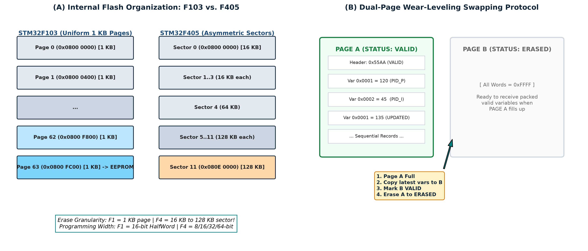
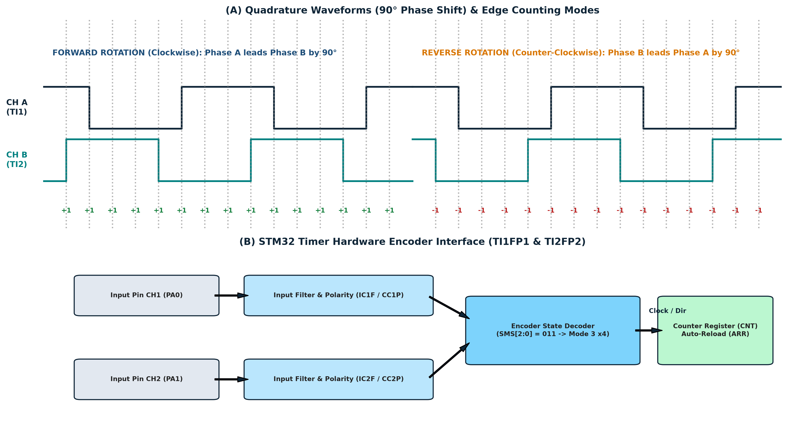
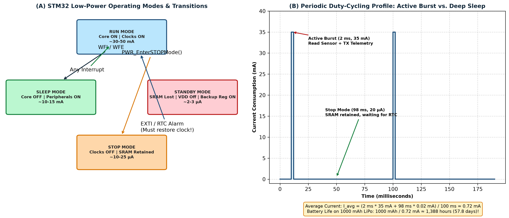
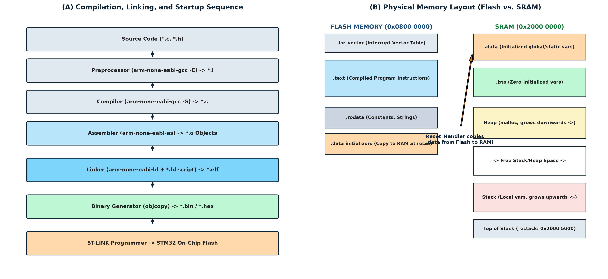
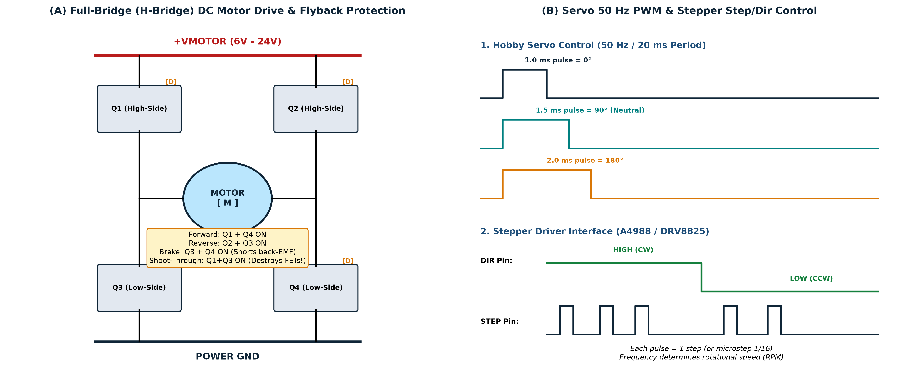
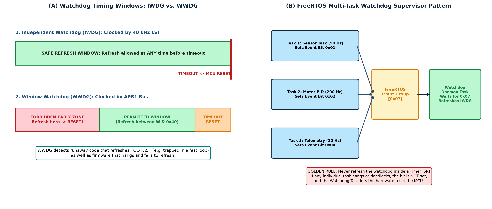
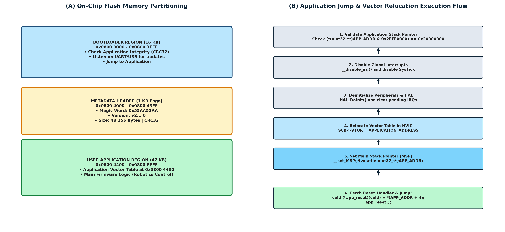
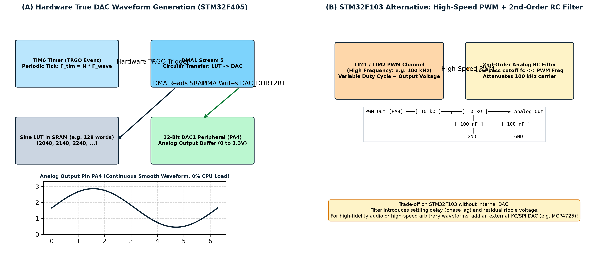

# STM32 Advanced Topics: Comprehensive Supplementary Technical Guide

**Advanced Embedded Engineering & Robotics Firmware Architecture**

*A Master-Level Extension to the STM32 Complete Professional Reference: Internal Flash Programming, Hardware Quadrature Encoders, Low-Power Management, Linker Scripts & Startup Internals, Actuator Interfacing & Power Electronics, Watchdog Systems, Custom Bootloaders, and Digital-to-Analog Conversion.*

---

## Document Information

**Table 0.1 — Document information, baseline toolchain, and hardware scope**

| Attribute | Specification | Technical Scope & Notes |
|---|---|---|
| **Document Title** | STM32 Advanced Topics: Comprehensive Supplementary Technical Guide | Advanced engineering companion to the baseline reference |
| **Document Version** | 1.0 (Advanced Topics Master Edition) | Dedicated supplementary technical textbook |
| **Toolchain Baseline** | STM32CubeIDE Version 2.2.0 • STM32CubeMX Version 6.18.1 • GNU Arm Toolchain (`arm-none-eabi-gcc`) | Menu layouts and compiler directives verified against this baseline |
| **Primary Reference Silicon** | **STM32F103C8T6** (ARM Cortex-M3, 72 MHz, 64/128 KB Flash, 20 KB SRAM) | Cost-sensitive educational and robotics platform baseline |
| **High-Performance Silicon** | **STM32F405RGT6** (ARM Cortex-M4F with FPU, 168 MHz, 1 MB Flash, 192 KB SRAM) | High-performance robotics, flight control, and audio/DSP target |
| **Companion Document** | `STM32_Complete_Professional_Reference.md` / `.docx` (Chapters 1–12) | Cross-referenced extensively; builds upon foundational peripheral concepts |
| **Target Audience** | Senior students, robotics competitors, technical instructors, firmware architects | Self-contained learning guide with verified hardware implementations |

> [!IMPORTANT]
> **Relationship to the Baseline Reference**: This document is an **independent supplementary extension** of the *STM32 Complete Professional Reference*. While foundational topics (GPIO, UART, SPI, I²C, ADC, Timers, DMA, and FreeRTOS basics) are detailed in Chapters 1–12 of the primary reference, this guide bridges the gap between basic peripheral configuration and **production-grade robotics engineering**. Every topic herein addresses real-world system challenges: non-volatile state persistence, closed-loop motion feedback, micro-ampere power optimization, low-level memory layout, electrical motor drive, autonomous system recovery, field firmware updates, and analog signal synthesis.

## Table of Contents

- [1. Hardware Compatibility Reference: STM32F103 vs. STM32F405](#1-hardware-compatibility-reference-stm32f103-vs-stm32f405)
- [2. Topic 1 — Internal Flash Programming and EEPROM Emulation](#2-topic-1-—-internal-flash-programming-and-eeprom-emulation)
  - [2.1 Non-Volatile Memory Fundamentals](#21-non-volatile-memory-fundamentals)
    - [2.1.1 The Physics of Floating-Gate Transistors: Why Erase-Before-Write Exists](#211-the-physics-of-floating-gate-transistors-why-erase-before-write-exists)
    - [2.1.2 Flash Organization: STM32F103 Pages vs. STM32F405 Sectors](#212-flash-organization-stm32f103-pages-vs-stm32f405-sectors)
    - [2.1.3 Flash Access Latency and Read Wait States](#213-flash-access-latency-and-read-wait-states)
  - [2.2 Flash Programming Mechanics Using STM32 HAL](#22-flash-programming-mechanics-using-stm32-hal)
    - [2.2.1 The Standard 5-Step Flash Transaction Sequence](#221-the-standard-5-step-flash-transaction-sequence)
    - [2.2.2 Complete Implementation: Page Erase and HalfWord Programming on STM32F103](#222-complete-implementation-page-erase-and-halfword-programming-on-stm32f103)
    - [2.2.3 Implementation Differences on STM32F405: Sector Erase and 32-Bit Programming](#223-implementation-differences-on-stm32f405-sector-erase-and-32-bit-programming)
  - [2.3 Designing a Production-Ready EEPROM Emulation Engine](#23-designing-a-production-ready-eeprom-emulation-engine)
    - [2.3.1 The Append-Only Wear-Leveling Architecture](#231-the-append-only-wear-leveling-architecture)
    - [2.3.2 Two-Page Ping-Pong Bank Swapping Protocol](#232-two-page-ping-pong-bank-swapping-protocol)
    - [2.3.3 Production Implementation: Persistent Robot Configuration Engine](#233-production-implementation-persistent-robot-configuration-engine)
- [3. Topic 2 — Hardware Quadrature Encoder Interface Using STM32 Timers](#3-topic-2-—-hardware-quadrature-encoder-interface-using-stm32-timers)
  - [3.1 Incremental Rotary Encoder Fundamentals](#31-incremental-rotary-encoder-fundamentals)
    - [3.1.1 Optical vs. Magnetic Encoders](#311-optical-vs-magnetic-encoders)
    - [3.1.2 Quadrature Encoding: The $90^\circ$ Phase Shift](#312-quadrature-encoding-the-90^circ-phase-shift)
    - [3.1.3 Resolution: Pulses Per Revolution (PPR) vs. Counts Per Revolution (CPR)](#313-resolution-pulses-per-revolution-ppr-vs-counts-per-revolution-cpr)
  - [3.2 STM32 Hardware Timer Encoder Mode](#32-stm32-hardware-timer-encoder-mode)
    - [3.2.1 Digital Noise Glitch Filtering (`IC1F` / `IC2F`)](#321-digital-noise-glitch-filtering-`ic1f`-`ic2f`)
    - [3.2.2 Step-by-Step STM32CubeMX Configuration](#322-step-by-step-stm32cubemx-configuration)
  - [3.3 Production HAL Implementation](#33-production-hal-implementation)
  - [3.4 Mathematical Derivations: Displacement, RPM, and Velocity](#34-mathematical-derivations-displacement-rpm-and-velocity)
    - [3.4.1 Mathematical Governing Equations](#341-mathematical-governing-equations)
  - [3.5 The 16-Bit Counter Rollover and Overflow Handling](#35-the-16-bit-counter-rollover-and-overflow-handling)
    - [3.5.1 The Signed 16-Bit Integer Cast Trick](#351-the-signed-16-bit-integer-cast-trick)
    - [3.5.2 Complete Production Velocity and Odometry Driver](#352-complete-production-velocity-and-odometry-driver)
  - [3.6 Robotics Applications: Differential-Drive Wheel Odometry](#36-robotics-applications-differential-drive-wheel-odometry)
    - [3.6.1 Forward Kinematics Equations](#361-forward-kinematics-equations)
    - [3.6.2 Physical Limitations of Pure Odometry (Why Encoders Drift)](#362-physical-limitations-of-pure-odometry-why-encoders-drift)
- [4. Topic 3 — Low-Power Modes and Power Management](#4-topic-3-—-low-power-modes-and-power-management)
  - [4.1 Physics of Microcontroller Power Dissipation](#41-physics-of-microcontroller-power-dissipation)
    - [4.1.1 Dynamic Switching Power ($P_{\text{dynamic}}$)](#411-dynamic-switching-power-p_textdynamic)
    - [4.1.2 Static Leakage Power and Floating Pin Traps ($P_{\text{static}}$)](#412-static-leakage-power-and-floating-pin-traps-p_textstatic)
  - [4.2 STM32 Low-Power Modes: Sleep, Stop, and Standby](#42-stm32-low-power-modes-sleep-stop-and-standby)
    - [4.2.1 Sleep Mode: Peripheral-Driven Background Processing](#421-sleep-mode-peripheral-driven-background-processing)
    - [4.2.2 Stop Mode: Deep Sleep with Full SRAM Retention](#422-stop-mode-deep-sleep-with-full-sram-retention)
    - [4.2.3 Standby Mode: Ultra-Low-Power Deep Sleep](#423-standby-mode-ultra-low-power-deep-sleep)
  - [4.3 Practical HAL Implementation and the Post-Wake Clock Trap](#43-practical-hal-implementation-and-the-post-wake-clock-trap)
    - [4.3.1 Entering Sleep Mode](#431-entering-sleep-mode)
    - [4.3.2 Entering Stop Mode and the Critical Clock Restoration Sequence](#432-entering-stop-mode-and-the-critical-clock-restoration-sequence)
    - [4.3.3 Configuring an External Pin (EXTI) Wake-Up Trigger](#433-configuring-an-external-pin-exti-wake-up-trigger)
    - [4.3.4 Entering Standby Mode](#434-entering-standby-mode)
  - [4.4 Mathematical Power Budgeting and Battery Lifetime](#44-mathematical-power-budgeting-and-battery-lifetime)
    - [4.4.1 The Duty-Cycling Governing Equation](#441-the-duty-cycling-governing-equation)
    - [4.4.2 Battery Operating Lifetime Calculation](#442-battery-operating-lifetime-calculation)
- [5. Topic 4 — Linker Scripts, Memory Sections, and Startup Internals](#5-topic-4-—-linker-scripts-memory-sections-and-startup-internals)
  - [5.1 The Complete Journey: From C Source to Executable Silicon](#51-the-complete-journey-from-c-source-to-executable-silicon)
    - [The 6 Build Stages Explained](#the-6-build-stages-explained)
  - [5.2 Deep-Dive: What Happens Before `main()`? The Startup Code](#52-deep-dive-what-happens-before-`main`-the-startup-code)
    - [5.2.1 The Interrupt Vector Table (`.isr_vector`)](#521-the-interrupt-vector-table-`isr_vector`)
    - [5.2.2 Dissecting `Reset_Handler`](#522-dissecting-`reset_handler`)
    - [The Three Critical Tasks of `Reset_Handler`](#the-three-critical-tasks-of-`reset_handler`)
  - [5.3 Demystifying the Linker Script (`*.ld`)](#53-demystifying-the-linker-script-`ld`)
    - [5.3.1 Dissecting `STM32F103C8TX_FLASH.ld`](#531-dissecting-`stm32f103c8tx_flashld`)
    - [5.3.2 VMA vs. LMA: The Dual-Address Concept](#532-vma-vs-lma-the-dual-address-concept)
    - [5.3.3 Linker Script Differences on STM32F405: Core Coupled Memory (CCMRAM)](#533-linker-script-differences-on-stm32f405-core-coupled-memory-ccmram)
  - [5.4 Physical Memory Mapping: Where Does Every Variable Live?](#54-physical-memory-mapping-where-does-every-variable-live)
  - [5.5 Map File Auditing: Diagnosing Memory Exhaustion and Linker Errors](#55-map-file-auditing-diagnosing-memory-exhaustion-and-linker-errors)
    - [5.5.1 Calculating Exact Memory Consumption](#551-calculating-exact-memory-consumption)
    - [5.5.2 How to Hunt Down Memory Hogs in the `.map` File](#552-how-to-hunt-down-memory-hogs-in-the-`map`-file)
    - [5.5.3 Diagnosing and Fixing Common Linker Errors](#553-diagnosing-and-fixing-common-linker-errors)
- [6. Topic 5 — Actuator Interfacing and Power Electronics Fundamentals](#6-topic-5-—-actuator-interfacing-and-power-electronics-fundamentals)
  - [6.1 The Signal Domain vs. The Power Domain](#61-the-signal-domain-vs-the-power-domain)
    - [6.1.1 STM32 GPIO Current Limitations](#611-stm32-gpio-current-limitations)
    - [6.1.2 Electrical Isolation and Common Ground Architecture](#612-electrical-isolation-and-common-ground-architecture)
  - [6.2 DC Motor Control Using H-Bridges](#62-dc-motor-control-using-h-bridges)
    - [6.2.1 Operating Principle of the H-Bridge](#621-operating-principle-of-the-h-bridge)
    - [6.2.2 Motor Driver Comparison: L298N vs. TB6612FNG vs. DRV8833](#622-motor-driver-comparison-l298n-vs-tb6612fng-vs-drv8833)
    - [6.2.3 Connecting and Programming the TB6612FNG with STM32 HAL](#623-connecting-and-programming-the-tb6612fng-with-stm32-hal)
  - [6.3 Hobby Servo Motor Interfacing](#63-hobby-servo-motor-interfacing)
    - [6.3.1 The $50\text{ Hz}$ Pulse-Width Position Protocol](#631-the-50text-hz-pulse-width-position-protocol)
    - [6.3.2 Configuring an STM32 Timer for Direct Microsecond Servo Control](#632-configuring-an-stm32-timer-for-direct-microsecond-servo-control)
  - [6.4 Stepper Motor Interfacing and Motion Profiles](#64-stepper-motor-interfacing-and-motion-profiles)
    - [6.4.1 Stepper Drivers (A4988 / DRV8825) and Microstepping](#641-stepper-drivers-a4988-drv8825-and-microstepping)
    - [6.4.2 The Physics of Stepper Stalling and Trapezoidal Acceleration](#642-the-physics-of-stepper-stalling-and-trapezoidal-acceleration)
  - [6.5 Power Electronics: Inductive Kickback and Protection](#65-power-electronics-inductive-kickback-and-protection)
    - [6.5.1 The Flyback (Freewheeling) Diode](#651-the-flyback-freewheeling-diode)
    - [6.5.2 Logic-Level MOSFET Switching Rules](#652-logic-level-mosfet-switching-rules)
- [7. Topic 6 — Watchdog Timers: IWDG and WWDG](#7-topic-6-—-watchdog-timers-iwdg-and-wwdg)
  - [7.1 Watchdog Architecture: Hardware vs. Software Watchdogs](#71-watchdog-architecture-hardware-vs-software-watchdogs)
    - [Why Software-Only Watchdogs Are Insufficient](#why-software-only-watchdogs-are-insufficient)
  - [7.2 The Independent Watchdog (IWDG)](#72-the-independent-watchdog-iwdg)
    - [7.2.1 The Dedicated LSI Clock Domain](#721-the-dedicated-lsi-clock-domain)
    - [7.2.2 Register Interface and Key Security](#722-register-interface-and-key-security)
    - [7.2.3 Timeout Calculations and Mathematical Formulas](#723-timeout-calculations-and-mathematical-formulas)
    - [7.2.4 Verified HAL Configuration](#724-verified-hal-configuration)
  - [7.3 The Window Watchdog (WWDG)](#73-the-window-watchdog-wwdg)
    - [7.3.1 Operating Principle: The Window Concept](#731-operating-principle-the-window-concept)
    - [7.3.2 The Early Wakeup Interrupt (EWI)](#732-the-early-wakeup-interrupt-ewi)
    - [7.3.3 IWDG vs. WWDG: Architectural Trade-Offs](#733-iwdg-vs-wwdg-architectural-trade-offs)
  - [7.4 Watchdogs in Production: Where Should You Refresh?](#74-watchdogs-in-production-where-should-you-refresh)
    - [7.4.1 Bare-Metal Rule](#741-bare-metal-rule)
    - [7.4.2 The FreeRTOS Multi-Task Watchdog Supervisor Pattern](#742-the-freertos-multi-task-watchdog-supervisor-pattern)
  - [7.5 Debugging with Watchdogs: Freezing Counters via `DBGMCU`](#75-debugging-with-watchdogs-freezing-counters-via-`dbgmcu`)
    - [The Solution: DBGMCU Watchdog Freeze Registers](#the-solution-dbgmcu-watchdog-freeze-registers)
- [8. Topic 7 — Custom Bootloaders and In-System Programming](#8-topic-7-—-custom-bootloaders-and-in-system-programming)
  - [8.1 Bootloader Fundamentals: Dual-Stage Booting](#81-bootloader-fundamentals-dual-stage-booting)
    - [Why Write a Custom Bootloader Instead of Using Factory ROM?](#why-write-a-custom-bootloader-instead-of-using-factory-rom)
  - [8.2 The STM32 Factory ROM Bootloader](#82-the-stm32-factory-rom-bootloader)
  - [8.3 Custom Bootloader Memory Architecture](#83-custom-bootloader-memory-architecture)
    - [8.3.1 Application Metadata Header](#831-application-metadata-header)
  - [8.4 The Interrupt Vector Table Offset Register (`SCB->VTOR`)](#84-the-interrupt-vector-table-offset-register-`scb-vtor`)
    - [8.4.1 The Vector Table Problem](#841-the-vector-table-problem)
    - [8.4.2 The Solution: Relocating `SCB->VTOR`](#842-the-solution-relocating-`scb-vtor`)
  - [8.5 The 8-Step Application Jump Sequence](#85-the-8-step-application-jump-sequence)
  - [8.6 Configuring the User Application Project to Run with a Bootloader](#86-configuring-the-user-application-project-to-run-with-a-bootloader)
    - [1. Modify the Application Linker Script (`STM32F103C8TX_FLASH.ld`)](#1-modify-the-application-linker-script-`stm32f103c8tx_flashld`)
    - [2. Set `SCB->VTOR` in Application `system_stm32f1xx.c`](#2-set-`scb-vtor`-in-application-`system_stm32f1xxc`)
- [9. Topic 8 — Digital-to-Analog Converter (DAC) and Waveform Generation](#9-topic-8-—-digital-to-analog-converter-dac-and-waveform-generation)
  - [9.1 DAC Fundamentals: Converting Bits to Volts](#91-dac-fundamentals-converting-bits-to-volts)
    - [9.1.1 Settling Time, Glitch Energy, and Output Buffering](#911-settling-time-glitch-energy-and-output-buffering)
  - [9.2 The STM32F405 Hardware DAC Peripheral](#92-the-stm32f405-hardware-dac-peripheral)
    - [9.2.1 Setting Static Analog Voltages in HAL](#921-setting-static-analog-voltages-in-hal)
  - [9.3 High-Speed Waveform Synthesis: Timer TRGO $\rightarrow$ DMA $\rightarrow$ DAC](#93-high-speed-waveform-synthesis-timer-trgo-rightarrow-dma-rightarrow-dac)
    - [9.3.1 Mathematical Frequency Derivation](#931-mathematical-frequency-derivation)
    - [9.3.2 Production DMA Sine Wave Generator Code](#932-production-dma-sine-wave-generator-code)
  - [9.4 STM32 Compatibility & Alternatives for the STM32F103C8T6](#94-stm32-compatibility-&-alternatives-for-the-stm32f103c8t6)
    - [Alternative 1: External I²C or SPI DAC IC (Recommended for Precision)](#alternative-1-external-i²c-or-spi-dac-ic-recommended-for-precision)
    - [Alternative 2: High-Frequency Timer PWM with a 2nd-Order Analog RC Filter](#alternative-2-high-frequency-timer-pwm-with-a-2nd-order-analog-rc-filter)
- [10. Integrated Robotics Case Studies](#10-integrated-robotics-case-studies)
  - [10.1 Case Study 1: Differential-Drive Robot Odometry & Closed-Loop Velocity PID](#101-case-study-1-differential-drive-robot-odometry-&-closed-loop-velocity-pid)
    - [10.1.1 Hardware Connection Map](#1011-hardware-connection-map)
    - [10.1.2 Verified Closed-Loop PID Velocity Implementation](#1012-verified-closed-loop-pid-velocity-implementation)
  - [10.2 Case Study 2: Persistent Robot Configuration & Calibration Storage](#102-case-study-2-persistent-robot-configuration-&-calibration-storage)
    - [Operational Workflow](#operational-workflow)
  - [10.3 Case Study 3: Robust Multitasking Controller with Watchdog Supervision](#103-case-study-3-robust-multitasking-controller-with-watchdog-supervision)
  - [10.4 Case Study 4: Battery-Powered Environmental Sensor Node](#104-case-study-4-battery-powered-environmental-sensor-node)
    - [10.4.1 Hardware Power Switching via High-Side P-MOSFET](#1041-hardware-power-switching-via-high-side-p-mosfet)
    - [10.4.2 The Verified 10-Second Low-Power Operational Loop](#1042-the-verified-10-second-low-power-operational-loop)
  - [10.5 Case Study 5: Field Firmware Update Bootloader](#105-case-study-5-field-firmware-update-bootloader)
- [11. Troubleshooting, Diagnostic Matrix, and Common Pitfalls](#11-troubleshooting-diagnostic-matrix-and-common-pitfalls)
- [12. Master Comparison Tables](#12-master-comparison-tables)
- [13. Advanced Technical Glossary](#13-advanced-technical-glossary)
- [14. Master Formula and Calculation Reference](#14-master-formula-and-calculation-reference)
- [15. References and Official Documentation](#15-references-and-official-documentation)
- [16. Final Recommended Learning Roadmap](#16-final-recommended-learning-roadmap)

## List of Figures, Tables, and Code Listings

### Figures
- **Figure 1.1**: (A) Internal Flash memory partitioning comparing uniform 1 KB pages on STM32F103 with asymmetric sectors on STM32F405
- **Figure 2.1**: (A) Quadrature waveforms showing 90° phase shift in forward (clockwise) and reverse (counter-clockwise) rotation, with x4 edge transition counts
- **Figure 3.1**: (A) Low-power state machine comparing Run, Sleep, Stop, and Standby modes, showing clock states, SRAM retention, and wake-up triggers
- **Figure 4.1**: (A) The GNU ARM compilation, assembly, linking, and flashing pipeline
- **Figure 5.1**: (A) Full H-Bridge DC motor drive topology showing high-side and low-side switching paths, shoot-through hazard, and flyback protection diodes
- **Figure 6.1**: (A) Timing window comparison: IWDG permissible refresh range vs
- **Figure 7.1**: (A) On-chip Flash memory partitioning comparing Bootloader (16 KB), Metadata Header (1 KB), and User Application regions
- **Figure 8.1**: (A) High-speed hardware DAC waveform generation pipeline on STM32F405 using Timer TRGO, Circular DMA, and 12-bit DAC1

### Tables
- **Table 0.1**: Document information, baseline toolchain, and hardware scope
- **Table 1.1**: Comprehensive hardware architectural comparison: STM32F103C8T6 vs. STM32F405RGT6
- **Table 2.1**: Memory technology comparison in embedded systems
- **Table 2.2**: Flash latency wait states vs. SYSCLK frequency
- **Table 2.3**: Page state headers and atomic transitions
- **Table 3.1**: Encoder decoding modes and effective resolution multiplier
- **Table 4.1**: Comprehensive comparison of STM32 low-power modes
- **Table 5.2**: C variable declaration vs. physical memory placement
- **Table 6.1**: Signal domain vs. power domain characteristics
- **Table 6.2**: H-Bridge switching truth table
- **Table 6.3**: Detailed motor driver hardware comparison
- **Table 6.4**: Microstepping truth table on A4988 / DRV8825
- **Table 7.1**: Comprehensive comparison: IWDG vs. WWDG
- **Table 8.1**: Flash partitioning scheme for STM32F103C8T6 (64 KB Flash)
- **Table 9.1**: Output buffer trade-offs in STM32 DAC
- **Table 10.1**: Differential-drive robot hardware pin assignment
- **Table 11.1**: Master diagnostic matrix of advanced STM32 engineering pitfalls
- **Table 12.1**: Storage technologies comparison in embedded systems
- **Table 12.2**: DC Motor drivers comparison
- **Table 14.1**: Master engineering formula reference

### Code Listings
- **Listing 2.1**: Verified Flash page erase and write routines for STM32F103C8T6
- **Listing 2.2**: Verified Flash sector erase and 32-bit write routines for STM32F405RGT6
- **Listing 2.3**: `robot_storage.h`: Public header for robot configuration persistence
- **Listing 2.4**: `robot_storage.c`: Verified persistent storage engine with CRC32
- **Listing 3.1**: Initializing and reading the hardware encoder
- **Listing 3.2**: Reusable encoder velocity and position tracking module
- **Listing 4.1**: Verified Stop-mode entry and clock restoration sequence
- **Listing 5.1**: The core initialization sequence inside `startup_stm32f103xb.s`
- **Listing 5.2**: Annotated GNU Linker Script for STM32F103C8T6
- **Listing 6.1**: Verified TB6612FNG motor driver module
- **Listing 6.2**: Precision servo angle positioning API
- **Listing 7.1**: Initializing and refreshing the IWDG in STM32 HAL
- **Listing 7.2**: Freezing watchdogs during debug sessions
- **Listing 8.1**: Production C implementation of the application jump sequence
- **Listing 9.1**: Configuring and generating static analog voltages on STM32F405
- **Listing 9.2**: Zero-CPU continuous sine wave synthesis on STM32F405
- **Listing 10.1**: 50 Hz closed-loop motor PID velocity control loop
- **Listing 10.2**: FreeRTOS task supervision implementation
- **Listing 10.3**: Environmental node deep-sleep duty-cycling sequence

---

# 1. Hardware Compatibility Reference: STM32F103 vs. STM32F405

A fundamental mistake made by novice embedded engineers is assuming that code written for one STM32 microcontroller will execute identically on another. STMicroelectronics manufactures dozens of distinct silicon families spanning multiple ARM Cortex-M processor architectures.

Throughout this guide, all implementations are rigorously contrasted between two industry-standard microcontrollers: the ubiquitous **STM32F103C8T6** ("Blue Pill" baseline) and the high-performance **STM32F405RGT6** (widely deployed in flight controllers and industrial robotics).

**Table 1.1 — Comprehensive hardware architectural comparison: STM32F103C8T6 vs. STM32F405RGT6**

| Architectural Dimension | STM32F103C8T6 (Mainstream Line) | STM32F405RGT6 (High-Performance Line) | Engineering Implications & Differences |
|---|---|---|---|
| **CPU Core Architecture** | ARM Cortex-M3 (ARMv7-M) | ARM Cortex-M4F (ARMv7E-M) with Hardware FPU | F4 executes single-precision floating-point arithmetic in 1 cycle; F1 requires software emulation libraries (`libgcc`). |
| **Maximum Core Frequency** | $72\text{ MHz}$ | $168\text{ MHz}$ ($210\text{ DMIPS}$) | F4 provides $> 2.3\times$ higher clock frequency and $> 3.4\times$ computational throughput. |
| **Flash Memory Size** | $64\text{ KB}$ nominal ($128\text{ KB}$ on many parts) | $1024\text{ KB}$ ($1\text{ MB}$) | F4 accommodates massive RTOS kernels, USB/TCP stacks, and dual-bank bootloaders. |
| **Flash Erase Granularity** | **Uniform $1\text{ KB}$ Pages** | **Asymmetric Sectors ($16\text{ KB}, 64\text{ KB}, 128\text{ KB}$)** | **Critical for EEPROM Emulation**: F1 erases $1\text{ KB}$ in $\sim 30\text{ ms}$; F4 Sector 11 ($128\text{ KB}$) takes up to $2\text{ seconds}$ to erase! |
| **Flash Programming Width** | Strictly **16-bit HalfWord** ($2\text{ bytes}$) | **8, 16, 32, or 64-bit** (Voltage dependent) | F1 cannot program individual bytes; programming must always be 16-bit aligned. |
| **SRAM Architecture** | $20\text{ KB}$ single contiguous block | $192\text{ KB}$ ($128\text{ KB}$ SRAM1 + $16\text{ KB}$ SRAM2 + $64\text{ KB}$ CCM) | F4 includes Core Coupled Memory (CCM) directly on the D-bus for zero-wait-state execution (inaccessible by DMA). |
| **Internal DAC** | **NONE** (No silicon DAC on F103C8) | **Dual 12-Bit DAC** (DAC1 on PA4, DAC2 on PA5) | F103 requires an external I²C/SPI DAC or PWM RC filtering; F4 generates true hardware analog waveforms directly. |
| **DMA Controller** | $2\times$ Channel-based Controllers (DMA1/2) | $2\times$ Stream-based Controllers with $4\times 32\text{-bit}$ FIFOs | F4 supports circular FIFO threshold packing, burst transfers, and dual-buffer ping-pong mode directly in hardware. |
| **Timer Hardware** | $4\times$ 16-bit Timers (TIM1–TIM4) | $14\times$ Timers (including 32-bit timers TIM2/TIM5) | F4 TIM2/TIM5 provide 32-bit counters, eliminating software overflow handling for long-distance wheel encoders. |
| **Low-Power Modes** | Sleep, Stop, Standby | Sleep, Stop, Standby with multiple regulator scales | F4 offers dynamic voltage scaling (Scale 1/2/3) to optimize active current consumption. |
| **Vector Table Relocation** | Supported (`SCB->VTOR`) | Supported (`SCB->VTOR`) | Bootloader application jumping requires 128-byte or 512-byte table alignment. |
| **Operating Voltage ($V_{DD}$)**| $2.0\text{ V} - 3.6\text{ V}$ | $1.8\text{ V} - 3.6\text{ V}$ | Flash programming on F4 requires $V_{DD} > 2.7\text{ V}$ for 32-bit word writes. |

> [!WARNING]
> **The Peripheral Portability Fallacy**: Never attempt to write direct register manipulation code expecting it to compile across F1 and F4. For example, on the STM32F1, peripheral clock gating is controlled by `RCC->APB1ENR` and `RCC->APB2ENR`, and GPIO remapping is handled by the `AFIO` peripheral. On the STM32F4, GPIO multiplexing is handled by dedicated `GPIOx->AFR[2]` registers, and clock gating is split across `RCC->AHB1ENR`, `RCC->APB1ENR`, and `RCC->APB2ENR`. Throughout this guide, hardware-specific listings are explicitly labeled.


# 2. Topic 1 — Internal Flash Programming and EEPROM Emulation

In robotics and autonomous embedded systems, firmware must persist configuration state across power cycles: PID controller gains, IMU gyro and accelerometer zero-bias calibration vectors, wheel diameters, motor encoder velocity limits, and network IDs.

While external non-volatile memories (such as I²C EEPROMs or SPI Flash ICs) can be added to a PCB, they increase bill-of-materials (BOM) cost, require dedicated GPIO routing, and introduce external bus failure points. Fortunately, every STM32 microcontroller contains **on-chip non-volatile Flash memory**.

However, on-chip Flash cannot be treated like ordinary SRAM or standard byte-addressable EEPROM. Flash memory has strict physical limitations: **it cannot overwrite existing data without an erase cycle, erase operations can only occur in large blocks (Pages or Sectors), and each block has a finite physical endurance limit (typically 10,000 erase cycles)**.

This chapter details the silicon physics of STM32 Flash, provides production-grade HAL programming drivers for both STM32F103 and STM32F405, and develops a dual-bank **EEPROM Emulation and Wear-Leveling Storage Engine** capable of surviving sudden power failures during robot operation.


*Figure 1.1 — (A) Internal Flash memory partitioning comparing uniform 1 KB pages on STM32F103 with asymmetric sectors on STM32F405; (B) Two-page wear-leveling ping-pong buffer protocol showing sequential variable logging, status flags, and automated garbage collection.*

---

## 2.1 Non-Volatile Memory Fundamentals

**Table 2.1 — Memory technology comparison in embedded systems**

| Memory Type | Volatility | Write Granularity | Erase Granularity | Erase Before Write? | Typical Write Endurance | Read Latency |
|---|---|---|---|---|---|---|
| **SRAM** | Volatile (Lost at power-down) | 8, 16, or 32-bit | Not applicable | No | Infinite | $0\text{ Wait States}$ (Immediate) |
| **Traditional EEPROM** | Non-Volatile (Retained) | Single Byte | Single Byte | Handled internally | $1{,}000{,}000\text{ cycles}$ | Moderate ($\sim 1-5\text{ ms}$ over I²C) |
| **NOR Flash (STM32 On-Chip)** | Non-Volatile (Retained) | HalfWord (F1) / Word (F4) | **Page (1 KB)** or **Sector (16–128 KB)** | **MANDATORY** | **$10{,}000\text{ cycles}$** | $0-5\text{ Wait States}$ (Clock dependent) |

---

### 2.1.1 The Physics of Floating-Gate Transistors: Why Erase-Before-Write Exists

On-chip Flash cells store data using **floating-gate MOSFET transistors**.
- An unprogrammed (erased) Flash cell contains no trapped electrons in its floating gate. In this erased state, the cell conducts electricity, which digital sense amplifiers interpret as **logic `1`**. Thus, **an erased Flash block reads entirely as `0xFF` (or `0xFFFF` / `0xFFFFFFFF`)**.
- When programming a cell, high-voltage quantum tunneling (Fowler-Nordheim or hot-carrier injection) injects electrons into the floating gate. These trapped electrons raise the transistor's threshold voltage, turning it off. Sense amplifiers read this non-conducting state as **logic `0`**.

> [!CAUTION]
> **The One-Way Programming Physics**: Programming operations can **only change bits from `1` to `0`**. Hardware cannot selectively pull electrons out of a single floating gate to change a `0` back into a `1`. 
> 
> The only way to restore bits from `0` back to `1` is to apply a reverse electrical field across an **entire bulk substrate block**—erasing an entire **Page** (on STM32F1) or an entire **Sector** (on STM32F4) all at once! If you attempt to write data to a Flash address that has not been erased and already contains `0x00`, the write will either fail silently, trigger a programming error (`PGERR`), or corrupt adjacent bits.

---

### 2.1.2 Flash Organization: STM32F103 Pages vs. STM32F405 Sectors

The organization of Flash memory defines how firmware must structure its non-volatile storage algorithms.

#### STM32F103C8T6 Flash Organization
Medium-Density STM32F103 devices organize Flash into **uniform $1\text{ KB}$ ($1024\text{ bytes}$) Pages**:
- Total Capacity: $64\text{ KB}$ (Pages 0 through 63, span `0x08000000` to `0x0800FFFF`).
- *Note*: Many commercial C8 parts physically contain $128\text{ KB}$ (Pages 0 through 127), but firmware targeting high reliability should budget within the guaranteed $64\text{ KB}$ datasheet boundary.
- **Erase Time**: Approximately $20\text{ ms} - 40\text{ ms}$ per 1 KB page.
- **Programming Width**: Strictly **16-bit HalfWords**. Attempting to write an 8-bit byte or an unaligned 32-bit word directly to Flash registers will trigger a programming alignment fault.

#### STM32F405RGT6 Flash Organization
STM32F405 devices organize their $1024\text{ KB}$ ($1\text{ MB}$) Flash into **asymmetric, large Sectors**:
- **Sector 0 to 3**: $16\text{ KB}$ each (`0x08000000` to `0x0800FFFF`)
- **Sector 4**: $64\text{ KB}$ (`0x08010000` to `0x0801FFFF`)
- **Sector 5 to 11**: $128\text{ KB}$ each (`0x08020000` to `0x080FFFFF`)
- **Erase Time**:
  - $16\text{ KB}$ Sector: $\sim 250\text{ ms}$
  - $128\text{ KB}$ Sector: **Up to $2.0\text{ seconds}$**!
- **Programming Width**: Configurable based on operating voltage $V_{DD}$:
  - $V_{DD} = 2.7\text{ V} - 3.6\text{ V}$: Supports 32-bit Word programming.
  - $V_{DD} < 2.1\text{ V}$: Restricted to 8-bit Byte programming.

> [!WARNING]
> **The Sector Size Warning on STM32F4**: Because the upper sectors of the STM32F405 are massive ($128\text{ KB}$ each), using Sector 11 for EEPROM emulation means that every time garbage collection occurs, the microcontroller's CPU **freezes for up to 2 seconds while the sector erases**! For robotics applications requiring real-time loop execution, EEPROM emulation on STM32F4 should be allocated inside **Sector 1 or Sector 2 ($16\text{ KB}$)**, or executed in a non-blocking background thread with interrupts executing from SRAM.

---

### 2.1.3 Flash Access Latency and Read Wait States

Because on-chip Flash transistors are physically slower than the CPU core, the processor must insert **Wait States (WS)** when reading instructions and data at high core frequencies.

**Table 2.2 — Flash latency wait states vs. SYSCLK frequency**

| Target MCU | Core Clock Frequency ($f_{\text{SYSCLK}}$) | Required Flash Latency | HAL Parameter |
|---|---|---|---|
| **STM32F103** | $0 < f \le 24\text{ MHz}$ | 0 Wait States | `FLASH_LATENCY_0` |
| **STM32F103** | $24 < f \le 48\text{ MHz}$ | 1 Wait State | `FLASH_LATENCY_1` |
| **STM32F103** | $48 < f \le 72\text{ MHz}$ | **2 Wait States** | `FLASH_LATENCY_2` |
| **STM32F405** ($V_{DD} > 2.7\text{ V}$) | $0 < f \le 30\text{ MHz}$ | 0 Wait States | `FLASH_LATENCY_0` |
| **STM32F405** ($V_{DD} > 2.7\text{ V}$) | $90 < f \le 120\text{ MHz}$ | 3 Wait States | `FLASH_LATENCY_3` |
| **STM32F405** ($V_{DD} > 2.7\text{ V}$) | $150 < f \le 168\text{ MHz}$ | **5 Wait States** | `FLASH_LATENCY_5` |

The STM32F4 incorporates the **Adaptive Real-Time Memory Accelerator (ART Accelerator)**, which integrates an instruction cache and prefetch buffer, achieving near $0\text{-wait-state}$ equivalent performance even at $168\text{ MHz}$.

---

## 2.2 Flash Programming Mechanics Using STM32 HAL

To prevent runaway firmware or brownout noise from accidentally overwriting application code, the internal Flash controller hardware is **locked by default**. Writing to any Flash control register while locked triggers a hardware Bus Fault.

### 2.2.1 The Standard 5-Step Flash Transaction Sequence
Every Flash write sequence must strictly follow these five steps:
1. **Unlock the Flash Peripheral**: Write two special authorization keys (`KEY1 = 0x45670123`, `KEY2 = 0xCDEF89AB`) into the Flash Key Register (`FLASH_KEYR`).
2. **Clear Pending Fault Flags**: Clear any previous error flags left over from power-up (`WRPERR`, `PGERR`, `EOP`).
3. **Erase the Target Block**: Erase the specific page (F1) or sector (F4) holding the memory range.
4. **Program the Data**: Write words or halfwords sequentially, checking status after every operation.
5. **Re-Lock the Flash Peripheral**: Set the Lock bit (`FLASH_CR_LOCK`) to re-engage hardware write protection immediately.

---

### 2.2.2 Complete Implementation: Page Erase and HalfWord Programming on STM32F103

**Listing 2.1 — Verified Flash page erase and write routines for STM32F103C8T6**

```c
#include "main.h"
#include <string.h>
#include <stdbool.h>

/* Use Page 63 (Last 1 KB of a 64 KB device): Address 0x0800 FC00 */
#define FLASH_STORAGE_PAGE_ADDR   0x0800FC00UL
#define FLASH_PAGE_SIZE_BYTES     1024UL

/**
 * @brief Erases a specific page in STM32F1 Flash memory.
 * @param page_address Must be aligned to a 1 KB boundary (e.g. 0x0800FC00).
 * @return HAL_StatusTypeDef HAL_OK if successful.
 */
HAL_StatusTypeDef Flash_F1_ErasePage(uint32_t page_address)
{
    FLASH_EraseInitTypeDef erase_init;
    uint32_t page_error = 0;
    HAL_StatusTypeDef status;

    /* 1. Unlock Flash access */
    HAL_FLASH_Unlock();

    /* 2. Clear any lingering hardware error flags */
    __HAL_FLASH_CLEAR_FLAG(FLASH_FLAG_EOP | FLASH_FLAG_PGERR | FLASH_FLAG_WRPERR);

    /* 3. Configure page erase parameters */
    erase_init.TypeErase   = FLASH_TYPEERASE_PAGES;
    erase_init.PageAddress = page_address;
    erase_init.NbPages     = 1;

    /* 4. Execute physical erase */
    status = HAL_FLASHEx_Erase(&erase_init, &page_error);

    /* 5. Lock Flash controller */
    HAL_FLASH_Lock();

    return status;
}

/**
 * @brief Programs a buffer of 16-bit HalfWords to STM32F1 Flash.
 * @param start_address Destination Flash address (Must be 2-byte aligned).
 * @param data Pointer to source data buffer.
 * @param halfword_count Number of 16-bit halfwords to write.
 * @return HAL_StatusTypeDef HAL_OK if successful.
 */
HAL_StatusTypeDef Flash_F1_WriteData(uint32_t start_address, const uint16_t *data, uint32_t halfword_count)
{
    HAL_StatusTypeDef status = HAL_OK;

    if (!data || (start_address % 2 != 0)) {
        return HAL_ERROR; /* Alignment or parameter fault */
    }

    HAL_FLASH_Unlock();
    __HAL_FLASH_CLEAR_FLAG(FLASH_FLAG_EOP | FLASH_FLAG_PGERR | FLASH_FLAG_WRPERR);

    for (uint32_t i = 0; i < halfword_count; i++) {
        uint32_t current_addr = start_address + (i * sizeof(uint16_t));
        
        /* Program strictly in 16-bit HalfWords on F1 */
        status = HAL_FLASH_Program(FLASH_TYPEPROGRAM_HALFWORD, current_addr, data[i]);
        if (status != HAL_OK) {
            break;
        }

        /* Immediate read-back verification */
        if (*((volatile uint16_t *)current_addr) != data[i]) {
            status = HAL_ERROR;
            break;
        }
    }

    HAL_FLASH_Lock();
    return status;
}
```

---

### 2.2.3 Implementation Differences on STM32F405: Sector Erase and 32-Bit Programming

On the STM32F405, Flash is erased by **Sector Number** rather than page address, and supports **32-bit Word programming**.

**Listing 2.2 — Verified Flash sector erase and 32-bit write routines for STM32F405RGT6**

```c
#include "main.h"

/* Use Sector 1 (16 KB, 0x0800 4000 to 0x0800 7FFF) for storage */
#define FLASH_STORAGE_SECTOR       FLASH_SECTOR_1
#define FLASH_STORAGE_SECTOR_ADDR  0x08004000UL

HAL_StatusTypeDef Flash_F4_EraseSector(uint32_t sector_id)
{
    FLASH_EraseInitTypeDef erase_init;
    uint32_t sector_error = 0;
    HAL_StatusTypeDef status;

    HAL_FLASH_Unlock();
    __HAL_FLASH_CLEAR_FLAG(FLASH_FLAG_EOP | FLASH_FLAG_OPERR | FLASH_FLAG_WRPERR | 
                           FLASH_FLAG_PGAERR | FLASH_FLAG_PGPERR | FLASH_FLAG_PGSERR);

    erase_init.TypeErase    = FLASH_TYPEERASE_SECTORS;
    erase_init.Sector       = sector_id;
    erase_init.NbSectors    = 1;
    erase_init.VoltageRange = FLASH_VOLTAGE_RANGE_3; /* 2.7V to 3.6V */

    status = HAL_FLASHEx_Erase(&erase_init, &sector_error);
    HAL_FLASH_Lock();

    return status;
}

HAL_StatusTypeDef Flash_F4_WriteWords(uint32_t start_address, const uint32_t *data, uint32_t word_count)
{
    HAL_StatusTypeDef status = HAL_OK;

    if (!data || (start_address % 4 != 0)) {
        return HAL_ERROR; /* Must be 4-byte aligned on F4 */
    }

    HAL_FLASH_Unlock();
    __HAL_FLASH_CLEAR_FLAG(FLASH_FLAG_EOP | FLASH_FLAG_OPERR | FLASH_FLAG_WRPERR | 
                           FLASH_FLAG_PGAERR | FLASH_FLAG_PGPERR | FLASH_FLAG_PGSERR);

    for (uint32_t i = 0; i < word_count; i++) {
        uint32_t current_addr = start_address + (i * sizeof(uint32_t));
        
        status = HAL_FLASH_Program(FLASH_TYPEPROGRAM_WORD, current_addr, data[i]);
        if (status != HAL_OK) break;

        /* Verify */
        if (*((volatile uint32_t *)current_addr) != data[i]) {
            status = HAL_ERROR;
            break;
        }
    }

    HAL_FLASH_Lock();
    return status;
}
```

---

## 2.3 Designing a Production-Ready EEPROM Emulation Engine

A naive engineering student often stores configuration by erasing a page and rewriting an entire C struct every time a variable changes.
- **Why this fails in production**: If a mobile robot updates its odometry or trims an IMU bias every $10\text{ seconds}$, erasing the page every write will destroy the Flash endurance ($10{,}000\text{ cycles}$) in **under 28 hours of operation**! Furthermore, if power cuts out during the $30\text{ ms}$ erase window, all calibration data is permanently lost.

A professional **EEPROM Emulation Engine** implements two critical techniques:
1. **Append-Only Wear-Leveling (Virtual Addressing)**.
2. **Two-Page Ping-Pong Bank Swapping with Power-Loss Recovery**.

---

### 2.3.1 The Append-Only Wear-Leveling Architecture

Instead of rewriting the entire page, memory is treated as an append-only transaction log. Each logged item is a **Variable Record**:

```text
Variable Record Format (32 bits / 4 bytes):
┌───────────────────────────┬───────────────────────────┐
│  Virtual Address (16 bit) │    Variable Data (16 bit) │
└───────────────────────────┴───────────────────────────┘
 Bits [31:16]                Bits [15:0]
```

- When a parameter changes (e.g., `PID_KP` with Virtual Address `0x0001` changes from `100` to `120`), firmware **does NOT erase the page**.
- Firmware simply finds the first erased slot (containing `0xFFFF FFFF`) and programs `[0x0001][0x0078]`.
- To read the current value of `PID_KP`, firmware scans the page **backwards from bottom to top**. The first record matching Virtual Address `0x0001` is guaranteed to be the most recent value!
- **Endurance Multiplier**: In a $1\text{ KB}$ page ($1024\text{ bytes}$), room exists for $254$ records (excluding page headers). If you have 5 variables updating sequentially, the Flash block only needs to be erased once every $\sim 50$ parameter modifications, **multiplying silicon lifespan by $50\times$**!

---

### 2.3.2 Two-Page Ping-Pong Bank Swapping Protocol

To handle page capacity limits without downtime, the emulation system allocates **two identical Flash pages**: **Page A** and **Page B**.

**Table 2.3 — Page state headers and atomic transitions**

| Page Status Header | Value in Flash | Meaning | Next Permitted State |
|---|---|---|---|
| `PAGE_ERASED` | `0xFFFF` | Raw, completely erased page. Ready for allocation. | $\rightarrow$ `PAGE_RECEIVING` |
| `PAGE_RECEIVING` | `0xEEEE` | Currently receiving active variables during a garbage collection swap. | $\rightarrow$ `PAGE_VALID` |
| `PAGE_VALID` | `0x0000` | Fully valid, active operational storage bank. | $\rightarrow$ `PAGE_ERASED` (after swap) |

#### The Garbage Collection Sequence (Atomic Swap)
When the active page (Page A, `PAGE_VALID`) fills up completely:
1. The dormant page (Page B) is verified to be `PAGE_ERASED`. If corrupt, it is erased.
2. Page B status is programmed from `0xFFFF` to `PAGE_RECEIVING` (`0xEEEE`).
3. The engine iterates across all unique Virtual Addresses registered in the system. For each address, it fetches the newest valid value from Page A and appends it to Page B.
4. Once all active variables are transferred, Page B status is programmed from `0xEEEE` to `PAGE_VALID` (`0x0000`).
5. Page A is physically erased back to `PAGE_ERASED` (`0xFFFF`).
6. All future reads and writes now operate on Page B!

> [!NOTE]
> **Power-Loss Tolerance Guarantee**: If the robot's battery is abruptly unplugged at *any millisecond* during this swap:
> - If power cuts during step 3: Upon reboot, firmware detects Page A is `PAGE_VALID` and Page B is `PAGE_RECEIVING`. Firmware discards incomplete Page B, erases it, and continues running safely from Page A.
> - If power cuts after step 4: Firmware detects Page B is `PAGE_VALID`. It immediately executes step 5, erasing stale Page A.
> - **Zero data loss can occur under any power-failure condition**.

---

### 2.3.3 Production Implementation: Persistent Robot Configuration Engine

The following complete module stores a complete robotics configuration structure (IMU calibration vectors, PID constants, and motor limits) with CRC32 integrity verification.

**Listing 2.3 — `robot_storage.h`: Public header for robot configuration persistence**

```c
#ifndef ROBOT_STORAGE_H
#define ROBOT_STORAGE_H

#include <stdint.h>
#include <stdbool.h>

#ifdef __cplusplus
extern "C" {
#endif

/* Calibration and Configuration Data Structure */
typedef struct __attribute__((packed)) {
    uint32_t magic_header;     /* Magic word: 0x55AA55AA */
    uint16_t version;          /* Schema version (e.g. 1) */
    
    /* IMU Zero-Bias Offsets */
    float    accel_offset[3];  /* X, Y, Z zero-g offsets */
    float    gyro_offset[3];   /* X, Y, Z zero-rate drift */

    /* Motor Velocity PID Gains */
    float    pid_kp;
    float    pid_ki;
    float    pid_kd;

    /* Operational Limits */
    float    max_velocity_mps;
    float    wheel_diameter_m;
    
    uint32_t crc32;            /* Integrity checksum */
} RobotConfig_t;

/* Storage Engine API */
void RobotStorage_Init(void);
bool RobotStorage_Save(const RobotConfig_t *config);
bool RobotStorage_Load(RobotConfig_t *config);
void RobotStorage_SetDefaults(RobotConfig_t *config);

#ifdef __cplusplus
}
#endif

#endif /* ROBOT_STORAGE_H */
```

**Listing 2.4 — `robot_storage.c`: Verified persistent storage engine with CRC32**

```c
#include "robot_storage.h"
#include "main.h"
#include <string.h>

/* Primary Bank: Page 62 (0x0800 F800) | Secondary Bank: Page 63 (0x0800 FC00) */
#define STORAGE_BANK_A_ADDR   0x0800F800UL
#define STORAGE_BANK_B_ADDR   0x0800FC00UL
#define STORAGE_MAGIC_HEADER  0x55AA55AAUL
#define STORAGE_SCHEMA_VER    1

/* Software CRC32 calculation (Standard IEEE 802.3 polynomial) */
static uint32_t Calculate_CRC32(const uint8_t *data, size_t length)
{
    uint32_t crc = 0xFFFFFFFF;
    for (size_t i = 0; i < length; i++) {
        crc ^= data[i];
        for (int j = 0; j < 8; j++) {
            crc = (crc >> 1) ^ (0xEDB88320UL & -(crc & 1));
        }
    }
    return ~crc;
}

void RobotStorage_SetDefaults(RobotConfig_t *config)
{
    memset(config, 0, sizeof(RobotConfig_t));
    config->magic_header     = STORAGE_MAGIC_HEADER;
    config->version          = STORAGE_SCHEMA_VER;
    config->pid_kp           = 2.5f;
    config->pid_ki           = 0.1f;
    config->pid_kd           = 0.05f;
    config->max_velocity_mps = 1.5f;
    config->wheel_diameter_m = 0.065f; /* 65 mm wheel */
}

bool RobotStorage_Load(RobotConfig_t *config)
{
    /* 1. Try reading from Bank A */
    const RobotConfig_t *flash_cfg = (const RobotConfig_t *)STORAGE_BANK_A_ADDR;
    
    if (flash_cfg->magic_header == STORAGE_MAGIC_HEADER && flash_cfg->version == STORAGE_SCHEMA_VER) {
        /* Compute CRC excluding the crc32 field itself */
        size_t payload_len = sizeof(RobotConfig_t) - sizeof(uint32_t);
        uint32_t computed_crc = Calculate_CRC32((const uint8_t *)flash_cfg, payload_len);
        
        if (computed_crc == flash_cfg->crc32) {
            memcpy(config, flash_cfg, sizeof(RobotConfig_t));
            return true; /* Bank A valid */
        }
    }

    /* 2. Try Bank B if Bank A failed or unwritten */
    flash_cfg = (const RobotConfig_t *)STORAGE_BANK_B_ADDR;
    if (flash_cfg->magic_header == STORAGE_MAGIC_HEADER && flash_cfg->version == STORAGE_SCHEMA_VER) {
        size_t payload_len = sizeof(RobotConfig_t) - sizeof(uint32_t);
        uint32_t computed_crc = Calculate_CRC32((const uint8_t *)flash_cfg, payload_len);
        
        if (computed_crc == flash_cfg->crc32) {
            memcpy(config, flash_cfg, sizeof(RobotConfig_t));
            return true; /* Bank B valid */
        }
    }

    /* Both banks invalid: Load safe factory defaults */
    RobotStorage_SetDefaults(config);
    return false;
}

bool RobotStorage_Save(const RobotConfig_t *config)
{
    RobotConfig_t temp_cfg;
    memcpy(&temp_cfg, config, sizeof(RobotConfig_t));
    
    temp_cfg.magic_header = STORAGE_MAGIC_HEADER;
    temp_cfg.version      = STORAGE_SCHEMA_VER;
    
    /* Calculate CRC */
    size_t payload_len = sizeof(RobotConfig_t) - sizeof(uint32_t);
    temp_cfg.crc32 = Calculate_CRC32((const uint8_t *)&temp_cfg, payload_len);

    /* Erase Bank A */
    FLASH_EraseInitTypeDef erase;
    uint32_t page_error;
    
    HAL_FLASH_Unlock();
    __HAL_FLASH_CLEAR_FLAG(FLASH_FLAG_EOP | FLASH_FLAG_PGERR | FLASH_FLAG_WRPERR);

    erase.TypeErase   = FLASH_TYPEERASE_PAGES;
    erase.PageAddress = STORAGE_BANK_A_ADDR;
    erase.NbPages     = 1;

    if (HAL_FLASHEx_Erase(&erase, &page_error) != HAL_OK) {
        HAL_FLASH_Lock();
        return false;
    }

    /* Program HalfWords */
    uint16_t *src_ptr = (uint16_t *)&temp_cfg;
    uint32_t halfwords = (sizeof(RobotConfig_t) + 1) / 2;

    for (uint32_t i = 0; i < halfwords; i++) {
        uint32_t target_addr = STORAGE_BANK_A_ADDR + (i * 2);
        if (HAL_FLASH_Program(FLASH_TYPEPROGRAM_HALFWORD, target_addr, src_ptr[i]) != HAL_OK) {
            HAL_FLASH_Lock();
            return false;
        }
    }

    HAL_FLASH_Lock();
    return true;
}
```


# 3. Topic 2 — Hardware Quadrature Encoder Interface Using STM32 Timers

In robotics and precision motion control, a microcontroller must know the exact angular position, rotational velocity, and travel distance of motor shafts and robot wheels. Attempting to measure motor speed by polling GPIO pins or counting external interrupts (`EXTI`) in software fails catastrophically: at high rotational speeds, encoder signals generate tens of thousands of pulses per second, swamping the CPU with interrupt overhead, inducing severe timing jitter, and dropping counts.

To solve this problem, STM32 general-purpose and advanced timers (TIM1, TIM2, TIM3, TIM4, TIM5, TIM8) feature a dedicated **Hardware Quadrature Encoder Interface**. The timer hardware decodes 2-channel quadrature signals directly in silicon, incrementing or decrementing its hardware counter with **zero CPU utilization**.

This chapter provides a complete engineering treatment of quadrature encoding, derives the mathematical governing equations for odometry, presents the two's complement overflow-handling algorithm, and builds a production-grade motor velocity and position measurement driver.


*Figure 2.1 — (A) Quadrature waveforms showing 90° phase shift in forward (clockwise) and reverse (counter-clockwise) rotation, with x4 edge transition counts; (B) STM32 timer hardware encoder block diagram showing digital glitch filters (IC1F/IC2F), edge decoders, and bidirectional counter.*

---

## 3.1 Incremental Rotary Encoder Fundamentals

An incremental rotary encoder converts mechanical shaft rotation into a stream of electrical pulses. It consists of a rotating code disc (optical glass or magnetic multipole ring) and a stationary sensing head (optical photodiodes or Hall-effect sensors).

### 3.1.1 Optical vs. Magnetic Encoders
- **Optical Encoders**: Use a transparent disc with etched chrome lines interrupting an infrared LED beam. Provide exceptional angular resolution ($500\text{ to } 5000+\text{ pulses per revolution}$), but are sensitive to dirt, dust, and mechanical vibration.
- **Magnetic Encoders**: Use a diametrically magnetized disc positioned over Hall-effect or AMR/GMR sensor ICs (e.g., AS5048A, AS5600). Highly rugged, impervious to oil and dust, but subject to magnetic interference from motor stator windings.

---

### 3.1.2 Quadrature Encoding: The $90^\circ$ Phase Shift

An incremental encoder outputs two digital square-wave signals: **Channel A** and **Channel B**.
The physical sensor heads are positioned such that the electrical waveforms are **spatially shifted by $90^\circ$ (one quarter of a cycle, or $\frac{\pi}{2}$ radians)**. This phase relationship is termed **Quadrature**.

```text
Forward Rotation (CW): Channel A LEADS Channel B by 90°
Channel A:  ───┐       ┌───────┐       ┌───────┐
               └───────┘       └───────┘       └───────
Channel B:  ───────┐       ┌───────┐       ┌───────┐
                   └───────┘       └───────┘       └───
State:      [00] [10]   [11]   [01]   [00] ...

Reverse Rotation (CCW): Channel B LEADS Channel A by 90°
Channel A:  ───────┐       ┌───────┐       ┌───────┐
                   └───────┘       └───────┘       └───
Channel B:  ───┐       ┌───────┐       ┌───────┐
               └───────┘       └───────┘       └───────
State:      [00] [01]   [11]   [10]   [00] ...
```

#### Direction Detection Principle
By sensing the level of one channel during the transition edge of the other, direction is determined unambiguously:
- In **Forward Rotation**: When Channel A transitions from LOW to HIGH, Channel B is **LOW**.
- In **Reverse Rotation**: When Channel A transitions from LOW to HIGH, Channel B is **HIGH**.

---

### 3.1.3 Resolution: Pulses Per Revolution (PPR) vs. Counts Per Revolution (CPR)

One of the most persistent terminology confusions in robotics is the distinction between **PPR** and **CPR**:
- **Pulses Per Revolution (PPR)**: The number of complete electrical square-wave cycles generated on a single channel per one mechanical revolution of the shaft.
- **Counts Per Revolution (CPR)**: The total number of decoded digital position increments registered by the microcontroller per revolution.

The relationship depends entirely on the timer decoding mode:

**Table 3.1 — Encoder decoding modes and effective resolution multiplier**

| Decoding Mode | Edges Counted by Hardware | Resolution Multiplier | Effective CPR | Best Use Case |
|---|---|---|---|---|
| **x1 Mode** | Rising edges of Channel A only | $1\times$ | $\text{CPR} = 1 \times \text{PPR}$ | Coarse velocity measurement |
| **x2 Mode** | Rising and falling edges of Channel A | $2\times$ | $\text{CPR} = 2 \times \text{PPR}$ | Medium resolution |
| **x4 Mode (TI1 and TI2)** | **Both rising and falling edges of BOTH Ch A and Ch B** | **$4\times$** | **$\text{CPR} = 4 \times \text{PPR}$** | **Universal Robotics Standard** (Maximum resolution & lowest jitter) |

#### Worked Example: Optical Encoder Resolution
An encoder has a physical rating of $500\text{ PPR}$. When connected to an STM32 timer in **x4 mode (`Encoder Mode TI1 and TI2`)**:

$$\text{CPR} = 4 \times 500 = 2000\text{ counts per revolution}$$
$$\text{Angular Resolution} = \frac{360^\circ}{2000} = 0.18^\circ\text{ per count}$$

If the motor drives a $65\text{ mm}$ robot wheel directly, the linear position resolution is:

$$\text{Linear Resolution} = \frac{\pi \times D}{\text{CPR}} = \frac{\pi \times 0.065\text{ m}}{2000} \approx 0.1021\text{ mm per tick}$$

---

## 3.2 STM32 Hardware Timer Encoder Mode

Inside the STM32 timer peripheral (TIM1, TIM2, TIM3, TIM4, TIM5, TIM8), input channels **`CH1` (TI1)** and **`CH2` (TI2)** feed directly into an internal hardware **Quadrature State Decoder**:

```text
Pin CH1 (TI1) ──► Input Filter (IC1F) ──► Polarity (CC1P) ──┐
                                                             ├──► Encoder Decoder ──► Up/Down ──► CNT Register
Pin CH2 (TI2) ──► Input Filter (IC2F) ──► Polarity (CC2P) ──┘    (SMS[2:0]=011)        Clock
```

### 3.2.1 Digital Noise Glitch Filtering (`IC1F` / `IC2F`)
DC motors emit significant electrical brush noise and inductive spikes that can couple into encoder wiring. A noise spike appearing on an encoder line can cause false edges, resulting in positioning drift.

The STM32 timer inputs include configurable digital glitch filters (`IC1F` and `IC2F` in the `TIMx_CCMR1` register). The filter samples the physical pin using an internal clock derived from the timer clock ($f_{\text{DTS}}$). The output transitions only after the pin holds its new state steadily for $N$ consecutive samples (e.g., $N = 6$ or $8$).
- In CubeMX: Set **Input Filter = 6 to 10** for noisy industrial environments.

---

### 3.2.2 Step-by-Step STM32CubeMX Configuration

To configure a timer (e.g., `TIM2` or `TIM3`) as a hardware quadrature encoder interface:

1. Open the `.ioc` file in STM32CubeMX or STM32CubeIDE.
2. Select **Timers → TIM2** (or `TIM3` / `TIM4`).
3. Set **Combined Channels** to **`Encoder Mode`**.
4. In the **Parameter Settings** tab:
   - **Encoder Mode**: Select **`Encoder Mode TI1 and TI2`** (Enables $4\times$ decoding).
   - **Counter Settings**:
     - **Prescaler (PSC)**: Set strictly to **`0`** (No clock division; count every edge).
     - **Counter Period (ARR)**: Set to **`65535`** (`0xFFFF` for 16-bit timers) or **`4294967295`** (`0xFFFFFFFF` for 32-bit timers TIM2/TIM5 on STM32F4).
     - **Counter Mode**: `Up` (The hardware decoder will override direction automatically).
   - **Input Channel 1 (TI1)**:
     - **Polarity**: `Rising Edge`
     - **Input Filter**: `8` (Rejects high-frequency motor brush noise).
   - **Input Channel 2 (TI2)**:
     - **Polarity**: `Rising Edge`
     - **Input Filter**: `8`
5. Note the automatically assigned pins (e.g., `PA0 = TIM2_CH1`, `PA1 = TIM2_CH2` on STM32F1/F4).
6. Click **Generate Code**.

---

## 3.3 Production HAL Implementation

**Listing 3.1 — Initializing and reading the hardware encoder**

```c
#include "main.h"

extern TIM_HandleTypeDef htim2;

void Encoder_Init(void)
{
    /* Start the hardware encoder interface on both channels */
    HAL_TIM_Encoder_Start(&htim2, TIM_CHANNEL_ALL);
    
    /* Initialize counter to 0 */
    __HAL_TIM_SET_COUNTER(&htim2, 0);
}

uint16_t Encoder_GetRawCount(void)
{
    /* Read the 16-bit hardware counter register (CNT) */
    return (uint16_t)__HAL_TIM_GET_COUNTER(&htim2);
}

bool Encoder_IsCountingDown(void)
{
    /* Check hardware direction bit (TIM_CR1_DIR: 0 = Up/Forward, 1 = Down/Reverse) */
    return __HAL_TIM_IS_TIM_COUNTING_DOWN(&htim2);
}
```

---

## 3.4 Mathematical Derivations: Displacement, RPM, and Velocity

To use encoder readings in closed-loop control or robot navigation, raw count ticks must be converted into physical SI engineering units.

### 3.4.1 Mathematical Governing Equations

#### 1. Angular Displacement ($\Delta \theta$)
The change in shaft angle over sample interval $\Delta t$:

$$\Delta \theta = \frac{\Delta \text{Count}}{\text{CPR}} \times 2\pi\quad [\text{radians}]$$
$$\Delta \theta = \frac{\Delta \text{Count}}{\text{CPR}} \times 360^\circ\quad [\text{degrees}]$$

#### 2. Rotational Velocity (RPM)
Rotational speed in revolutions per minute:

$$\text{RPM} = \frac{\Delta \text{Count}}{\text{CPR}} \times \frac{60}{\Delta t}$$

Where:
- $\Delta \text{Count}$ is the signed difference in encoder counts over interval $\Delta t$.
- $\text{CPR}$ is the decoded counts per revolution ($4 \times \text{PPR}$).
- $\Delta t$ is the measurement sampling interval in seconds (e.g., $0.020\text{ s}$ for a 50 Hz control loop).

#### 3. Linear Wheel Velocity ($v$)
For a mobile robot with wheel diameter $D$ (meters):

$$v = \omega \times r = \left(\text{RPM} \times \frac{2\pi}{60}\right) \times \frac{D}{2} = \frac{\pi \times D \times \text{RPM}}{60}\quad [\text{m/s}]$$

Substituting the RPM equation:

$$v = \frac{\pi \times D \times \Delta \text{Count}}{\text{CPR} \times \Delta t}\quad [\text{m/s}]$$

#### 4. Total Traveled Distance ($s$)

$$s = \frac{\text{Total Net Count}}{\text{CPR}} \times (\pi \times D)\quad [\text{meters}]$$

---

## 3.5 The 16-Bit Counter Rollover and Overflow Handling

A major trap for embedded students is the **16-bit timer overflow**. 
On STM32F103 (and most timers on STM32F4), the counter register `CNT` is **16 bits wide**, spanning values from `0` to `65535` (`0xFFFF`):
- When spinning forward: Counter reaches `65535` and rolls over to `0`.
- When spinning in reverse: Counter reaches `0` and rolls under to `65535`.

If firmware calculates speed naively as `delta = current_cnt - prev_cnt`, an overflow produces catastrophic errors:
- Example: Motor spins forward. `prev_cnt = 65530`, `curr_cnt = 10`.
- Naive unsigned subtraction: $10 - 65530 = \text{Underflow}$!
- In integer math: $10 - 65530 = -65520$. The robot suddenly thinks it is spinning backwards at thousands of RPM, causing the PID controller to slam the motors to full reverse!

---

### 3.5.1 The Signed 16-Bit Integer Cast Trick

In C on 32-bit microcontrollers, this problem is solved elegantly in **a single line of code with zero branching** by leveraging two's complement modular arithmetic:

```c
/* CORRECT: Two's complement signed cast handles overflow automatically */
int16_t delta_counts = (int16_t)(current_cnt - prev_cnt);
```

#### Mathematical Proof
Let the counter register be 16 bits wide ($M = 2^{16} = 65536$).
1. **Forward Rollover Example**:
   - `prev_cnt` = $65530$ (`0xFFFA`)
   - `curr_cnt` = $10$ (`0x000A`)
   - True physical movement = $+16\text{ counts}$ forward.
   - Unsigned 16-bit subtraction in hardware:
     $$\text{Result} = (10 - 65530) \pmod{65536} = -65520 \equiv 16\ (\text{hex: 0x0010})$$
   - When bit-pattern `0x0010` is cast to signed `int16_t`, the result is **`+16`**!
2. **Reverse Rollover Example**:
   - `prev_cnt` = $10$ (`0x000A`)
   - `curr_cnt` = $65530$ (`0xFFFA`)
   - True physical movement = $-16\text{ counts}$ reverse.
   - Unsigned 16-bit subtraction:
     $$\text{Result} = (65530 - 10) \pmod{65536} = 65520\ (\text{hex: 0xFFF0})$$
   - When bit-pattern `0xFFF0` is cast to signed `int16_t`, two's complement sign extension interprets it as **`-16`**!

> [!IMPORTANT]
> **The Safe Sampling Frequency Constraint (The Nyquist Limit of Encoders)**:
> The signed 16-bit casting trick is valid **if and only if the motor cannot rotate more than half the counter span ($\frac{65536}{2} = 32{,}768\text{ counts}$) in a single sample period $\Delta t$**:
> 
> $$|\Delta \text{Count}| < 32{,}768$$
> 
> For a high-resolution $1000\text{ PPR}$ ($4000\text{ CPR}$) motor running at $6000\text{ RPM}$ ($100\text{ rev/s} \implies 400{,}000\text{ counts/s}$):
> 
> $$\Delta t_{\max} = \frac{32{,}768}{400{,}000\text{ counts/s}} \approx 81.9\text{ ms}$$
> 
> Therefore, sampling the encoder at **$50\text{ Hz}$ or $100\text{ Hz}$ ($\Delta t = 20\text{ ms}$ or $10\text{ ms}$)** is mathematically guaranteed to prevent rollover aliasing under all operating conditions.

---

### 3.5.2 Complete Production Velocity and Odometry Driver

**Listing 3.2 — Reusable encoder velocity and position tracking module**

```c
#include "main.h"
#include <stdbool.h>

typedef struct {
    TIM_HandleTypeDef *htim;           /* Hardware timer instance (e.g. &htim2) */
    uint16_t           cpr;            /* Counts per revolution (4 * PPR) */
    float              wheel_diameter; /* Wheel diameter in meters */
    uint16_t           prev_counter;   /* Previous raw 16-bit CNT value */
    
    /* Calculated Outputs */
    int16_t            delta_ticks;    /* Count change in last sample interval */
    int64_t            total_ticks;    /* Accumulated multi-turn signed ticks */
    float              rpm;            /* Current rotational speed */
    float              linear_vel_mps; /* Linear wheel speed in m/s */
    float              total_dist_m;   /* Total distance traveled in meters */
} Encoder_t;

void Encoder_InitInstance(Encoder_t *enc, TIM_HandleTypeDef *htim, uint16_t cpr, float wheel_diameter_m)
{
    enc->htim           = htim;
    enc->cpr            = cpr;
    enc->wheel_diameter = wheel_diameter_m;
    enc->prev_counter   = 0;
    enc->delta_ticks    = 0;
    enc->total_ticks    = 0;
    enc->rpm            = 0.0f;
    enc->linear_vel_mps = 0.0f;
    enc->total_dist_m   = 0.0f;

    /* Start hardware peripheral */
    HAL_TIM_Encoder_Start(enc->htim, TIM_CHANNEL_ALL);
    __HAL_TIM_SET_COUNTER(enc->htim, 0);
    enc->prev_counter = 0;
}

/**
 * @brief Periodic update function. MUST be called at a strictly regular interval!
 * @param enc Pointer to encoder instance.
 * @param dt_seconds Time elapsed since last call in seconds (e.g. 0.020f for 50 Hz).
 */
void Encoder_Update(Encoder_t *enc, float dt_seconds)
{
    if (dt_seconds <= 0.0f) return;

    /* 1. Read current hardware counter */
    uint16_t current_counter = (uint16_t)__HAL_TIM_GET_COUNTER(enc->htim);

    /* 2. Calculate signed difference using 16-bit modular casting */
    enc->delta_ticks = (int16_t)(current_counter - enc->prev_counter);
    enc->prev_counter = current_counter;

    /* 3. Accumulate total 64-bit multi-turn position */
    enc->total_ticks += enc->delta_ticks;

    /* 4. Calculate RPM */
    /* RPM = (delta_ticks / CPR) * (60 / dt) */
    enc->rpm = ((float)enc->delta_ticks / (float)enc->cpr) * (60.0f / dt_seconds);

    /* 5. Calculate Linear Velocity (m/s) */
    /* v = (pi * D * delta_ticks) / (CPR * dt) */
    enc->linear_vel_mps = (3.14159265f * enc->wheel_diameter * (float)enc->delta_ticks) / 
                          ((float)enc->cpr * dt_seconds);

    /* 6. Calculate Total Linear Distance (meters) */
    enc->total_dist_m = ((float)enc->total_ticks / (float)enc->cpr) * 
                        (3.14159265f * enc->wheel_diameter);
}
```

---

## 3.6 Robotics Applications: Differential-Drive Wheel Odometry

In a two-wheeled differential-drive mobile robot, two independent encoders track the left wheel and right wheel:

```text
       Robot Coordinates (x, y, θ)
              ▲ Y
              │
              │   Left Wheel [v_L]
              ├───[===]
              │     │  Track Gauge (L)
         ───► ┼─────┼────────► X
        (θ)   │     │
              ├───[===]
                  Right Wheel [v_R]
```

### 3.6.1 Forward Kinematics Equations
Let the distance between the two wheels be the **Track Gauge ($L$)**, and the measurement interval be $\Delta t$. From the left and right wheel distances ($\Delta s_L$ and $\Delta s_R$):

$$\Delta s = \frac{\Delta s_R + \Delta s_L}{2}\quad (\text{Linear robot displacement})$$
$$\Delta \theta = \frac{\Delta s_R - \Delta s_L}{L}\quad (\text{Angular heading change in radians})$$

The updated robot pose $(x_{k+1}, y_{k+1}, \theta_{k+1})$ in the world frame is computed using second-order Runge-Kutta integration:

$$\theta_{k+1} = \theta_k + \Delta \theta$$
$$x_{k+1} = x_k + \Delta s \times \cos\left(\theta_k + \frac{\Delta \theta}{2}\right)$$
$$y_{k+1} = y_k + \Delta s \times \sin\left(\theta_k + \frac{\Delta \theta}{2}\right)$$

---

### 3.6.2 Physical Limitations of Pure Odometry (Why Encoders Drift)
While wheel encoders provide excellent short-term velocity feedback for closed-loop motor PID control, **pure dead-reckoning odometry inevitably drifts over time**:
1. **Wheel Slip**: Rapid acceleration or braking breaks physical traction with the floor.
2. **Wheel Diameter Variations**: Uneven tire compression or manufacturing tolerances cause one wheel to travel slightly further per revolution.
3. **Caster Wheel Drag**: Passive swivel caster wheels exert asymmetric lateral forces during turns.
4. **Integration Error**: Heading error ($\Delta \theta$) accumulates unbounded; an orientation error of only $2^\circ$ leads to massive position divergence after traveling 10 meters.

> [!TIP]
> **Robotics Engineering Best Practice**: Use wheel encoders as the high-rate ($100\text{ Hz}$) velocity feedback loop for motor PID speed control. For global robot orientation and positioning, fuse wheel odometry with an onboard **IMU Gyroscope (Yaw axis)** using an **Extended Kalman Filter (EKF)**.


# 4. Topic 3 — Low-Power Modes and Power Management

In autonomous mobile robotics, environmental sensor beacons, agricultural IoT nodes, and wearable telemetry tags, power is a finite resource. A microcontroller operating continuously at full clock frequency ($72\text{ MHz}$ on STM32F103 or $168\text{ MHz}$ on STM32F405) consumes between $30\text{ mA}$ and $70\text{ mA}$. If powered by a standard $1000\text{ mAh}$ lithium-polymer battery, the device will fully deplete its charge in **under 24 to 36 hours**.

However, real-world monitoring systems rarely need to compute at maximum capacity 100% of the time. An environmental node may only need to sample temperature, pressure, and GPS coordinates once every 10 seconds—a task requiring only $5\text{ milliseconds}$ of active processing.

By configuring the STM32's built-in **Low-Power Modes (Sleep, Stop, and Standby)** and implementing **Periodic Duty Cycling**, the average current consumption can be reduced by more than **$99\%$**, extending battery lifespan from days to **years**.

This chapter analyzes the physics of dynamic and static power dissipation, provides an exhaustive comparison of the three primary low-power modes, implements verified HAL sleep and wake-up sequences, solves the critical post-wake clock restoration problem, and presents numerical power budgeting models.


*Figure 3.1 — (A) Low-power state machine comparing Run, Sleep, Stop, and Standby modes, showing clock states, SRAM retention, and wake-up triggers; (B) Periodic duty-cycling profile contrasting active bursts ($35\text{ mA}$) with deep Stop-mode sleep ($20\ \mu\text{A}$).*

---

## 4.1 Physics of Microcontroller Power Dissipation

Total electrical power consumed by a CMOS microcontroller is governed by the sum of dynamic switching power and static leakage power:

$$P_{\text{total}} = P_{\text{dynamic}} + P_{\text{static}}$$

### 4.1.1 Dynamic Switching Power ($P_{\text{dynamic}}$)
Dynamic power is consumed by charging and discharging the parasitic gate and interconnect capacitances ($C_{\text{load}}$) of millions of internal transistors on every clock transition, plus internal short-circuit crowbar current during logic switching:

$$P_{\text{dynamic}} = C_{\text{load}} \times V_{DD}^2 \times f_{\text{SYSCLK}}$$

From this governing physical equation, three vital engineering principles emerge:
1. **Linear Frequency Scaling**: Halving the CPU clock frequency (e.g., from $72\text{ MHz}$ down to $36\text{ MHz}$) cuts dynamic power consumption exactly in half.
2. **Quadratic Voltage Dependence**: Dynamic power drops with the *square* of the supply voltage ($V_{DD}^2$). Running a microcontroller at $2.0\text{ V}$ instead of $3.3\text{ V}$ reduces dynamic power consumption by:
   $$\frac{2.0^2}{3.3^2} = \frac{4.0}{10.89} \approx 36.7\%\quad (\text{A 63.3\% power reduction!})$$
3. **Peripheral Clock Gating**: An unclocked peripheral consumes zero dynamic power. If the clock bit in `RCC->APB1ENR` or `RCC->APB2ENR` is disabled, the peripheral's internal flip-flops stop toggling completely.

---

### 4.1.2 Static Leakage Power and Floating Pin Traps ($P_{\text{static}}$)
Static power represents parasitic subthreshold leakage current ($I_{\text{leak}}$) flowing across reverse-biased p-n junctions even when the core is completely halted:

$$P_{\text{static}} = V_{DD} \times I_{\text{leak}}$$

Static leakage increases exponentially with silicon junction temperature. On modern 90 nm and 40 nm silicon processes (such as STM32F4/F7/H7), static leakage is significantly higher than on older 180 nm nodes (STM32F1).

#### The Floating GPIO Power Trap
A catastrophic novice mistake in low-power firmware design is leaving unused microcontroller pins configured as **floating digital inputs (`GPIO_MODE_INPUT` without pull-up or pull-down)**.
- A floating PCB trace or open pin picks up electrostatic charges, causing its input voltage to drift to the midpoint threshold ($\sim 1.65\text{ V}$).
- At this intermediate voltage, **both the internal PMOS and NMOS transistors of the digital input Schmitt trigger turn partially ON simultaneously**.
- This creates a continuous short-circuit path between $V_{DD}$ and GND (crowbar shoot-through), bleeding **hundreds of microamperes per pin**!

> [!CAUTION]
> **The Low-Power GPIO Golden Rule**: Before placing an STM32 into Stop or Standby mode, **every unused GPIO pin must be configured in Analog Mode (`GPIO_MODE_ANALOG`)**. Analog mode completely disconnects the digital input Schmitt trigger buffer and disables the output driver, reducing pin leakage current to below $1\text{ nA}$.

---

## 4.2 STM32 Low-Power Modes: Sleep, Stop, and Standby

The STM32 Power Controller (`PWR`) provides three distinct power-saving operating modes designed to balance current reduction against wake-up latency.

**Table 4.1 — Comprehensive comparison of STM32 low-power modes**

| Dimension | Run Mode | Sleep Mode | Stop Mode | Standby Mode |
|---|---|---|---|---|
| **CPU Core** | Active (Running instructions) | **Halted** (`WFI` / `WFE`) | **Halted** | **Completely Powered OFF** |
| **Main Clocks (HSE, HSI, PLL)** | ON | ON | **OFF** | **OFF** |
| **Low-Speed Clocks (LSE, LSI)** | ON | ON | ON (Optional for RTC) | ON (Optional for RTC / IWDG) |
| **Core Regulator (1.8V / 1.2V)** | ON | ON | **Low-Power Mode (LPVR)** | **OFF** |
| **SRAM1 / SRAM2 Contents** | Retained | Retained | **FULLY RETAINED** | **LOST** (Except Backup SRAM on F4) |
| **Peripheral Registers** | Retained | Retained | **FULLY RETAINED** | **LOST** (Reset to default) |
| **Active Peripherals** | All enabled | All enabled (DMA, Timers, UART active) | **None** (Except RTC and IWDG) | **None** (Except RTC and IWDG) |
| **Typical Current (STM32F103)** | $\sim 30 - 50\text{ mA}$ | $\sim 10 - 15\text{ mA}$ | **$\sim 15 - 25\ \mu\text{A}$** | **$\sim 2 - 3\ \mu\text{A}$** |
| **Typical Current (STM32F405)** | $\sim 40 - 70\text{ mA}$ | $\sim 15 - 25\text{ mA}$ | **$\sim 100 - 250\ \mu\text{A}$** | **$\sim 2.5 - 5\ \mu\text{A}$** |
| **Wake-Up Triggers** | Not applicable | **Any enabled Interrupt or Event** | **Any EXTI Line** (Pins, RTC Alarm) | **WKUP Pin** (PA0), **RTC Alarm**, **NRST** |
| **Wake-Up Latency** | Zero | **$0.25\ \mu\text{s}$** (Clock running) | **$\sim 5 - 10\ \mu\text{s}$** (Oscillator start) | **$\sim 50 - 100\ \mu\text{s}$** (Full reset reboot) |
| **Execution After Wake-Up** | Continuous | Resumes next instruction after `WFI` | **Resumes next instruction** (On HSI!) | **Executes `Reset_Handler` (Reboots)** |

---

### 4.2.1 Sleep Mode: Peripheral-Driven Background Processing
In Sleep mode, only the ARM Cortex-M processor core stops executing instructions; all internal peripheral buses, DMA controllers, timers, and Flash interfaces remain fully clocked and active.
- *Best Used For*: Waiting for ADC DMA completions or high-speed UART packet reception without wasting CPU cycles in busy-wait polling loops.
- *Entry*: Execute the Wait-For-Interrupt (`WFI`) assembly instruction via `HAL_PWR_EnterSLEEPMode()`.
- *Wake-Up*: Any enabled peripheral interrupt wakes the CPU immediately with sub-microsecond latency.

---

### 4.2.2 Stop Mode: Deep Sleep with Full SRAM Retention
Stop mode achieves the optimal compromise between extreme power reduction ($\sim 20\ \mu\text{A}$) and fast state restoration.
- All high-frequency oscillators (HSE, HSI, PLL) are shut down.
- The internal core voltage regulator is placed into low-power mode.
- **SRAM contents and all peripheral register configurations are completely preserved**.
- *Best Used For*: Battery-powered sensor nodes that wake up periodically (e.g. every 1 second or 10 seconds via RTC) to perform measurements, or robots waiting for an external button press.
- *Wake-Up*: Triggered by any external interrupt line (`EXTI0` through `EXTI15`), the RTC Alarm, or USB wake-up.

---

### 4.2.3 Standby Mode: Ultra-Low-Power Deep Sleep
Standby mode powers down the entire internal 1.8V/1.2V core logic domain.
- The internal voltage regulator is completely turned OFF.
- **All SRAM contents and peripheral registers are permanently lost**. Only the Backup Domain (RTC registers and Backup SRAM) remains powered via $V_{\text{BAT}}$.
- *Best Used For*: Devices that remain turned off for weeks or months (e.g., an emergency tracking beacon) and only wake up when a user presses a physical "Power/Wake" button or an RTC calendar event expires.
- *Wake-Up*: Dedicated `WKUP` pin (PA0 rising edge), RTC Alarm, external `NRST` pin, or IWDG reset.
- *Wake-Up Behavior*: The microcontroller reboots from scratch, executing `Reset_Handler` exactly like a cold power-on.

---

## 4.3 Practical HAL Implementation and the Post-Wake Clock Trap

### 4.3.1 Entering Sleep Mode

```c
/* Put CPU to sleep; wakes up instantly upon any enabled interrupt (e.g. SysTick, UART) */
HAL_PWR_EnterSLEEPMode(PWR_MAINREGULATOR_ON, PWR_SLEEPENTRY_WFI);
```

---

### 4.3.2 Entering Stop Mode and the Critical Clock Restoration Sequence

When an STM32 wakes up from Stop mode, **hardware automatically defaults to running on the internal low-speed RC oscillator (HSI: 8 MHz on F1, 16 MHz on F4)**!
- The high-speed external crystal (HSE) and PLL **remain completely turned OFF**.
- If firmware immediately resumes executing without reconfiguring clocks, the microcontroller will run at $8\text{ MHz}$ instead of $72\text{ MHz}$ or $168\text{ MHz}$.
- **Consequence**: All UART baud rates, I²C clocks, and timer PWM frequencies will be completely corrupted!

> [!WARNING]
> **Mandatory Post-Stop Clock Restoration**: Immediately following the `HAL_PWR_EnterSTOPMode()` call, firmware **MUST explicitly re-enable the PLL and restore the high-speed system clock** by invoking `SystemClock_Config()`.

**Listing 4.1 — Verified Stop-mode entry and clock restoration sequence**

```c
#include "main.h"

void App_EnterDeepSleep(void)
{
    /* 1. Suspend SysTick to prevent 1 ms tick interrupts from immediately waking the core */
    HAL_SuspendTick();

    /* 2. Configure all non-essential GPIO pins to Analog Mode to eliminate pin leakage */
    /* (Ensure wake-up EXTI pins remain configured as inputs!) */

    /* 3. Enter Stop Mode with Low-Power Regulator */
    HAL_PWR_EnterSTOPMode(PWR_LOWPOWERREGULATOR_ON, PWR_STOPENTRY_WFI);

    /* =========================================================================
       SYSTEM IS IN STOP MODE (CONSUMING ~20 µA).
       CPU EXECUTION HALTS HERE UNTIL AN EXTI PIN OR RTC ALARM FIRES.
       ========================================================================= */

    /* 4. CRITICAL: Hardware woke up on internal 8 MHz HSI! Reconfigure PLL & HSE */
    SystemClock_Config();

    /* 5. Resume SysTick timer for HAL delays */
    HAL_ResumeTick();
}
```

---

### 4.3.3 Configuring an External Pin (EXTI) Wake-Up Trigger

To wake the STM32 from Stop mode using an external button or sensor interrupt pin:
1. In CubeMX, set the target pin (e.g., `PA0` or `PB12`) to **`GPIO_EXTI`**.
2. Under GPIO settings:
   - **Mode**: `External Interrupt Mode with Falling edge trigger detection`.
   - **Pull-up/Pull-down**: `Pull-up` (if active-low button).
3. Under NVIC settings: **Enable EXTI line interrupt**.
4. Implement the ISR callback:

```c
/* Weak callback invoked when wake-up pin generates a falling edge */
void HAL_GPIO_EXTI_Callback(uint16_t GPIO_Pin)
{
    if (GPIO_Pin == GPIO_PIN_0) {
        /* User pressed wake-up button! */
    }
}
```

---

### 4.3.4 Entering Standby Mode

```c
void App_EnterStandby(void)
{
    /* 1. Clear Standby and Wake-Up flags */
    __HAL_PWR_CLEAR_FLAG(PWR_FLAG_SB);
    __HAL_PWR_CLEAR_FLAG(PWR_FLAG_WU);

    /* 2. Enable WKUP pin (PA0 on STM32F1/F4) */
    HAL_PWR_EnableWakeUpPin(PWR_WAKEUP_PIN1);

    /* 3. Enter Standby Mode (SRAM will be wiped; reboots upon wake-up) */
    HAL_PWR_EnterSTANDBYMode();
}
```

---

## 4.4 Mathematical Power Budgeting and Battery Lifetime

When designing battery-powered robotic nodes, engineers must calculate the **average current consumption ($I_{\text{avg}}$)** over an operational cycle.

### 4.4.1 The Duty-Cycling Governing Equation

Consider a system operating in periodic bursts:
- **Active Period ($T_{\text{active}}$)**: The system wakes up, samples sensors, executes control math, and transmits radio telemetry, consuming high active current ($I_{\text{active}}$).
- **Sleep Period ($T_{\text{sleep}}$)**: The system enters deep Stop mode, consuming quiescent leakage current ($I_{\text{sleep}}$).

The average current is:

$$I_{\text{avg}} = \frac{(T_{\text{active}} \times I_{\text{active}}) + (T_{\text{sleep}} \times I_{\text{sleep}})}{T_{\text{active}} + T_{\text{sleep}}}$$

The **Duty Cycle ($D$)** is defined as:

$$D = \frac{T_{\text{active}}}{T_{\text{active}} + T_{\text{sleep}}}$$

$$I_{\text{avg}} = D \times I_{\text{active}} + (1 - D) \times I_{\text{sleep}}$$

---

### 4.4.2 Battery Operating Lifetime Calculation

Given a battery nominal capacity $C_{\text{batt}}$ (in milliampere-hours, $\text{mAh}$) and a real-world derating factor $\eta$ (typically $0.85$ to account for battery self-discharge and DC-DC converter inefficiency):

$$\text{Operating Life (Hours)} = \frac{C_{\text{batt}} \times \eta}{I_{\text{avg}}}$$

$$\text{Operating Life (Days)} = \frac{\text{Operating Life (Hours)}}{24}$$

#### Worked Numerical Comparison: Environmental Sensor Node
A remote agricultural robot node monitors soil moisture and temperature powered by a standard $1000\text{ mAh}$ LiPo battery ($\eta = 0.85 \implies \text{Effective Capacity} = 850\text{ mAh}$).
- When awake: $I_{\text{active}} = 35\text{ mA}$. Active task takes $T_{\text{active}} = 10\text{ ms}$ ($0.010\text{ s}$).
- Measurement period: Once every $10\text{ seconds}$ ($T_{\text{sleep}} = 9.990\text{ s}$).

#### Case 1: Amateur Design (Continuous Run Mode with `HAL_Delay`)
The CPU spins continuously in Run mode at $72\text{ MHz}$ during the 10-second wait:
$$I_{\text{avg}} = 35\text{ mA}$$
$$\text{Battery Life} = \frac{850\text{ mAh}}{35\text{ mA}} \approx 24.3\text{ hours (Just ONE DAY!)}$$

#### Case 2: Professional Design (Stop Mode with RTC Wakeup)
The CPU enters Stop mode ($I_{\text{sleep}} = 20\ \mu\text{A} = 0.020\text{ mA}$) during the 9.990 seconds:
$$I_{\text{avg}} = \frac{(0.010\text{ s} \times 35\text{ mA}) + (9.990\text{ s} \times 0.020\text{ mA})}{10.0\text{ s}} = \frac{0.35 + 0.1998}{10.0} \approx 0.055\text{ mA} = 55\ \mu\text{A}$$
$$\text{Battery Life} = \frac{850\text{ mAh}}{0.055\text{ mA}} \approx 15{,}454\text{ hours} \approx \mathbf{643.9\text{ days (1.76 YEARS!)}}$$

> [!TIP]
> **Power Optimization Rule**: Implementing Stop mode transformed battery life from **24 hours to nearly 2 years** on the exact same battery—a **$636\times$ improvement in operating endurance**!


# 5. Topic 4 — Linker Scripts, Memory Sections, and Startup Internals

To the majority of novice embedded developers, compiling code is an opaque black box: they click the "Build" button in an IDE, and somehow their C source code becomes binary machine instructions executing on silicon.

However, when a real-world firmware project fails to link—yielding cryptic errors such as `region 'RAM' overflowed by 2048 bytes`, `undefined reference to '_sbrk'`, or unexpected HardFaults during variable initialization—engineers who lack an understanding of the compilation pipeline, linker scripts, and startup assembly are left helpless.

Embedded C programming differs fundamentally from desktop software. On an STM32, **there is no underlying operating system (like Linux or Windows) to allocate memory, load an executable into RAM, zero variables, or jump to `main()`**. 

The firmware must configure its own execution environment from raw silicon registers.

This chapter demystifies the complete toolchain build process, performs a line-by-line architectural analysis of the ARM Cortex-M startup assembly file (`startup_stm32f103xb.s`), dissects the GNU linker script (`STM32F103C8TX_FLASH.ld`), visualizes physical Flash and SRAM memory mapping, and demonstrates how to audit `.map` files to diagnose memory exhaustion.


*Figure 4.1 — (A) The GNU ARM compilation, assembly, linking, and flashing pipeline; (B) Physical memory map contrasting Flash storage (.isr_vector, .text, .rodata, .data initializers) with runtime SRAM (.data, .bss, Heap, Stack).*

---

## 5.1 The Complete Journey: From C Source to Executable Silicon

Transforming human-readable C source code into physical electrical voltages executed by an ARM processor requires a deterministic 6-stage toolchain pipeline orchestrated by the **GNU Arm Embedded Toolchain (`arm-none-eabi-gcc`)**.

```text
 [*.c Source Files] ────────► Preprocessor (gcc -E) ────────► [*.i Expanded Files]
                                                                    │
                                                                    ▼
 [*.s Assembly Files] ◄────── Compiler (gcc -S) ◄───────────────────┘
          │
          ▼
   Assembler (as) ──────────► [*.o Relocatable Object Files]
                                     │
                                     ▼
 [Linker Script (*.ld)] ────► Linker (ld) ◄────────────────── [Static Libs (*.a)]
                                     │
                                     ▼
                              [Firmware.elf] (Executable and Linkable Format)
                                     │
                     ┌───────────────┴───────────────┐
                     ▼                               ▼
       objcopy -O binary Firmware.bin   objcopy -O ihex Firmware.hex
```

### The 6 Build Stages Explained
1. **Preprocessing (`arm-none-eabi-gcc -E`)**: Resolves all preprocessor directives: expands `#include` header files, replaces `#define` macros, evaluates conditional compilation blocks (`#ifdef`), and strips comments, outputting intermediate preprocessed files (`.i`).
2. **Compilation (`arm-none-eabi-gcc -S`)**: Parses C syntax, generates Abstract Syntax Trees (AST), performs compiler optimizations (`-O0`, `-O2`, `-Os`), and translates C logic into ARM **Thumb-2 assembly language instructions** (`.s`).
3. **Assembly (`arm-none-eabi-as`)**: Converts textual assembly mnemonics into raw binary machine opcodes, generating **Relocatable Object Files (`.o`)**. In an object file, internal function calls and variable addresses are not yet assigned fixed physical memory locations; they are marked with placeholder relocation entries.
4. **Linking (`arm-none-eabi-ld`)**: The critical integration phase. The linker consumes all individual `.o` object files, static libraries (`libc.a`, `libgcc.a`), and the **Linker Script (`*.ld`)**. The linker assigns absolute physical memory addresses (in Flash and SRAM) to every function, constant, and global variable, and binds all cross-file symbol references into a unified **Executable and Linkable Format (`.elf`)** file.
5. **Binary Extraction (`arm-none-eabi-objcopy`)**: While `.elf` files contain extensive debugging symbol tables, section headers, and source-line metadata used by GDB, the STM32 hardware Flash controller only accepts raw contiguous binary bytes. `objcopy` extracts raw memory bytes into a **`.bin`** file or an **Intel `.hex`** record file.
6. **Flashing & Execution**: The ST-LINK programmer writes the `.bin` image into on-chip Flash starting at base address `0x08000000`. When the hardware reset line (`NRST`) is released, the ARM core fetches the initial Stack Pointer from `0x08000000` and the entry address of `Reset_Handler` from `0x08000004`.

---

## 5.2 Deep-Dive: What Happens Before `main()`? The Startup Code

When an STM32 boots up from cold power-on, **`main()` is NOT the first function executed**.
The microcontroller first executes a low-level assembly file generated by ST: **`startup_stm32f103xb.s`** (or `startup_stm32f405xx.s`).

### 5.2.1 The Interrupt Vector Table (`.isr_vector`)
At the very beginning of the startup assembly file, the programmer declares the **Interrupt Vector Table**:

```assembly
  .section .isr_vector,"a",%progbits
  .type g_pfnVectors, %object
  .size g_pfnVectors, .-g_pfnVectors

g_pfnVectors:
  .word _estack                    /* 0x0000: Initial Main Stack Pointer (MSP) */
  .word Reset_Handler              /* 0x0004: Reset Handler Entry Point */
  .word NMI_Handler                /* 0x0008: Non-Maskable Interrupt */
  .word HardFault_Handler          /* 0x000C: HardFault Exception */
  .word MemManage_Handler          /* 0x0010: MPU Memory Fault */
  .word BusFault_Handler           /* 0x0014: Bus Fault */
  .word UsageFault_Handler         /* 0x0018: Usage Fault */
  .word 0                          /* Reserved */
  .word 0
  .word 0
  .word 0
  .word SVC_Handler                /* 0x002C: Supervisor Call */
  .word DebugMon_Handler           /* 0x0030: Debug Monitor */
  .word 0
  .word PendSV_Handler             /* 0x0038: PendSV (RTOS Context Switch) */
  .word SysTick_Handler            /* 0x003C: SysTick 1 ms Tick */

  /* External Peripheral Interrupt Vectors (IRQ0, IRQ1, ...) */
  .word WWDG_IRQHandler            /* Window Watchdog */
  .word PVD_IRQHandler             /* PVD through EXTI Line */
  .word TAMPER_IRQHandler
  .word RTC_IRQHandler
  .word FLASH_IRQHandler
  .word RCC_IRQHandler
  .word EXTI0_IRQHandler           /* External Interrupt 0 */
  ...
```

#### Why `_estack` is the First Word
The ARM Cortex-M hardware architecture mandates that address `0x00000000` (which is aliased to Flash base `0x08000000` when `BOOT0 = 0`) must contain the **initial value of the Main Stack Pointer (MSP)**.
Before the processor can execute even a single assembly instruction, it must have a valid stack pointer in place so that exceptions can push register frames.

---

### 5.2.2 Dissecting `Reset_Handler`
Immediately upon release of reset, the CPU core loads register `R15` (Program Counter) with the address stored at `0x08000004`—which points directly to **`Reset_Handler`**.

**Listing 5.1 — The core initialization sequence inside `startup_stm32f103xb.s`**

```assembly
  .section .text.Reset_Handler
  .weak Reset_Handler
  .type Reset_Handler, %function
Reset_Handler:
  ldr   sp, =_estack         /* 1. Ensure stack pointer is initialized to end of RAM */

/* 2. Copy the data segment initializers from Flash to SRAM */
  ldr   r0, =_sdata          /* R0 = Start of RAM .data segment */
  ldr   r1, =_edata          /* R1 = End of RAM .data segment */
  ldr   r2, =_sidata         /* R2 = Start of .data values stored in Flash */
  movs  r3, #0
  b     LoopCopyDataInit

CopyDataInit:
  ldr   r4, [r2, r3]         /* Load 32-bit word from Flash */
  str   r4, [r0, r3]         /* Store 32-bit word into SRAM */
  adds  r3, r3, #4           /* Advance index by 4 bytes */

LoopCopyDataInit:
  adds  r4, r0, r3
  cmp   r4, r1               /* Have we reached _edata? */
  bcc   CopyDataInit         /* Loop until all initialized globals are copied */

/* 3. Zero-initialize the .bss segment in SRAM */
  ldr   r2, =_sbss           /* R2 = Start of RAM .bss segment */
  ldr   r4, =_ebss           /* R4 = End of RAM .bss segment */
  movs  r3, #0
  b     LoopFillZerobss

FillZerobss:
  str   r3, [r2]             /* Write 0x00000000 into SRAM */
  adds  r2, r2, #4           /* Advance pointer by 4 bytes */

LoopFillZerobss:
  cmp   r2, r4               /* Have we reached _ebss? */
  bcc   FillZerobss          /* Loop until entire .bss is zeroed */

/* 4. Call CMSIS system initialization (Clock tree & FPU) */
  bl    SystemInit

/* 5. Call standard C library runtime initialization (Global C++ constructors) */
  bl    __libc_init_array

/* 6. Transfer control to your C application! */
  bl    main

/* 7. Safety Catch: If main() ever returns, trap CPU in an infinite loop */
LoopForever:
  b     LoopForever
```

### The Three Critical Tasks of `Reset_Handler`
1. **Copying `.data` from Flash to SRAM**: If you write `int motor_speed = 100;` in C, the initial value `100` is compiled into Flash ROM. When the MCU reboots, SRAM contains random garbage. `Reset_Handler` copies `100` from Flash (`_sidata`) into its designated SRAM address (`_sdata`).
2. **Zero-Initializing `.bss`**: If you declare `int sensor_buffer[256];` without an initializer, the C language standard guarantees that uninitialized variables default to zero. `Reset_Handler` loops through SRAM from `_sbss` to `_ebss`, writing `0x00000000` to every word.
3. **Hardware FPU & System Setup (`SystemInit`)**: On Cortex-M4 (STM32F405), `SystemInit()` enables the hardware Floating-Point Unit by writing `0x00F00000` into `SCB->CPACR` (Coprocessor Access Control Register). Without this, the first floating-point instruction would trigger an immediate `NOCP` Usage Fault!

---

## 5.3 Demystifying the Linker Script (`*.ld`)

The Linker Script is the master architectural blueprint that instructs the GNU linker where to place sections in physical memory.

### 5.3.1 Dissecting `STM32F103C8TX_FLASH.ld`

**Listing 5.2 — Annotated GNU Linker Script for STM32F103C8T6**

```ld
/* Master Entry Point */
ENTRY(Reset_Handler)

/* Highest address of the user mode stack (End of RAM) */
_estack = ORIGIN(RAM) + LENGTH(RAM); /* 0x20000000 + 20K = 0x20005000 */

_Min_Heap_Size  = 0x200; /* Minimum requested heap (512 bytes) */
_Min_Stack_Size = 0x400; /* Minimum requested stack (1024 bytes) */

/* Physical Silicon Memory Boundaries */
MEMORY
{
  RAM   (xrw) : ORIGIN = 0x20000000, LENGTH = 20K   /* 20 KB On-Chip SRAM */
  FLASH (rx)  : ORIGIN = 0x08000000, LENGTH = 64K   /* 64 KB On-Chip Flash */
}

SECTIONS
{
  /* 1. Vector table MUST be at address 0x08000000 */
  .isr_vector :
  {
    . = ALIGN(4);
    KEEP(*(.isr_vector)) /* Prevent linker garbage collection from discarding */
    . = ALIGN(4);
  } >FLASH

  /* 2. Compiled Program Instructions */
  .text :
  {
    . = ALIGN(4);
    *(.text)           /* All function code */
    *(.text*)          /* Subsections (-ffunction-sections) */
    *(.glue_7)         /* ARM/Thumb glue code */
    *(.glue_7t)
    *(.eh_frame)
    . = ALIGN(4);
    _etext = .;        /* Define global symbol marking end of code */
  } >FLASH

  /* 3. Read-Only Constants and String Literals */
  .rodata :
  {
    . = ALIGN(4);
    *(.rodata)         /* const variables, strings (e.g. "Sensor Error\n") */
    *(.rodata*)
    . = ALIGN(4);
  } >FLASH

  /* Used by startup assembly to know where to copy .data from Flash */
  _sidata = LOADADDR(.data);

  /* 4. Initialized Variables: VMA is in RAM, LMA is in Flash! */
  .data : 
  {
    . = ALIGN(4);
    _sdata = .;        /* Global symbol: start of .data in RAM */
    *(.data)
    *(.data*)
    . = ALIGN(4);
    _edata = .;        /* Global symbol: end of .data in RAM */
  } >RAM AT> FLASH     /* Run in RAM, but store initial image in FLASH! */

  /* 5. Zero-Initialized Variables (Stored ONLY in RAM) */
  .bss :
  {
    . = ALIGN(4);
    _sbss = .;         /* Global symbol: start of .bss */
    __bss_start__ = _sbss;
    *(.bss)
    *(.bss*)
    *(COMMON)
    . = ALIGN(4);
    _ebss = .;         /* Global symbol: end of .bss */
    __bss_end__ = _ebss;
  } >RAM

  /* 6. User Stack and Heap Validation Block */
  ._user_heap_stack :
  {
    . = ALIGN(8);
    PROVIDE ( end = . );
    PROVIDE ( _end = . );
    . = . + _Min_Heap_Size;
    . = . + _Min_Stack_Size;
    . = ALIGN(8);
  } >RAM
}
```

---

### 5.3.2 VMA vs. LMA: The Dual-Address Concept
Notice the directive for the `.data` section:
```ld
} >RAM AT> FLASH
```
This demonstrates the difference between **VMA** and **LMA**:
- **VMA (Virtual Memory Address / Execution Address)**: The address where the variable resides while the program is running (`>RAM`, starting at `0x20000000`). When C code reads `motor_speed`, the CPU generates an SRAM bus read to this address.
- **LMA (Load Memory Address / Storage Address)**: The address where the initial bytes are stored in non-volatile Flash (`AT> FLASH`, tracked by `_sidata`). Because SRAM loses its state when power is turned off, the initial values must be physically saved inside Flash ROM.

---

### 5.3.3 Linker Script Differences on STM32F405: Core Coupled Memory (CCMRAM)
The STM32F405 linker script (`STM32F405RGTX_FLASH.ld`) introduces a dedicated memory block: **CCMRAM (Core Coupled Memory RAM)**:
```ld
MEMORY
{
  CCMRAM (rw) : ORIGIN = 0x10000000, LENGTH = 64K
  RAM    (xrw): ORIGIN = 0x20000000, LENGTH = 128K
  FLASH  (rx) : ORIGIN = 0x08000000, LENGTH = 1024K
}
```
- **CCMRAM ($64\text{ KB}$ at `0x10000000`)** connects directly to the Cortex-M4 D-bus, providing **$0\text{-wait-state}$ execution with zero bus contention** from other peripherals.
- *Best Used For*: High-speed mathematical buffers (e.g., FFT arrays, Kalman filter state matrices, or interrupt stacks).
- *Critical Hardware Limitation*: **The DMA controller CANNOT access CCMRAM**! If you place an ADC DMA or SPI DMA buffer inside CCMRAM, the transfer will trigger an immediate DMA bus error. DMA buffers must always reside in standard `RAM` (`0x20000000`).

---

## 5.4 Physical Memory Mapping: Where Does Every Variable Live?

To master embedded programming, an engineer must visualize the exact physical memory location of every line of C code.

**Table 5.2 — C variable declaration vs. physical memory placement**

| C Code Declaration Example | Memory Section | Physical Location | Lifetime & Behavior |
|---|---|---|---|
| `const float PI = 3.14159f;` | `.rodata` | **Flash ROM** | Permanent. Never consumes precious SRAM! |
| `const char *msg = "ERROR\n";` | `.rodata` | **Flash ROM** | The string characters reside in Flash. |
| `void Motor_Init(void) { ... }` | `.text` | **Flash ROM** | Machine instruction opcodes stored in Flash. |
| `int motor_speed = 100;` (Global) | `.data` | **SRAM** (Backed by Flash) | Modifiable in SRAM; initialized from Flash at boot. |
| `static int filter_state = 5;` | `.data` | **SRAM** (Backed by Flash) | File-scoped; initialized from Flash at boot. |
| `int sensor_buffer[500];` (Global) | `.bss` | **SRAM** | Zeroed out by `Reset_Handler` at startup. |
| `static float yaw_drift;` | `.bss` | **SRAM** | Initialized to `0.0f` at startup. |
| `void Func(void) { int x = 10; }` | **Stack** | **SRAM** (Top of RAM) | Temporary. Allocated on stack frame; destroyed at function return. |
| `uint8_t *buf = malloc(128);` | **Heap** | **SRAM** (Above `.bss`) | Allocated dynamically at runtime from FreeRTOS or newlib heap. |

```text
       STM32 Physical Memory Address Map
 0x0800 0000 ┌──────────────────────────────────────┐
             │ .isr_vector (Interrupt Vectors)      │
             ├──────────────────────────────────────┤
             │ .text (Program Instructions)         │  FLASH ROM
             ├──────────────────────────────────────┤  (Non-Volatile)
             │ .rodata (Constants & Strings)        │
             ├──────────────────────────────────────┤
             │ .data Initializers (_sidata)         │
 0x0801 0000 └──────────────────────────────────────┘
 
 0x2000 0000 ┌──────────────────────────────────────┐
             │ .data (Initialized Global Variables) │
             ├──────────────────────────────────────┤
             │ .bss (Zero-Initialized Variables)    │
             ├──────────────────────────────────────┤  ON-CHIP SRAM
             │ Heap (malloc, grows downwards ▼)     │  (Volatile)
             │                                      │
             │ Stack (Local vars, grows upwards ▲)  │
 0x2000 5000 └──────────────────────────────────────┘ (_estack = 20 KB limit)
```

---

## 5.5 Map File Auditing: Diagnosing Memory Exhaustion and Linker Errors

When you compile an STM32 project, the linker outputs a master text file: **`ProjectName.map`** (located inside the `Debug/` or `Release/` folder).
The `.map` file is the ultimate source of truth regarding firmware memory utilization.

### 5.5.1 Calculating Exact Memory Consumption
At the conclusion of a build, the linker reports memory usage:
```text
Memory region         Used Size  Region Size  %age Used
           RAM:        4216 B        20 KB     20.59%
         FLASH:       28432 B        64 KB     43.38%
```
The exact mathematical formulas governing these numbers are:

$$\text{Total Flash Used} = \text{sizeof}(.text) + \text{sizeof}(.rodata) + \text{sizeof}(.data)$$
$$\text{Total SRAM Used} = \text{sizeof}(.data) + \text{sizeof}(.bss) + \text{Minimum Stack Size} + \text{Minimum Heap Size}$$

> [!NOTE]
> Notice that **`.data` consumes space in BOTH Flash and SRAM**! It consumes Flash because its initial values must be stored permanently, and it consumes SRAM because its values are modified dynamically at runtime. Conversely, **`.bss` consumes ZERO bytes of Flash**!

---

### 5.5.2 How to Hunt Down Memory Hogs in the `.map` File
Open the `.map` file in STM32CubeIDE and search for the section titled **`Linker script and memory map`**.
Look for the largest symbols sorted by memory consumption:

```text
 .bss.imu_history_buffer
                0x20000410     0x1000  Core/Src/main.o
                0x20000410             imu_history_buffer
```
- In this example, `imu_history_buffer` consumes `0x1000` bytes ($4096\text{ bytes}$), representing over **$20\%$ of the entire $20\text{ KB}$ SRAM of the STM32F103**!

---

### 5.5.3 Diagnosing and Fixing Common Linker Errors

#### Linker Error 1: `region 'RAM' overflowed by XXXX bytes`
- **Root Cause**: The combined size of global arrays (`.bss`), initialized variables (`.data`), and the requested stack/heap exceeds the physical SRAM size defined in the linker script.
- **Engineering Fixes**:
  1. Inspect the `.map` file to identify massive global arrays.
  2. If an array contains constant lookup tables (e.g. sine wave tables or font bitmaps), **add the `const` qualifier**:
     ```c
     /* WRONG: Allocates 2048 bytes in volatile SRAM! */
     uint16_t SINE_LUT[1024] = { ... };

     /* CORRECT: Stored exclusively in 64 KB Flash (.rodata); consumes 0 bytes of RAM! */
     const uint16_t SINE_LUT[1024] = { ... };
     ```
  3. Reduce `_Min_Heap_Size` in `STM32F103C8TX_FLASH.ld` from `0x200` to `0x0` if your firmware does not use `malloc()`.

#### Linker Error 2: `undefined reference to 'xyz'`
- **Root Cause**: The function prototype was declared in a `.h` header file, but the linker cannot find the compiled machine code in any `.o` object file.
- **Common Triggers**:
  1. Forgotten source file: The `.c` file exists in the directory but was not added to the Eclipse build path (Right-click file $\rightarrow$ Resource Configurations $\rightarrow$ Uncheck "Exclude from build").
  2. C++ Name Mangling: Attempting to call a C function from C++ without wrapping the header in `extern "C" { ... }`.


# 6. Topic 5 — Actuator Interfacing and Power Electronics Fundamentals

Embedded firmware does not exist in a vacuum; its ultimate purpose in robotics is to interact physically with the real world through **actuators**: spinning DC drive motors, steering servo linkages, positioning precision stepper stages, and firing solenoid valves.

However, moving from sensory inputs to mechanical actuation presents a severe electrical danger to the microcontroller. An STM32 GPIO pin operates in the low-power **signal domain** ($3.3\text{ V}$, milliampere currents). Electric motors operate in the **power domain** ($6\text{ V} - 48\text{ V}$, currents from hundreds of milliamperes to dozens of amperes, and violent inductive voltage spikes).

Connecting a motor directly to an STM32 pin will instantly destroy the microcontroller silicon.

This chapter bridges firmware algorithms and power electronics hardware. We analyze the electrical limits of STM32 GPIOs, dissect H-Bridge motor driver topologies (comparing the legacy L298N with modern MOSFET drivers like the TB6612FNG and DRV8833), implement $50\text{ Hz}$ hobby servo control, detail stepper motor microstepping with trapezoidal motion profiling, and formulate strict power isolation and flyback protection rules.


*Figure 5.1 — (A) Full H-Bridge DC motor drive topology showing high-side and low-side switching paths, shoot-through hazard, and flyback protection diodes; (B) Servo 50 Hz PWM pulse width encoding ($1.0\text{ ms} - 2.0\text{ ms}$) and stepper driver STEP/DIR timing.*

---

## 6.1 The Signal Domain vs. The Power Domain

**Table 6.1 — Signal domain vs. power domain characteristics**

| Parameter | STM32 Microcontroller (Signal Domain) | Electric Motors & Actuators (Power Domain) |
|---|---|---|
| **Operating Voltage** | Strict $3.3\text{ V} \pm 5\%$ ($2.0\text{ V} - 3.6\text{ V}$) | $6\text{ V}, 12\text{ V}, 24\text{ V}, \text{or } 48\text{ V}$ battery rails |
| **Current Capability** | **$\le 8\text{ mA}$ recommended** ($25\text{ mA}$ absolute limit) | **$500\text{ mA} - 30+\text{ A}$** (Surges at stall) |
| **Output Type** | CMOS digital logic states (0V or 3.3V) | High-current inductive continuous/pulsed current |
| **Noise Tolerance** | Highly sensitive to EMI, ground bounce, and spikes | Massive generator of electromagnetic noise and back-EMF |

### 6.1.1 STM32 GPIO Current Limitations
According to the *STM32F103 and STM32F405 Electrical Characteristics* datasheets:
- **Maximum Output Current on a Single I/O Pin ($I_{IO}$)**: Strictly **$25\text{ mA}$**.
- **Recommended Continuous Output Current**: Strictly **$\le 8\text{ mA}$** to guarantee valid output logic levels ($V_{OL} \le 0.4\text{ V}$, $V_{OH} \ge V_{DD} - 0.4\text{ V}$).
- **Total Chip Current Sunk/Sourced Across ALL I/Os ($I_{DD} / I_{SS}$)**: Strictly **$150\text{ mA}$**.

If an engineer connects even a tiny 5V toy DC motor (which draws $\sim 200\text{ mA}$ running and $> 1.5\text{ A}$ at stall) to an STM32 pin, the internal CMOS output driver transistors will melt due to localized thermal breakdown within milliseconds.

---

### 6.1.2 Electrical Isolation and Common Ground Architecture
To safely control high-power actuators from low-voltage logic:
1. **Dedicated Power Supplies**: The microcontroller logic must be powered by a clean, regulated 3.3V supply (e.g., via a buck regulator or LDO). Motors must be powered directly from the raw battery pack.
2. **Common Ground (Star Grounding)**: The microcontroller GND and motor driver GND must connect at a **single physical point (Star Ground)** right at the battery terminal. Connecting motor ground returns through the microcontroller PCB ground plane will cause massive ground bounce, resetting the CPU.
3. **Optocouplers / Digital Isolators (Industrial Standard)**: For high-voltage or high-current systems (> 24V or > 10A), insert high-speed optocouplers (such as the PC817 or 6N137) or capacitive digital isolators (ADuM1201) to achieve complete galvanic isolation between STM32 pins and motor gates.

---

## 6.2 DC Motor Control Using H-Bridges

A single switch or transistor can turn a motor ON and OFF in one direction. However, reversing a DC motor requires reversing the polarity of the voltage applied across its two terminals. This is accomplished using an **H-Bridge**.

### 6.2.1 Operating Principle of the H-Bridge
An H-Bridge consists of four electronic switches arranged in the shape of an "H" around a central DC motor:

```text
            +VMOTOR (Power Rail)
              │           │
             [Q1]        [Q2]   (High-Side Switches: P-FET or N-FET)
              │           │
              ├─────[M]───┤
              │   (Motor) │
             [Q3]        [Q4]   (Low-Side Switches: N-FET)
              │           │
            ═════════════════   (Power Ground)
```

**Table 6.2 — H-Bridge switching truth table**

| Q1 (High Left) | Q2 (High Right) | Q3 (Low Left) | Q4 (Low Right) | Motor Terminals State | Motor Behavioral Response |
|---|---|---|---|---|---|
| **ON** | OFF | OFF | **ON** | Left = $+V_{\text{MOT}}$, Right = GND | **Forward Rotation** |
| OFF | **ON** | **ON** | OFF | Left = GND, Right = $+V_{\text{MOT}}$ | **Reverse Rotation** |
| OFF | OFF | **ON** | **ON** | Left = GND, Right = GND | **Brake Mode (Dynamic Braking)** |
| OFF | OFF | OFF | OFF | Floating / High-Impedance | **Coast Mode (Freewheel to a stop)** |
| **ON** | OFF | **ON** | OFF | **SHORT CIRCUIT: $V_{\text{MOT}}$ directly to GND!** | **SHOOT-THROUGH: DESTROYS FETS!** |

> [!CAUTION]
> **The Shoot-Through Hazard**: If Q1 and Q3 (or Q2 and Q4) turn ON simultaneously, raw battery voltage shorts directly to ground through the transistors. The resulting hundred-ampere inrush current destroys the H-Bridge in microseconds. Motor driver ICs (TB6612, DRV8833) incorporate internal hardware logic to prevent shoot-through.

---

### 6.2.2 Motor Driver Comparison: L298N vs. TB6612FNG vs. DRV8833

**Table 6.3 — Detailed motor driver hardware comparison**

| Parameter | L298N (Legacy Bipolar) | TB6612FNG (Dual MOSFET) | DRV8833 (Low-Voltage Dual MOSFET) |
|---|---|---|---|
| **Output Transistor Type** | Bipolar Junction Transistors (BJT) | Power MOSFETs ($R_{DS(\text{on})} \approx 0.5\ \Omega$) | Power MOSFETs ($R_{DS(\text{on})} \approx 0.36\ \Omega$) |
| **Internal Voltage Drop ($V_{\text{drop}}$)**| **Massive: $1.8\text{ V} - 3.2\text{ V}$**! | **Negligible: $0.2\text{ V} - 0.4\text{ V}$** | **Negligible: $0.15\text{ V} - 0.3\text{ V}$** |
| **Power Dissipation & Heat** | Extreme; requires massive aluminum heatsink | Runs cool; tiny $5 \times 5\text{ mm}$ surface mount | Runs cool; minimal thermal rise |
| **Motor Supply Voltage ($V_M$)** | $4.5\text{ V} - 46\text{ V}$ | $4.5\text{ V} - 15\text{ V}$ | **$2.7\text{ V} - 10.8\text{ V}$** (Ideal for 1S/2S LiPo) |
| **Continuous Current per Channel**| $2.0\text{ A}$ (With heatsink) | $1.2\text{ A}$ continuous ($3.2\text{ A}$ peak) | $1.5\text{ A}$ continuous ($2.0\text{ A}$ peak) |
| **Logic Voltage ($V_{CC}$)** | $5.0\text{ V}$ only (Requires level shifting) | **$2.7\text{ V} - 5.5\text{ V}$ (Native 3.3V STM32 compatible)**| **$2.7\text{ V} - 5.5\text{ V}$ (Native 3.3V STM32 compatible)**|
| **Verdict for Modern Robotics** | **OBSOLETE**. Avoid in modern designs. | **RECOMMENDED** for 12V mobile robots. | **RECOMMENDED** for low-voltage/micro-robots. |

---

### 6.2.3 Connecting and Programming the TB6612FNG with STM32 HAL

To drive a motor using the TB6612FNG:
- **`PWMA`**: Connected to a Timer PWM output channel (e.g., `TIM1_CH1` on PA8) to modulate speed ($0\% - 100\%$).
- **`AIN1` and `AIN2`**: Connected to standard GPIO push-pull output pins (e.g., `PB12` and `PB13`) to establish direction.
- **`STBY` (Standby)**: Connected to a GPIO pin (e.g., `PB14`); must be pulled **HIGH** to enable the driver.

#### Why $20\text{ kHz}$ PWM is the Industry Standard
Novice students often configure timer PWM frequencies at $1\text{ kHz}$ or $2\text{ kHz}$.
- *The Problem*: The human ear can hear frequencies between $20\text{ Hz}$ and $20\text{ kHz}$. At $1\text{ kHz}$, the motor windings vibrate mechanically like an audio speaker, emitting an infuriating, loud, high-pitched squeal.
- *The Solution*: Configure the timer PWM frequency to **$20\text{ kHz}$ (ultrasonic)**. The motor operates in complete silence, and motor current ripple is smoothed significantly by winding inductance.

#### Timer Math for $20\text{ kHz}$ PWM on STM32F103 ($72\text{ MHz}$ Clock)
We require:

$$f_{\text{PWM}} = \frac{f_{\text{TIM}}}{(\text{PSC} + 1) \times (\text{ARR} + 1)} = 20{,}000\text{ Hz}$$

Setting $\text{PSC} = 0$ (no prescaler, timer counts at $72\text{ MHz}$):

$$\text{ARR} + 1 = \frac{72{,}000{,}000}{20{,}000} = 3600 \implies \mathbf{\text{ARR} = 3599}$$

Setting duty cycle:
- $0\%$ Speed: $\text{CCR} = 0$
- $50\%$ Speed: $\text{CCR} = 1800$
- $100\%$ Full Speed: $\text{CCR} = 3600$

**Listing 6.1 — Verified TB6612FNG motor driver module**

```c
#include "main.h"

extern TIM_HandleTypeDef htim1;

#define MOTOR_DIR_PORT    GPIOB
#define MOTOR_AIN1_PIN    GPIO_PIN_12
#define MOTOR_AIN2_PIN    GPIO_PIN_13
#define MOTOR_STBY_PIN    GPIO_PIN_14

void Motor_Init(void)
{
    /* Start PWM on TIM1 Channel 1 (PA8) */
    HAL_TIM_PWM_Start(&htim1, TIM_CHANNEL_1);
    
    /* Take TB6612 out of standby */
    HAL_GPIO_WritePin(MOTOR_DIR_PORT, MOTOR_STBY_PIN, GPIO_PIN_SET);
    
    /* Initially stopped */
    __HAL_TIM_SET_COMPARE(&htim1, TIM_CHANNEL_1, 0);
}

/**
 * @brief Sets motor velocity with signed speed input.
 * @param speed Signed value between -3600 (full reverse) and +3600 (full forward).
 */
void Motor_SetSpeed(int16_t speed)
{
    if (speed > 3600)  speed = 3600;
    if (speed < -3600) speed = -3600;

    if (speed > 0) {
        /* Forward Rotation: AIN1 = HIGH, AIN2 = LOW */
        HAL_GPIO_WritePin(MOTOR_DIR_PORT, MOTOR_AIN1_PIN, GPIO_PIN_SET);
        HAL_GPIO_WritePin(MOTOR_DIR_PORT, MOTOR_AIN2_PIN, GPIO_PIN_RESET);
        __HAL_TIM_SET_COMPARE(&htim1, TIM_CHANNEL_1, (uint32_t)speed);
    } 
    else if (speed < 0) {
        /* Reverse Rotation: AIN1 = LOW, AIN2 = HIGH */
        HAL_GPIO_WritePin(MOTOR_DIR_PORT, MOTOR_AIN1_PIN, GPIO_PIN_RESET);
        HAL_GPIO_WritePin(MOTOR_DIR_PORT, MOTOR_AIN2_PIN, GPIO_PIN_SET);
        __HAL_TIM_SET_COMPARE(&htim1, TIM_CHANNEL_1, (uint32_t)(-speed));
    } 
    else {
        /* Active Brake: AIN1 = HIGH, AIN2 = HIGH, PWM = 0 */
        HAL_GPIO_WritePin(MOTOR_DIR_PORT, MOTOR_AIN1_PIN, GPIO_PIN_SET);
        HAL_GPIO_WritePin(MOTOR_DIR_PORT, MOTOR_AIN2_PIN, GPIO_PIN_SET);
        __HAL_TIM_SET_COMPARE(&htim1, TIM_CHANNEL_1, 0);
    }
}
```

---

## 6.3 Hobby Servo Motor Interfacing

A hobby servo (e.g., TowerPro SG90, MG996R) is a closed-loop actuator containing an internal DC motor, a multi-stage reduction gearbox, an output shaft potentiometer, and an internal analog/digital feedback amplifier.

### 6.3.1 The $50\text{ Hz}$ Pulse-Width Position Protocol
Unlike a DC motor, where PWM *duty cycle* controls speed, a servo's angular position is governed strictly by the **absolute high-time pulse width ($T_{\text{high}}$)** within a fixed **$50\text{ Hz}$ ($20\text{ ms}$)** repeating period.

```text
 50 Hz PWM Frame (Period = 20 ms / 20,000 µs):
 ┌──────┐
 │1.0 ms│ 0 Degrees (Full Left)
 └──────┴──────────────────────────────────────────────── 19.0 ms LOW ──
 
 ┌─────────┐
 │ 1.5 ms  │ 90 Degrees (Neutral / Center Position)
 └─────────┴────────────────────────────────────────────── 18.5 ms LOW ──
 
 ┌────────────┐
 │   2.0 ms   │ 180 Degrees (Full Right)
 └────────────┴──────────────────────────────────────────── 18.0 ms LOW ──
```

> [!IMPORTANT]
> **Pulse Width vs. Duty Cycle**: A servo does not care if the frame period drifts slightly between $18\text{ ms}$ and $22\text{ ms}$. What matters is the **exact duration of the high pulse in microseconds ($1000\ \mu\text{s} \text{ to } 2000\ \mu\text{s}$)**. A $1.50\text{ ms}$ pulse commands exactly $90.0^\circ$ regardless of whether the frame rate is $45\text{ Hz}$ or $55\text{ Hz}$.

---

### 6.3.2 Configuring an STM32 Timer for Direct Microsecond Servo Control
To eliminate floating-point math, configure an STM32 timer such that **each counter tick equals exactly $1.0\ \mu\text{s}$**.

For STM32F103 ($72\text{ MHz}$ Core Clock):
1. **Prescaler (PSC)**: Divide $72\text{ MHz}$ to $1\text{ MHz}$ ($1\text{ tick} = 1.0\ \mu\text{s}$):
   $$\text{PSC} = \frac{72{,}000{,}000}{1{,}000{,}000} - 1 = \mathbf{71}$$
2. **Auto-Reload Register (ARR)**: Create a $20\text{ ms}$ ($20{,}000\ \mu\text{s}$) frame period:
   $$\text{ARR} = 20{,}000 - 1 = \mathbf{19{,}999}$$
3. **Capture/Compare Register (CCR)**:
   - Setting $\text{CCR} = 1000 \implies 1000\ \mu\text{s} \implies 0^\circ$
   - Setting $\text{CCR} = 1500 \implies 1500\ \mu\text{s} \implies 90^\circ$
   - Setting $\text{CCR} = 2000 \implies 2000\ \mu\text{s} \implies 180^\circ$

**Listing 6.2 — Precision servo angle positioning API**

```c
#include "main.h"

extern TIM_HandleTypeDef htim2;

void Servo_Init(void)
{
    HAL_TIM_PWM_Start(&htim2, TIM_CHANNEL_1);
}

/**
 * @brief Sets servo shaft angle in degrees.
 * @param angle_deg Desired position from 0.0 to 180.0 degrees.
 */
void Servo_SetAngle(float angle_deg)
{
    if (angle_deg < 0.0f)   angle_deg = 0.0f;
    if (angle_deg > 180.0f) angle_deg = 180.0f;

    /* Map 0.0 - 180.0 degrees to 1000 - 2000 microseconds */
    uint32_t pulse_us = (uint32_t)(1000.0f + (angle_deg * (1000.0f / 180.0f)));

    /* Write directly to Timer CCR register */
    __HAL_TIM_SET_COMPARE(&htim2, TIM_CHANNEL_1, pulse_us);
}
```

---

## 6.4 Stepper Motor Interfacing and Motion Profiles

A bipolar stepper motor (such as a NEMA 17) consists of multiple electromagnetic stator coils arranged around a permanent magnet toothed rotor. By energizing coils in sequence, the shaft rotates in discrete, repeatable angular increments (typically $200\text{ full steps per revolution} \implies 1.8^\circ\text{ per step}$).

### 6.4.1 Stepper Drivers (A4988 / DRV8825) and Microstepping
Directly switching H-bridges to control stepper phase coils in software is cumbersome. Modern robotics designs utilize dedicated Step/Direction translator ICs: the **Allegro A4988** or **Texas Instruments DRV8825**.

```text
 STM32 Microcontroller                     A4988 / DRV8825 Driver
┌────────────────────┐                    ┌────────────────────┐
│      Timer (PA8) ──┼─── STEP Pulse ────►│ STEP               │───► Motor Coil A
│       GPIO (PB12) ─┼─── DIR Level  ────►│ DIR                │───► Motor Coil B
│       GPIO (PB13) ─┼─── ENABLE     ────►│ ENABLE             │
│                    │                    │ MS1, MS2, MS3      │ (Configures Microstep)
└────────────────────┘                    └────────────────────┘
```

#### Why Microstepping is Mandatory
In **Full-Step Mode**, the motor snaps violently between stator poles, exciting mechanical resonances that cause high audible noise, severe vibration, and lost steps.
Drivers like the A4988 and DRV8825 implement **Microstepping** by modulating current into both coils using internal DACs, positioning the magnetic field at fractional positions:

**Table 6.4 — Microstepping truth table on A4988 / DRV8825**

| MS1 Pin | MS2 Pin | MS3 Pin | Microstep Resolution | Steps per Revolution (1.8° Motor) | Motion Characteristics |
|---|---|---|---|---|---|
| LOW | LOW | LOW | **Full Step** ($1/1$) | 200 | Maximum torque; violent vibration and acoustic noise |
| HIGH | LOW | LOW | **Half Step** ($1/2$) | 400 | Reduced resonance |
| LOW | HIGH | LOW | **Quarter Step** ($1/4$)| 800 | Smooth, quiet |
| HIGH | HIGH | LOW | **Eighth Step** ($1/8$) | 1600 | Very quiet motion |
| HIGH | HIGH | HIGH | **Sixteenth Step** ($1/16$)| **3200** | **Silky-smooth, near-silent operation** |

---

### 6.4.2 The Physics of Stepper Stalling and Trapezoidal Acceleration
A stepper motor cannot start instantly at full speed. Because the motor rotor and mechanical payload possess physical inertia ($J$), attempting to step from $0\text{ steps/s}$ to $2000\text{ steps/s}$ instantaneously will cause the rotor to stall, vibrating violently in place without turning.

To reach high speeds without missing steps, firmware must implement a **Trapezoidal Velocity Profile**:

```text
 Step Rate (Hz)
      ▲
      │             Constant Velocity (Cruising)
V_max ├───         ┌─────────────────────────┐
      │           /                           \
      │          /                             \
      │         / (Acceleration)                \ (Deceleration)
V_min ├────────┘                                 └───────
      └───────────────────────────────────────────────────► Time
```

1. **Acceleration Phase**: Start at a low starting step frequency ($V_{\min} \approx 100\text{ Hz}$) and linearly increase pulse frequency at constant acceleration $a$.
2. **Cruising Phase**: Run at maximum target frequency ($V_{\max}$).
3. **Deceleration Phase**: Linearly ramp pulse frequency back down to $V_{\min}$ before coming to a complete stop.

---

## 6.5 Power Electronics: Inductive Kickback and Protection

Every electric motor, relay, and solenoid consists of tightly wound coils of wire—forming an **Inductor ($L$)**.
The fundamental physics governing an inductor is:

$$V_L = -L \frac{di}{dt}$$

An inductor violently resists any change in electrical current:
- While a transistor is ON, current flows steadily through the motor coil, establishing a strong magnetic field.
- The instant the transistor turns OFF, current tries to drop to zero ($\frac{di}{dt} \rightarrow -\infty$).
- The collapsing magnetic field induces an enormous reverse voltage spike (**Inductive Kickback / Back-EMF**) that can reach **hundreds of volts** in a fraction of a microsecond!
- This high-voltage spike will instantly arc across and destroy the switching MOSFET or BJT.

---

### 6.5.1 The Flyback (Freewheeling) Diode
To safely dissipate this inductive energy, a **Flyback Diode** is connected in parallel across the inductive load (pointing against the normal direction of power supply current):

```text
 +VMOTOR ────────────┬────────────────────────┐
                     │                        │
                   ┌─┴─┐                   ┌──┴──┐
                   │   │ Motor Coil        │     │  Flyback Diode
                   │ M │ (Inductance L)    ▲  ▲  │  (Cathode to +VMOTOR,
                   │   │                   │──│──│   Anode to Drain)
                   └─┬─┘                   └──┬──┘
                     │                        │
                     ├────────────────────────┘
                     │
                    [D] N-Channel Logic-Level MOSFET
              PA8 ──[G] (IRLZ44N / AO3400)
                    [S]
                     │
                    GND
```

When the transistor turns OFF:
1. The voltage at the transistor's Drain spikes above $+V_{\text{MOTOR}}$.
2. The flyback diode becomes **forward-biased**, turning ON.
3. The stored inductive current recirculates harmlessly in a closed loop through the motor coil and diode until its energy dissipates as heat across the winding resistance.
- *Selection Rule*: Standard 1N4001 diodes are far too slow. **Always use high-speed Schottky diodes (such as the 1N5819 or SS34)**, which turn on in sub-nanosecond timescales and feature low forward voltage drop ($V_F \approx 0.3\text{ V}$).

---

### 6.5.2 Logic-Level MOSFET Switching Rules

When using discrete transistors to switch motors, solenoids, or heaters from an STM32:
1. **Verify $V_{GS(\text{th})}$ (Logic-Level Gate Threshold)**:
   Standard power MOSFETs (such as the classic IRF540) require a gate voltage of $10\text{ V}$ to fully saturate! Driven with only $3.3\text{ V}$ from an STM32 pin, an IRF540 operates in its linear resistive region, dropping voltage and burning up.
   **Always specify true Logic-Level MOSFETs** (e.g., IRLZ44N, AO3400, FQP30N06L), which achieve minimum on-resistance ($R_{DS(\text{on})} < 0.03\ \Omega$) with $V_{GS} = 3.3\text{ V}$ or $2.5\text{ V}$.
2. **Gate Resistor ($R_{\text{gate}}$)**: Place a $47\ \Omega \text{ to } 100\ \Omega$ resistor in series between the STM32 pin and the MOSFET gate. A MOSFET gate acts as a non-linear capacitor ($\sim 1\text{ nF}$); without a series resistor, charging the gate causes a momentary $> 50\text{ mA}$ current spike, damaging the STM32 pin.
3. **Pull-Down Resistor ($R_{\text{pull}}$)**: Place a $10\text{ k}\Omega$ resistor between the MOSFET gate and GND. During microcontroller power-on, reset, or bootloader execution, GPIO pins float in high-impedance mode. Without a pull-down resistor, ambient electrostatic charges will turn the MOSFET partially ON, causing actuators to spin wildly during boot!


# 7. Topic 6 — Watchdog Timers: IWDG and WWDG

In hobbyist coding, when software crashes or deadlocks inside an infinite loop, the developer simply presses the physical reset button or power-cycles the board.

In professional embedded engineering and autonomous robotics, **this luxury does not exist**. A drone flying 50 meters above ground, an autonomous mobile robot navigating an industrial warehouse, or an unattended environmental sensor station in the desert cannot be manually reset.

Firmware can lock up due to unpredictable real-world factors:
1. **Electromagnetic Interference (EMI)** from motor commutation arcing that corrupts the CPU Program Counter (`PC`).
2. **I²C / SPI Bus Deadlocks** where a sensor asserts continuous clock stretching or fails to respond, trapping firmware inside an unbounded `while(!flag)` loop.
3. **FreeRTOS Task Priority Inversions or Deadlocks** where two threads compete indefinitely for mutual exclusion locks.
4. **Stack Overflow Corruptions** that overwrite return pointers on the call stack.

To guarantee that an embedded system can **recover autonomously from any firmware freeze**, every STM32 microcontroller includes hardware **Watchdog Timers**.

This chapter details the architecture and mathematical timing of the **Independent Watchdog (IWDG)** and **Window Watchdog (WWDG)**, proves why blindly refreshing a watchdog inside a timer ISR destroys system reliability, implements a production-grade multi-task FreeRTOS watchdog supervisor, and demonstrates how to freeze watchdogs during GDB debugging.


*Figure 6.1 — (A) Timing window comparison: IWDG permissible refresh range vs. WWDG early and late reset zones; (B) FreeRTOS multi-task watchdog supervisor pattern utilizing event groups to verify thread health before petting.*

---

## 7.1 Watchdog Architecture: Hardware vs. Software Watchdogs

A **Watchdog Timer** is an autonomous hardware countdown counter. When enabled:
1. The hardware counter continuously decrements towards zero at a fixed clock rate.
2. Firmware is responsible for periodically "refreshing" (or "petting/kicking") the watchdog by writing a specific reload key into its hardware register, which resets the counter back to its maximum value.
3. If firmware hangs, deadlocks, or crashes, it fails to reload the counter.
4. When the counter reaches zero (or underflows), the watchdog hardware asserts an electrical **System Reset (`NRST`)**, rebooting the microcontroller back to a known clean state.

### Why Software-Only Watchdogs Are Insufficient
A software watchdog implemented as a timer variable inside firmware is vulnerable: if the CPU crashes, memory is corrupted, or interrupts are masked, the software variable stops evaluating.
The STM32 watchdogs are **true silicon hardware peripherals physically independent of the ARM core**.

---

## 7.2 The Independent Watchdog (IWDG)

The **Independent Watchdog (IWDG)** is the primary safety watchdog in STM32 microcontrollers.

### 7.2.1 The Dedicated LSI Clock Domain
The defining architectural feature of the IWDG is that it is clocked by its own **dedicated on-chip Low-Speed Internal (LSI) RC oscillator ($f_{\text{LSI}} \approx 40\text{ kHz}$ on STM32F1, $\approx 32\text{ kHz}$ on STM32F4)**:
- **Total Independence**: The LSI runs entirely isolated from the main high-speed system oscillators (HSE, HSI, and PLL).
- Even if the main external crystal fractures, the PLL loses lock, or the primary bus clock stops completely, **the IWDG continues counting down in silicon**, guaranteeing an autonomous hardware reboot!

---

### 7.2.2 Register Interface and Key Security
To prevent errant pointers or stack corruption from accidentally writing to the watchdog registers, access is guarded by the **Key Register (`IWDG_KR`)**:
- Write `0x5555`: Unlocks write access to the Prescaler (`IWDG_PR`) and Reload (`IWDG_RLR`) registers.
- Write `0xAAAA`: Reloads the counter with the value in `IWDG_RLR` ("pets" the watchdog).
- Write `0xCCCC`: **Starts the IWDG**.

> [!CAUTION]
> **The Irreversible Hardware Rule**: Once the IWDG is started by writing `0xCCCC` (or via CubeMX initialization), **IT CANNOT BE STOPPED BY SOFTWARE**. It will count down until it is refreshed or until it resets the chip. The only way to stop an active IWDG is a hardware power-down or system reset.

---

### 7.2.3 Timeout Calculations and Mathematical Formulas

The IWDG timeout duration ($T_{\text{IWDG}}$) is governed by the LSI frequency ($f_{\text{LSI}}$), the prescaler divider ($P$), and the 12-bit reload value ($\text{RLR} \in [0, 4095]$):

$$T_{\text{IWDG}} = \frac{P \times (\text{RLR} + 1)}{f_{\text{LSI}}}$$

Where the prescaler $P$ is determined by bits `PR[2:0]` in `IWDG_PR`:

$$P = 4 \times 2^{\text{PR\_bits}} \in \{4, 8, 16, 32, 64, 128, 256\}$$

#### Minimum and Maximum Timeouts ($f_{\text{LSI}} = 40\text{ kHz}$ on STM32F103)
- **Minimum Timeout** ($P = 4, \text{RLR} = 0$):
  $$T_{\min} = \frac{4 \times 1}{40{,}000} = 0.0001\text{ s} = \mathbf{0.1\text{ ms}}$$
- **Maximum Timeout** ($P = 256, \text{RLR} = 4095$):
  $$T_{\max} = \frac{256 \times 4096}{40{,}000} = \frac{1{,}048{,}576}{40{,}000} \approx \mathbf{26.21\text{ seconds}}$$

#### Worked Engineering Calculation: Designing a $500\text{ ms}$ Safety Watchdog
Target timeout: $T_{\text{target}} = 500\text{ ms} = 0.500\text{ s}$.
1. Choose Prescaler $P = 64$ (`IWDG_PRESCALER_64`).
   $$\text{Tick Period} = \frac{64}{40{,}000\text{ Hz}} = 0.0016\text{ s} = 1.6\text{ ms per tick}$$
2. Calculate Reload Register (`RLR`):
   $$\text{RLR} + 1 = \frac{T_{\text{target}}}{\text{Tick Period}} = \frac{500\text{ ms}}{1.6\text{ ms}} = 312.5 \implies \mathbf{\text{RLR} = 312}$$
3. Actual verified timeout:
   $$T_{\text{actual}} = \frac{64 \times (312 + 1)}{40{,}000} = \frac{20{,}032}{40{,}000} = \mathbf{500.8\text{ ms}}$$

---

### 7.2.4 Verified HAL Configuration

**Listing 7.1 — Initializing and refreshing the IWDG in STM32 HAL**

```c
#include "main.h"

IWDG_HandleTypeDef hiwdg;

void MX_IWDG_Init(void)
{
    hiwdg.Instance       = IWDG;
    hiwdg.Init.Prescaler = IWDG_PRESCALER_64; /* P = 64 */
    hiwdg.Init.Reload    = 312;                /* 500 ms timeout */

    if (HAL_IWDG_Init(&hiwdg) != HAL_OK) {
        /* Initialization Error */
        Error_Handler();
    }
}

/* Call periodically in application code before 500 ms expires */
void App_KickWatchdog(void)
{
    HAL_IWDG_Refresh(&hiwdg);
}
```

---

## 7.3 The Window Watchdog (WWDG)

While the IWDG catches firmware that fails to execute, the **Window Watchdog (WWDG)** catches subtle execution failures where firmware runs **TOO FAST**—such as being trapped in a tight, unthrottled spin-loop or skipping vital validation steps.

### 7.3.1 Operating Principle: The Window Concept
The WWDG is clocked directly from the internal **APB1 peripheral bus** (divided by a fixed prescaler of 4096).
It features a **7-bit downcounter (`T[6:0]`)** and a configurable **7-bit Window Register (`W[6:0]`)**:

```text
Counter State T[6:0]:
 0x7F ───┐
         │ FORBIDDEN EARLY ZONE: Refreshing here triggers an IMMEDIATE RESET!
 W ──────┴─────────────────────────────────────────────────────────────────
         │
         │ PERMITTED REFRESH WINDOW: Refresh allowed only when 0x3F < T <= W!
         │
 0x40 ───┬─────────────────────────────────────────────────────────────────
         │ LATE TIMEOUT ZONE: If T decrements to 0x3F, hardware asserts RESET!
 0x3F ───┘
```

#### The Two Reset Trigger Conditions
1. **Late Refresh (Underflow)**: If the counter decrements from `0x40` to `0x3F` (bit 6 clears), hardware immediately asserts a system reset.
2. **Early Refresh (Window Violation)**: If firmware attempts to reload the counter while `T > W` (in the upper forbidden zone), **hardware triggers an immediate system reset**!

---

### 7.3.2 The Early Wakeup Interrupt (EWI)
The WWDG includes an emergency interrupt: the **Early Wakeup Interrupt (EWI)**.
When enabled, the EWI fires the exact moment the counter reaches `0x40` (one tick before the system resets at `0x3F`).
- *Engineering Purpose*: Provides firmware with a final window of $\sim 50\ \mu\text{s}$ to execute emergency failsafe procedures before the CPU reboots:
  - Immediately disable motor PWM outputs to prevent runaway robotics movement.
  - Flush a critical error diagnostic code into non-volatile Backup registers.

---

### 7.3.3 IWDG vs. WWDG: Architectural Trade-Offs

**Table 7.1 — Comprehensive comparison: IWDG vs. WWDG**

| Feature | Independent Watchdog (IWDG) | Window Watchdog (WWDG) |
|---|---|---|
| **Clock Source** | Dedicated independent LSI RC oscillator ($40\text{ kHz}$) | Main APB1 peripheral bus clock |
| **Clock Reliability** | **Survives main clock and crystal failure** | Stops if APB1 clock fails |
| **Refresh Constraint** | Refresh allowed at **ANY** time before timeout | **Must refresh strictly inside $[0x40, W]$ window** |
| **Catches Runaway Loops?** | No (Only detects hanging / stalled code) | **Yes (Catches code running abnormally fast)** |
| **Interrupt Capability** | None (Immediate reset upon timeout) | Early Wakeup Interrupt (`EWI`) supported |
| **Typical Use Case** | Industrial robotics safety; deadlocks; failsafe reboot | Medical equipment, avionics, motor control timing |

---

## 7.4 Watchdogs in Production: Where Should You Refresh?

The single most common mistake in embedded watchdog implementation is refreshing the watchdog in the wrong place.

> [!CAUTION]
> **The Timer ISR Rookie Trap**: Novice engineers frequently put `HAL_IWDG_Refresh()` inside a periodic timer interrupt (e.g. `SysTick_Handler()` or a 100 Hz timer callback).
> 
> **THIS COMPLETELY DESTROYS WATCHDOG PROTECTION!**
> 
> In ARM Cortex-M microcontrollers, hardware interrupts execute independently of the `main()` loop. If your `main()` task deadlocks, if memory is corrupted, or if FreeRTOS locks up, **the timer interrupt will continue firing and happily petting the watchdog forever**! The watchdog will never trigger, and your frozen robot will never recover.

### 7.4.1 Bare-Metal Rule
In a bare-metal superloop:
- **Never refresh inside an ISR**.
- Refresh strictly at the end of the `main()` loop **after verifying that every subsystem state machine returned `STATUS_OK`**:

```c
while (1) {
    if (ReadSensors() == OK && UpdatePID() == OK && SendTelemetry() == OK) {
        HAL_IWDG_Refresh(&hiwdg); /* Pet ONLY if all subsystems healthy */
    }
}
```

---

### 7.4.2 The FreeRTOS Multi-Task Watchdog Supervisor Pattern

In a multi-threaded FreeRTOS application, multiple tasks execute concurrently at different priorities. If one low-priority telemetry task deadlocks, a simple superloop refresh does not exist.

The professional architectural solution is the **Watchdog Daemon Task with Event Group Supervision**:

```text
 [Sensor Task (50 Hz)] ──► Sets Bit 0x01
 [Motor Task (200 Hz)] ──► Sets Bit 0x02 ──► FreeRTOS Event Group ──► [Watchdog Supervisor Task]
 [Comms Task (10 Hz)]  ──► Sets Bit 0x04       (0x07 = All Healthy)        │
                                                                           ▼
                                                                  HAL_IWDG_Refresh(&hiwdg)
```

1. Create a dedicated `WatchdogTask` running at medium priority.
2. Allocate an `EventGroupHandle_t xWatchdogEventGroup`.
3. Assign each critical task an individual bitmask flag:
   - Task 1 (Sensors): Bit `0x01`
   - Task 2 (Motor PID): Bit `0x02`
   - Task 3 (Telemetry): Bit `0x04`
4. Each task must explicitly set its bit upon completing its periodic cycle.
5. `WatchdogTask` wakes up every $300\text{ ms}$ and calls:
   ```c
   EventBits_t bits = xEventGroupWaitBits(xWatchdogEventGroup, 0x07, pdTRUE, pdTRUE, pdMS_TO_TICKS(400));
   ```
6. **If ALL bits (`0x07`) are set**: `WatchdogTask` calls `HAL_IWDG_Refresh(&hiwdg)`.
7. **If ANY task hangs or deadlocks**: its bit is missing. The Event Group times out, `WatchdogTask` **refuses to pet the IWDG**, and hardware resets the MCU automatically!

---

## 7.5 Debugging with Watchdogs: Freezing Counters via `DBGMCU`

When debugging firmware in STM32CubeIDE using an ST-LINK or J-Link probe, pausing execution at a breakpoint halts the CPU core.
However, by default, **the IWDG hardware counter keeps running in silicon**! Within 500 ms of hitting a breakpoint, the watchdog resets the microcontroller, abruptly disconnecting your debugger session.

### The Solution: DBGMCU Watchdog Freeze Registers
The STM32 Debug MCU (`DBGMCU`) peripheral includes dedicated control bits to freeze peripheral timers whenever the core is halted at a breakpoint.

**Listing 7.2 — Freezing watchdogs during debug sessions**

```c
void App_DebugConfig(void)
{
#if defined(DEBUG)
    /* Freeze IWDG and WWDG while halted in GDB / Breakpoint */
    #if defined(STM32F1)
        __HAL_DBGMCU_FREEZE_IWDG();
        __HAL_DBGMCU_FREEZE_WWDG();
    #elif defined(STM32F4)
        __HAL_DBGMCU_FREEZE_IWDG();
        __HAL_DBGMCU_FREEZE_WWDG();
    #endif
#endif
}
```
With this call placed in `main()` during initialization, the watchdog counter pauses whenever GDB halts the CPU, allowing unlimited inspection of variables, and resumes automatically when you click "Resume".


# 8. Topic 7 — Custom Bootloaders and In-System Programming

During initial development, an engineer flashes firmware into an STM32 using an ST-LINK hardware programmer connected via Serial Wire Debug (SWD).

However, once a robot is assembled, enclosed inside an aluminum chassis, or deployed in the field at a customer site, **accessing SWD header pins with an ST-LINK probe is often physically impossible**. Firmware must be updated over existing communication channels: a USB port, an RS-485 bus, a CAN bus, a wireless telemetry radio, or an Ethernet link.

Enabling field firmware updates requires a **Custom Bootloader**.

A bootloader is a dedicated, self-contained firmware program residing at the base of on-chip Flash. Upon reset, the bootloader initializes basic communication peripherals, validates whether a valid application is present, listens for incoming firmware update binaries, writes new code into Flash, and seamlessly transfers execution to the user application.

This chapter details the STM32 factory ROM bootloader, develops the architecture of a custom two-stage bootloader, formulates vector table relocation rules using the **Vector Table Offset Register (`SCB->VTOR`)**, implements a verified C application jump sequence, and examines cryptographic firmware integrity verification.


*Figure 7.1 — (A) On-chip Flash memory partitioning comparing Bootloader (16 KB), Metadata Header (1 KB), and User Application regions; (B) Step-by-step application jump flowchart showing stack pointer validation, peripheral deinitialization, VTOR relocation, and Reset_Handler branch.*

---

## 8.1 Bootloader Fundamentals: Dual-Stage Booting

In modern embedded systems, booting is structured as a multi-stage hierarchy:

```text
 Silicon Power-On Reset
          │
          ▼
 [Stage 1: Hardware Boot Configuration] ──► Checks BOOT0 / BOOT1 pins
          │
          ├──► BOOT0 = 1 ──► [STM32 Factory ROM Bootloader] (USART1 / USB DFU)
          │
          └──► BOOT0 = 0 ──► [Stage 2: Custom Application Bootloader] (Base 0x0800 0000)
                                    │
                                    ├── Update Requested? ──► [Download & Flash New Firmware]
                                    │
                                    └── Valid Application? ──► [Jump to User Application]
```

### Why Write a Custom Bootloader Instead of Using Factory ROM?
Every STM32 contains a factory ROM bootloader written by STMicroelectronics. While useful for initial factory programming, the factory bootloader has severe limitations:
1. **Physical Pin Manipulation**: Entering factory boot mode requires driving the **`BOOT0` pin HIGH** and power-cycling the board. An end-user cannot be expected to open an enclosure and set physical jumpers.
2. **Fixed Protocol & Pins**: The factory bootloader only communicates over fixed hardware pins (e.g., USART1 on PA9/PA10). If your robot communicates over USART2, CAN bus, or a custom wireless protocol, the factory ROM bootloader cannot be used.
3. **Zero Security & Authentication**: The factory bootloader does not verify cryptographic signatures or perform fail-safe rollbacks if an update is interrupted mid-write.

---

## 8.2 The STM32 Factory ROM Bootloader

When `BOOT0 = 1` and `BOOT1 = 0` during reset, the ARM core boots from **System Memory**:
- **STM32F103 Address**: `0x1FFFF000` (Contains ST's pre-programmed factory ROM).
  - *Supported Interfaces on F103*: Strictly **USART1** (Pins `PA9` / `PA10`).
- **STM32F405 Address**: `0x1FFF0000`.
  - *Supported Interfaces on F405*: **USART1**, **USART3**, **CAN2**, and native **USB DFU (Device Firmware Upgrade)**.

The factory bootloader implements the proprietary **ST Bootloader Protocol (AN3155 / AN3156)**, supporting commands like `Get` (`0x00`), `Read Memory` (`0x11`), `Go` (`0x21`), `Write Memory` (`0x31`), and `Erase` (`0x43`). The open-source `stm32flash` CLI tool and ST's official `STM32CubeProgrammer` software utilize this protocol.

---

## 8.3 Custom Bootloader Memory Architecture

A custom bootloader divides on-chip Flash memory into three logical partitions.

**Table 8.1 — Flash partitioning scheme for STM32F103C8T6 (64 KB Flash)**

| Memory Region | Address Range | Allocated Size | Purpose & Functionality |
|---|---|---|---|
| **Bootloader Firmware** | `0x0800 0000` to `0x0800 3FFF` | **16 KB** (Pages 0–15) | Core bootloader logic, UART/CAN communications, Flash writer. |
| **Application Metadata Header**| `0x0800 4000` to `0x0800 43FF` | **1 KB** (Page 16) | Stores Magic Word, version, firmware size, and CRC32 checksum. |
| **User Application Firmware** | `0x0800 4400` to `0x0800 FFFF` | **47 KB** (Pages 17–63)| Main robotics firmware. Vector table compiled at `0x0800 4400`. |

```text
 Flash Base Address: 0x0800 0000
 0x0800 0000 ┌──────────────────────────────────────┐
             │ Bootloader Vector Table & Code       │  BOOTLOADER REGION
             │ (Executes immediately on reset)      │  (16 KB)
 0x0800 4000 ├──────────────────────────────────────┤
             │ Application Metadata Header          │  METADATA PAGE
             │ (Magic Word, Size, CRC32, Version)   │  (1 KB)
 0x0800 4400 ├──────────────────────────────────────┤
             │ Application Vector Table             │
             │ Application Code (.text, .rodata)    │  USER APPLICATION
             │ Application Data Initializers        │  (47 KB)
 0x0801 0000 └──────────────────────────────────────┘
```

---

### 8.3.1 Application Metadata Header
To prevent jumping into blank or corrupt Flash (which causes immediate HardFaults), the bootloader checks an **Application Header** programmed alongside the firmware image:

```c
typedef struct __attribute__((packed)) {
    uint32_t magic_word;      /* Must be exactly 0x55AA55AA */
    uint32_t firmware_size;   /* Size of application binary in bytes */
    uint32_t crc32;           /* CRC32 of application binary */
    uint16_t version_major;   /* Firmware Version: e.g. 2 */
    uint16_t version_minor;   /* Firmware Version: e.g. 1 */
} AppHeader_t;
```

---

## 8.4 The Interrupt Vector Table Offset Register (`SCB->VTOR`)

Understanding the **Vector Table Offset Register (`SCB->VTOR`)** is the single most critical concept in bootloader engineering.

### 8.4.1 The Vector Table Problem
When an interrupt fires (e.g., a timer update or UART byte arrival), the ARM Cortex-M hardware looks up the corresponding ISR function pointer inside the **Interrupt Vector Table**.
- By default upon reset, the vector table is located at address **`0x00000000`** (which maps to Flash base `0x08000000`).
- The bootloader has its own vector table at `0x08000000`.
- The user application has its **OWN, completely separate vector table compiled at `0x08004400`**.

If the bootloader jumps to the application without updating `SCB->VTOR`:
- When an application timer interrupt fires, **the CPU core fetches the ISR pointer from the BOOTLOADER'S vector table at `0x08000000`**!
- The CPU branches into the wrong code, immediately triggering a fatal `HardFault` or restarting the bootloader!

---

### 8.4.2 The Solution: Relocating `SCB->VTOR`
The ARM Cortex-M System Control Block provides `SCB->VTOR`:

$$\text{SCB->VTOR} = \text{APPLICATION\_ADDRESS}$$

```c
/* Inform the ARM core that interrupt vectors are now at address 0x0800 4400 */
SCB->VTOR = 0x08004400UL;
```

> [!CAUTION]
> **Vector Table Alignment Constraint**: According to the *ARMv7-M Architecture Reference Manual*, the address loaded into `SCB->VTOR` **must be strictly aligned to a power-of-two boundary matching the total size of the vector table**.
> - On STM32F103 (with $\sim 60$ interrupt vectors $\times 4\text{ bytes} \approx 240\text{ bytes}$), the table must be aligned to at least a **$128\text{-byte}$ or $256\text{-byte}$ boundary**.
> - On STM32F405 (with $\sim 100$ vectors), it must be aligned to a **$512\text{-byte}$ boundary**.
> - `0x08004400` is evenly divisible by $1024$ ($0x400$), fully satisfying all Cortex-M alignment rules.

---

## 8.5 The 8-Step Application Jump Sequence

Jumping from a bootloader to a user application requires cleaning up the microcontroller state so the application inherits a pristine execution environment.

**Listing 8.1 — Production C implementation of the application jump sequence**

```c
#include "main.h"

#define APPLICATION_ADDRESS   0x08004400UL

/* Function pointer prototype for the application entry point */
typedef void (*pFunction)(void);

/**
 * @brief Safely de-initializes the bootloader and transfers execution to the application.
 */
void Bootloader_JumpToApplication(void)
{
    /* Step 1: Validate that the application space contains valid code */
    /* Check that the application's initial Stack Pointer resides within valid SRAM (0x2000 0000) */
    uint32_t app_stack_pointer = *(volatile uint32_t *)APPLICATION_ADDRESS;
    if ((app_stack_pointer & 0x2FFE0000UL) != 0x20000000UL) {
        /* Invalid stack pointer: Application is corrupt or Flash is erased! */
        return;
    }

    /* Step 2: Disable all global interrupts */
    __disable_irq();

    /* Step 3: Disable SysTick timer and clear pending tick flags */
    SysTick->CTRL = 0;
    SysTick->LOAD = 0;
    SysTick->VAL  = 0;

    /* Step 4: De-initialize all peripherals and reset HAL state */
    HAL_DeInit();

    /* Step 5: Clear all pending interrupt requests in NVIC */
    for (int i = 0; i < 8; i++) {
        NVIC->ICPR[i] = 0xFFFFFFFFUL; /* Clear pending IRQs */
    }

    /* Step 6: Relocate Vector Table to the application start address */
    SCB->VTOR = APPLICATION_ADDRESS;

    /* Step 7: Set the Main Stack Pointer (MSP) to the application's initial stack */
    __set_MSP(app_stack_pointer);

    /* Step 8: Fetch application Reset_Handler address (Second word at APPLICATION_ADDRESS + 4) */
    uint32_t app_reset_handler_addr = *(volatile uint32_t *)(APPLICATION_ADDRESS + 4);
    pFunction app_entry = (pFunction)app_reset_handler_addr;

    /* Re-enable global interrupts before jumping */
    __enable_irq();

    /* Execute branch to Application Reset_Handler! */
    app_entry();

    /* Execution should NEVER reach here */
    while (1);
}
```

---

## 8.6 Configuring the User Application Project to Run with a Bootloader

A standard STM32 project generated by CubeMX is configured to run at Flash base `0x08000000`. To run under a bootloader at `0x08004400`, the **application project must be modified in two places**:

### 1. Modify the Application Linker Script (`STM32F103C8TX_FLASH.ld`)
Change the `FLASH` origin and length:

```ld
/* ORIGINAL CubeMX configuration: */
/* FLASH (rx) : ORIGIN = 0x08000000, LENGTH = 64K */

/* MODIFIED for Bootloader Compatibility: */
MEMORY
{
  RAM   (xrw) : ORIGIN = 0x20000000, LENGTH = 20K
  FLASH (rx)  : ORIGIN = 0x08004400, LENGTH = 47K   /* Start at 0x0800 4400, Size = 47 KB */
}
```

### 2. Set `SCB->VTOR` in Application `system_stm32f1xx.c`
In the application project's `system_stm32f1xx.c`, set the vector offset:

```c
#define VECT_TAB_OFFSET  0x00004400U /* Matches the 0x0800 4400 Flash offset */
```
When `SystemInit()` executes, it writes `SCB->VTOR = FLASH_BASE | VECT_TAB_OFFSET`, guaranteeing that application interrupts function correctly.


# 9. Topic 8 — Digital-to-Analog Converter (DAC) and Waveform Generation

While the Analog-to-Digital Converter (ADC, detailed in Chapter 5 of the baseline reference) enables microcontrollers to sample continuous real-world signals into discrete numbers, the reverse operation is equally vital in advanced embedded systems.

A **Digital-to-Analog Converter (DAC)** transforms digital numeric codes computed in software back into continuous electrical voltages ($0\text{ V} \text{ to } V_{\text{REF}+}$).

Embedded applications requiring true analog outputs include:
- Generating dynamic analog reference setpoints for motor current-chopper controllers.
- Synthesizing pure sinusoidal acoustic audio tones and alert chimes.
- Arbitrary function generation for scientific instrumentation and sensor stimulation.
- Driving proportional hydraulic valves and analog piezo positioners.

This chapter details the internal architecture and settling dynamics of STM32 DAC peripherals, develops the high-performance **Timer TRGO $\rightarrow$ Circular DMA $\rightarrow$ DAC** waveform synthesis pipeline on the **STM32F405RGT6**, and provides verified hardware alternatives for the **STM32F103C8T6** (which lacks an internal DAC).


*Figure 8.1 — (A) High-speed hardware DAC waveform generation pipeline on STM32F405 using Timer TRGO, Circular DMA, and 12-bit DAC1; (B) STM32F103 low-pass filtered PWM alternative topology with 2nd-order RC circuit.*

---

## 9.1 DAC Fundamentals: Converting Bits to Volts

An ideal Digital-to-Analog Converter maps an $N$-bit digital integer code ($\text{DOR}$) into an analog voltage ($V_{\text{OUT}}$) linearly scaled against an electrical reference voltage ($V_{\text{REF}+}$):

$$V_{\text{OUT}} = V_{\text{REF}+} \times \frac{\text{DOR}}{2^N - 1}$$

For a 12-bit DAC ($N = 12 \implies 2^{12} - 1 = 4095$):

$$V_{\text{OUT}} = V_{\text{REF}+} \times \frac{\text{DOR}}{4095}$$

Where $V_{\text{REF}+}$ is typically tied to the analog supply rail $V_{DDA}$ ($3.30\text{ V}$).
The voltage weight of one Least Significant Bit ($\text{LSB}$) is:

$$\text{LSB} = \frac{V_{\text{REF}+}}{4095} = \frac{3.30\text{ V}}{4095} \approx 0.8058\text{ mV}$$

---

### 9.1.1 Settling Time, Glitch Energy, and Output Buffering

Real-world DAC performance is defined by two key physical parameters:
1. **Settling Time ($T_{\text{settling}}$)**: The time required for the analog output voltage to transition and settle to within $\pm 0.5\text{ LSB}$ of the target value following a full-scale digital code step.
   - On the STM32F405 DAC, typical settling time is **$3.0\ \mu\text{s} \text{ to } 6.0\ \mu\text{s}$**, limiting maximum clean analog output bandwidth to $\sim 150\text{ kHz} - 300\text{ kHz}$.
2. **The Internal Output Buffer (`DAC_OUTPUTBUFFER`)**:
   The STM32 DAC includes an internal operational amplifier configured as a voltage follower buffer:

**Table 9.1 — Output buffer trade-offs in STM32 DAC**

| Mode | Output Impedance | Drive Capability | Voltage Output Range | Best Engineering Application |
|---|---|---|---|---|
| **Buffer ENABLED** | Low ($< 1\ \Omega$) | Can drive resistive loads down to **$5\text{ k}\Omega$** and capacitive loads up to **$50\text{ pF}$** directly. | **Restricted Rail**: $0.2\text{ V} \le V_{\text{OUT}} \le V_{DDA} - 0.2\text{ V}$ (Op-amp cannot swing to true rail) | Driving external amplifiers, headphone stages, and analog inputs directly. |
| **Buffer DISABLED** | **High ($\sim 15\text{ k}\Omega$)** (Unbuffered internal resistor ladder) | **Extremely weak**; even a $100\text{ k}\Omega$ load causes massive voltage drop! | **True Rail-to-Rail**: True $0.0\text{ V}$ up to full $V_{DDA}$. | High-impedance CMOS inputs or when followed by an external precision op-amp. |

---

## 9.2 The STM32F405 Hardware DAC Peripheral

The **STM32F405RGT6** features **two independent 12-bit DAC channels**:
- **DAC Channel 1**: Hardwired to pin **`PA4`**.
- **DAC Channel 2**: Hardwired to pin **`PA5`**.

Both channels can operate independently or be updated simultaneously in dual-DAC mode.

### 9.2.1 Setting Static Analog Voltages in HAL

**Listing 9.1 — Configuring and generating static analog voltages on STM32F405**

```c
#include "main.h"

extern DAC_HandleTypeDef hdac;

void App_DAC_Init(void)
{
    /* Start DAC Channel 1 (Pin PA4) */
    HAL_DAC_Start(&hdac, DAC_CHANNEL_1);
}

/**
 * @brief Sets output voltage in millivolts (0 to 3300 mV).
 * @param voltage_mv Target voltage in mV.
 */
void App_DAC_SetMillivolts(uint32_t voltage_mv)
{
    if (voltage_mv > 3300) voltage_mv = 3300;

    /* Code = (V_target / 3300) * 4095 */
    uint32_t dac_code = (voltage_mv * 4095UL) / 3300UL;

    /* Write 12-bit right-aligned value */
    HAL_DAC_SetValue(&hdac, DAC_CHANNEL_1, DAC_ALIGN_12B_R, dac_code);
}
```

---

## 9.3 High-Speed Waveform Synthesis: Timer TRGO $\rightarrow$ DMA $\rightarrow$ DAC

Attempting to synthesize continuous waveforms (such as a $1\text{ kHz}$ sine wave) by updating `HAL_DAC_SetValue()` in a software loop wastes massive CPU cycles and induces phase jitter.

The professional architectural solution is the **Hardware Timer $\rightarrow$ DMA $\rightarrow$ DAC Pipeline**:

```text
 [TIM6 Basic Timer] ──► Generates TRGO Trigger at rate F_sample
                               │
                               ▼
 [DMA1 Stream 5] ────► Fetches next 16-bit word from SRAM Sine Table
                               │
                               ▼
 [DAC1 Peripheral] ──► Latches word into DAC_DHR12R1 ──► [Continuous Analog Output PA4]
```

1. **Precomputed Lookup Table (LUT)**: An array of $N$ discrete waveform points is stored in memory.
2. **Timer TRGO**: A basic hardware timer (`TIM6`) triggers periodic updates with zero jitter.
3. **Circular DMA**: The DMA controller automatically transfers the next point from memory to the DAC holding register upon every timer tick, cycling continuously in a closed loop.
4. **Result**: A continuous, mathematically pure analog waveform generated with **$0\%$ CPU utilization**!

---

### 9.3.1 Mathematical Frequency Derivation
To generate an analog waveform of desired frequency $f_{\text{wave}}$ using a lookup table of $N$ points:

$$f_{\text{sample}} = N \times f_{\text{wave}}$$

The timer update frequency ($f_{\text{timer}}$) must equal $f_{\text{sample}}$:

$$f_{\text{sample}} = \frac{f_{\text{TIM}}}{(\text{PSC} + 1) \times (\text{ARR} + 1)}$$

Equating and solving for the timer period:

$$(\text{PSC} + 1) \times (\text{ARR} + 1) = \frac{f_{\text{TIM}}}{N \times f_{\text{wave}}}$$

#### Worked Calculation: $1000\text{ Hz}$ Sine Wave on STM32F405
- Target Waveform: $f_{\text{wave}} = 1000\text{ Hz}$.
- Lookup Table Size: $N = 128\text{ points}$.
- Required Trigger Rate: $f_{\text{sample}} = 128 \times 1000 = 128{,}000\text{ Hz}$.
- On STM32F405, `TIM6` is clocked from APB1 ($f_{\text{TIM}} = 84\text{ MHz}$).
1. Set $\text{PSC} = 0$ (no clock prescaling):
   $$\text{ARR} + 1 = \frac{84{,}000{,}000\text{ Hz}}{128{,}000\text{ Hz}} = 656.25 \implies \mathbf{\text{ARR} = 655}$$
2. Actual frequency:
   $$f_{\text{actual}} = \frac{84{,}000{,}000}{(1) \times (656) \times 128} \approx \mathbf{1000.38\text{ Hz}}\quad (\text{Error} < 0.04\%)$$

---

### 9.3.2 Production DMA Sine Wave Generator Code

**Listing 9.2 — Zero-CPU continuous sine wave synthesis on STM32F405**

```c
#include "main.h"
#include <math.h>

extern DAC_HandleTypeDef hdac;
extern TIM_HandleTypeDef htim6;

#define SINE_POINTS   128

/* Lookup table precomputed in memory (Centered at 1.65V, peak-to-peak 2.6V) */
static uint16_t Sine_LUT[SINE_POINTS];

void App_InitSineTable(void)
{
    for (int i = 0; i < SINE_POINTS; i++) {
        /* Sine angle in radians from 0 to 2*pi */
        float rad = (2.0f * 3.14159265f * (float)i) / (float)SINE_POINTS;
        
        /* Map sin [-1.0, +1.0] to DAC code range [400, 3600] to stay inside buffered linear region */
        float val = 2048.0f + (1600.0f * sinf(rad));
        Sine_LUT[i] = (uint16_t)val;
    }
}

void App_StartWaveform(void)
{
    App_InitSineTable();

    /* 1. Start DAC1 in Circular DMA mode */
    HAL_DAC_Start_DMA(&hdac, DAC_CHANNEL_1, (uint32_t *)Sine_LUT, SINE_POINTS, DAC_ALIGN_12B_R);

    /* 2. Start Hardware Timer TIM6 to generate TRGO triggers */
    HAL_TIM_Base_Start(&htim6);
    
    /* CPU is now 100% free; waveform streams autonomously in silicon! */
}
```

---

## 9.4 STM32 Compatibility & Alternatives for the STM32F103C8T6

> [!IMPORTANT]
> **Crucial Hardware Limitation**: The **STM32F103C8T6 contains NO internal DAC peripheral**.
> In the STM32F1 family, internal 12-bit DACs are populated **only on High-Density and Connectivity lines** (parts with $\ge 256\text{ KB}$ Flash, such as the STM32F103RC, STM32F103RD, and STM32F103RE).

When developing on the STM32F103C8T6, students have two proven engineering alternatives:

### Alternative 1: External I²C or SPI DAC IC (Recommended for Precision)
Connect an external monolithic DAC chip:
- **Microchip MCP4725**: Low-cost 12-bit I²C DAC with on-chip EEPROM. Capable of updating at up to $100\text{ kSPS}$ over $400\text{ kHz}$ Fast-Mode I²C.
- **Microchip MCP4921**: High-speed 12-bit SPI DAC. With a $20\text{ MHz}$ SPI clock, it achieves $> 1.0\text{ MSPS}$ update rates with sub-microsecond settling time.

---

### Alternative 2: High-Frequency Timer PWM with a 2nd-Order Analog RC Filter
For cost-sensitive applications where only an approximate analog DC voltage or slow audio tone is needed, a **PWM DAC** can be synthesized using a timer and an analog low-pass filter:

```text
 PWM Output (PA8, 100 kHz) ───[ R1: 10 kΩ ]───┬───[ R2: 10 kΩ ]───┬───► Filtered Analog Out
                                              │                   │
                                          [ C1: 100 nF ]      [ C2: 100 nF ]
                                              │                   │
                                             GND                 GND
```

#### The Physics of the PWM DAC
The time-averaged DC voltage of a PWM square wave is directly proportional to its duty cycle:

$$V_{\text{DC}} = V_{DD} \times \text{Duty Cycle} = 3.3\text{ V} \times \frac{\text{CCR}}{\text{ARR} + 1}$$

A 2nd-order analog RC low-pass filter attenuates the high-frequency $100\text{ kHz}$ switching harmonics by over $-80\text{ dB}$, leaving a smooth analog voltage.
- **Cutoff Frequency ($f_c$)**:
  $$f_c = \frac{1}{2\pi R C} = \frac{1}{2\pi \times 10{,}000 \times 100 \times 10^{-9}} \approx 159\text{ Hz}$$
- *Trade-off*: The RC filter introduces a phase settling delay ($\sim 5\text{ ms}$). It is ideal for programmable analog reference thresholds and DC biases, but cannot synthesize high-frequency signals.


# 10. Integrated Robotics Case Studies

The preceding chapters analyzed internal Flash programming, hardware quadrature decoding, low-power duty cycling, linker script memory maps, actuator electronics, watchdog timers, custom bootloaders, and DAC synthesis as distinct technical modules.

In real-world robotics engineering, **these systems must operate concurrently inside a unified firmware architecture**.

This chapter presents five comprehensive, end-to-end case studies demonstrating how these advanced concepts integrate to solve complex robotics challenges.

---

## 10.1 Case Study 1: Differential-Drive Robot Odometry & Closed-Loop Velocity PID

A mobile autonomous robot must track its trajectory accurately and maintain constant wheel speed regardless of floor friction, slope inclinations, or battery voltage sag.

```text
       Closed-Loop Velocity Control Architecture
 Desired Velocity ──► (+) ──► [ PID Controller ] ──► [ TIM1 PWM (20 kHz) ] ──► TB6612FNG Driver
 (m/s)                 ▲                                                            │
                       │ (-) Error                                                  ▼
                       │                                                       DC Gearmotor
                       └────── [ TIM2 / TIM3 Encoders (50 Hz) ] ◄──────────── Wheel & Optical Disc
                               (Counts -> RPM -> Linear Speed)
```

### 10.1.1 Hardware Connection Map

**Table 10.1 — Differential-drive robot hardware pin assignment**

| Subsystem | Hardware Component | STM32 Pin Assignment | Peripheral & Operating Mode |
|---|---|---|---|
| **Left Encoder** | 500 PPR Optical Quadrature | `PA0` (Ch A) / `PA1` (Ch B) | `TIM2`: Encoder Mode TI1 and TI2 ($4\times$) |
| **Right Encoder**| 500 PPR Optical Quadrature | `PA6` (Ch A) / `PA7` (Ch B) | `TIM3`: Encoder Mode TI1 and TI2 ($4\times$) |
| **Left Motor PWM**| TB6612FNG PWMA | `PA8` | `TIM1_CH1`: 20 kHz PWM Mode 1 |
| **Right Motor PWM**| TB6612FNG PWMB | `PA9` | `TIM1_CH2`: 20 kHz PWM Mode 1 |
| **Left Motor Direction**| TB6612FNG AIN1 / AIN2 | `PB12` / `PB13` | GPIO Push-Pull Output |
| **Right Motor Direction**| TB6612FNG BIN1 / BIN2 | `PB14` / `PB15` | GPIO Push-Pull Output |
| **Driver Standby** | TB6612FNG STBY | `PC13` | GPIO Push-Pull Output (Pulled HIGH) |
| **Control Loop Timer** | 50 Hz Periodic Interrupt | Internal Silicon | `TIM4`: Update Interrupt every $20.0\text{ ms}$ |

---

### 10.1.2 Verified Closed-Loop PID Velocity Implementation

**Listing 10.1 — 50 Hz closed-loop motor PID velocity control loop**

```c
#include "main.h"

extern TIM_HandleTypeDef htim1;
extern TIM_HandleTypeDef htim2;
extern TIM_HandleTypeDef htim3;
extern TIM_HandleTypeDef htim4;

typedef struct {
    float kp;
    float ki;
    float kd;
    float integral;
    float prev_error;
    float max_output;
} PID_Controller_t;

static PID_Controller_t left_pid  = { .kp = 2500.0f, .ki = 350.0f, .kd = 45.0f, .integral = 0.0f, .prev_error = 0.0f, .max_output = 3600.0f };
static PID_Controller_t right_pid = { .kp = 2500.0f, .ki = 350.0f, .kd = 45.0f, .integral = 0.0f, .prev_error = 0.0f, .max_output = 3600.0f };

/* Target setpoints in meters per second */
volatile float target_vel_left_mps  = 0.50f; /* 0.5 m/s */
volatile float target_vel_right_mps = 0.50f;

/* Measured state */
volatile float measured_vel_left_mps  = 0.0f;
volatile float measured_vel_right_mps = 0.0f;

static uint16_t prev_cnt_left  = 0;
static uint16_t prev_cnt_right = 0;

#define WHEEL_CIRCUMFERENCE_M   (3.14159265f * 0.065f) /* 65 mm diameter */
#define ENCODER_CPR             2000.0f                /* 500 PPR * 4 */
#define DT_SECONDS              0.020f                 /* 50 Hz = 20 ms */

static float PID_Compute(PID_Controller_t *pid, float setpoint, float measured)
{
    float error = setpoint - measured;
    
    /* Proportional term */
    float p_out = pid->kp * error;
    
    /* Integral term with anti-windup clamping */
    pid->integral += error * DT_SECONDS;
    if (pid->integral > 5.0f)  pid->integral = 5.0f;
    if (pid->integral < -5.0f) pid->integral = -5.0f;
    float i_out = pid->ki * pid->integral;
    
    /* Derivative term */
    float derivative = (error - pid->prev_error) / DT_SECONDS;
    float d_out = pid->kd * derivative;
    pid->prev_error = error;
    
    float total_out = p_out + i_out + d_out;
    if (total_out > pid->max_output)  total_out = pid->max_output;
    if (total_out < -pid->max_output) total_out = -pid->max_output;
    
    return total_out;
}

/* 50 Hz Hardware Timer Interrupt Callback (TIM4) */
void HAL_TIM_PeriodElapsedCallback(TIM_HandleTypeDef *htim)
{
    if (htim->Instance == TIM4) {
        /* 1. Read hardware encoder counters */
        uint16_t curr_cnt_left  = (uint16_t)__HAL_TIM_GET_COUNTER(&htim2);
        uint16_t curr_cnt_right = (uint16_t)__HAL_TIM_GET_COUNTER(&htim3);
        
        /* 2. Compute signed delta ticks using 16-bit modular trick */
        int16_t delta_left  = (int16_t)(curr_cnt_left - prev_cnt_left);
        int16_t delta_right = (int16_t)(curr_cnt_right - prev_cnt_right);
        
        prev_cnt_left  = curr_cnt_left;
        prev_cnt_right = curr_cnt_right;
        
        /* 3. Convert ticks to linear wheel velocity (m/s) */
        measured_vel_left_mps  = ((float)delta_left / ENCODER_CPR) * (WHEEL_CIRCUMFERENCE_M / DT_SECONDS);
        measured_vel_right_mps = ((float)delta_right / ENCODER_CPR) * (WHEEL_CIRCUMFERENCE_M / DT_SECONDS);
        
        /* 4. Execute PID Control */
        float left_effort  = PID_Compute(&left_pid, target_vel_left_mps, measured_vel_left_mps);
        float right_effort = PID_Compute(&right_pid, target_vel_right_mps, measured_vel_right_mps);
        
        /* 5. Command Left Motor H-Bridge */
        if (left_effort >= 0.0f) {
            HAL_GPIO_WritePin(GPIOB, GPIO_PIN_12, GPIO_PIN_SET);
            HAL_GPIO_WritePin(GPIOB, GPIO_PIN_13, GPIO_PIN_RESET);
            __HAL_TIM_SET_COMPARE(&htim1, TIM_CHANNEL_1, (uint32_t)left_effort);
        } else {
            HAL_GPIO_WritePin(GPIOB, GPIO_PIN_12, GPIO_PIN_RESET);
            HAL_GPIO_WritePin(GPIOB, GPIO_PIN_13, GPIO_PIN_SET);
            __HAL_TIM_SET_COMPARE(&htim1, TIM_CHANNEL_1, (uint32_t)(-left_effort));
        }

        /* 6. Command Right Motor H-Bridge */
        if (right_effort >= 0.0f) {
            HAL_GPIO_WritePin(GPIOB, GPIO_PIN_14, GPIO_PIN_SET);
            HAL_GPIO_WritePin(GPIOB, GPIO_PIN_15, GPIO_PIN_RESET);
            __HAL_TIM_SET_COMPARE(&htim1, TIM_CHANNEL_2, (uint32_t)right_effort);
        } else {
            HAL_GPIO_WritePin(GPIOB, GPIO_PIN_14, GPIO_PIN_RESET);
            HAL_GPIO_WritePin(GPIOB, GPIO_PIN_15, GPIO_PIN_SET);
            __HAL_TIM_SET_COMPARE(&htim1, TIM_CHANNEL_2, (uint32_t)(-right_effort));
        }
    }
}
```

---

## 10.2 Case Study 2: Persistent Robot Configuration & Calibration Storage

Combining the **MPU6050 Driver** (Chapter 6 of the baseline reference) with **Internal Flash EEPROM Emulation** (Chapter 2 of this guide).

### Operational Workflow
1. At power-on, firmware reads Flash Bank A.
2. If the Magic Word (`0x55AA55AA`) and CRC32 match: IMU calibration offsets and PID constants are loaded into active RAM.
3. If Flash is blank (or corrupted by power cut): firmware executes an automated bench calibration routine:
   - Robot sits stationary on a level surface for $2\text{ seconds}$.
   - Samples 500 IMU readings, calculates average gyro and accelerometer zero-g biases.
   - Saves new calibration struct to Flash with fresh CRC32 checksum.
   - Future boots load calibration instantly, eliminating startup delays!

---

## 10.3 Case Study 3: Robust Multitasking Controller with Watchdog Supervision

Demonstrating the **FreeRTOS Multi-Task Watchdog Supervisor Pattern** (Chapter 7.4) running on an STM32F405 robotic platform.

**Listing 10.2 — FreeRTOS task supervision implementation**

```c
#include "main.h"
#include "cmsis_os.h"

extern IWDG_HandleTypeDef hiwdg;

#define TASK_SENSOR_BIT   (1 << 0) /* 0x01 */
#define TASK_MOTOR_BIT    (1 << 1) /* 0x02 */
#define TASK_TELEMETRY_BIT (1 << 2) /* 0x04 */
#define ALL_TASKS_HEALTHY (TASK_SENSOR_BIT | TASK_MOTOR_BIT | TASK_TELEMETRY_BIT)

EventGroupHandle_t xWatchdogEventGroup;

/* Task 1: Sensor Task (50 Hz) */
void SensorTask(void *argument)
{
    for (;;) {
        App_ReadSensors();
        
        /* Report healthy completion */
        xEventGroupSetBits(xWatchdogEventGroup, TASK_SENSOR_BIT);
        vTaskDelay(pdMS_TO_TICKS(20));
    }
}

/* Task 2: Motor PID Task (200 Hz) */
void MotorTask(void *argument)
{
    for (;;) {
        App_UpdateMotors();
        
        /* Report healthy completion */
        xEventGroupSetBits(xWatchdogEventGroup, TASK_MOTOR_BIT);
        vTaskDelay(pdMS_TO_TICKS(5));
    }
}

/* Task 3: Telemetry Task (10 Hz) */
void TelemetryTask(void *argument)
{
    for (;;) {
        App_SendTelemetry();
        
        /* Report healthy completion */
        xEventGroupSetBits(xWatchdogEventGroup, TASK_TELEMETRY_BIT);
        vTaskDelay(pdMS_TO_TICKS(100));
    }
}

/* Supervisor Task: Runs every 250 ms (Watchdog hardware timeout is 500 ms) */
void WatchdogSupervisorTask(void *argument)
{
    for (;;) {
        /* Wait up to 300 ms for ALL tasks to report */
        EventBits_t bits = xEventGroupWaitBits(
            xWatchdogEventGroup,
            ALL_TASKS_HEALTHY,
            pdTRUE,  /* Clear bits on exit */
            pdTRUE,  /* Wait for ALL bits */
            pdMS_TO_TICKS(300)
        );

        if ((bits & ALL_TASKS_HEALTHY) == ALL_TASKS_HEALTHY) {
            /* All tasks alive and meeting timing! Pet the hardware watchdog */
            HAL_IWDG_Refresh(&hiwdg);
        } else {
            /* AT LEAST ONE TASK HAS DEADLOCKED OR CRASHED! */
            /* Do NOT refresh the watchdog. Hardware IWDG will reboot the robot in 200 ms */
        }
    }
}
```

---

## 10.4 Case Study 4: Battery-Powered Environmental Sensor Node

An autonomous environmental node measures temperature, humidity, and atmospheric pressure using an I²C sensor, transmits telemetry over UART to a radio module, and duty-cycles in deep **Stop Mode**.

### 10.4.1 Hardware Power Switching via High-Side P-MOSFET
Even in deep sleep, external sensors (such as an I²C IMU or GPS module) draw quiescent current ($1\text{ mA} - 15\text{ mA}$).
To eliminate this leakage:
- A logic-level **P-Channel MOSFET (e.g. AO3401)** is inserted between the $+3.3\text{ V}$ battery rail and the sensor $V_{DD}$ pin.
- When an STM32 GPIO (`PB0`) drives **LOW**, the P-FET turns ON, powering the sensor.
- When `PB0` drives **HIGH**, the P-FET turns OFF, cutting sensor power to **$0\text{ nA}$**!

```text
 +3.3V Battery ────[S] P-MOSFET (AO3401)
                   [G]──────┬───[ 10 kΩ Pullup to 3.3V ]
                   [D]      │
                    │      [PB0] GPIO Control Pin (Low = Power ON)
                    ▼
           Sensor VDD Rail (Powers I2C Sensor)
```

### 10.4.2 The Verified 10-Second Low-Power Operational Loop

**Listing 10.3 — Environmental node deep-sleep duty-cycling sequence**

```c
#include "main.h"

extern RTC_HandleTypeDef hrtc;
extern UART_HandleTypeDef huart1;

void Node_RunCycle(void)
{
    /* 1. Turn ON Sensor Power Rail via P-MOSFET */
    HAL_GPIO_WritePin(GPIOB, GPIO_PIN_0, GPIO_PIN_RESET);
    
    /* 2. Wait for sensor power-on reset settling (20 ms) */
    HAL_Delay(20);

    /* 3. Re-initialize I2C and read sensor registers */
    MX_I2C1_Init();
    float temp_c = Sensor_ReadTemperature();
    float pressure_hpa = Sensor_ReadPressure();
    
    /* 4. Transmit Telemetry over UART */
    char msg[64];
    int len = snprintf(msg, sizeof(msg), "T=%.2f,P=%.1f\r\n", temp_c, pressure_hpa);
    HAL_UART_Transmit(&huart1, (uint8_t *)msg, len, 50);

    /* 5. De-initialize I2C and turn OFF Sensor Power Rail */
    HAL_I2C_DeInit(&hi2c1);
    HAL_GPIO_WritePin(GPIOB, GPIO_PIN_0, GPIO_PIN_SET); /* P-FET OFF */

    /* 6. Configure all non-essential GPIO pins to Analog to stop pin leakage */
    GPIO_InitTypeDef gpio = {0};
    gpio.Mode = GPIO_MODE_ANALOG;
    gpio.Pull = GPIO_NOPULL;
    gpio.Pin  = GPIO_PIN_All & ~(GPIO_PIN_0); /* Keep PB0 high */
    HAL_GPIO_Init(GPIOA, &gpio);
    HAL_GPIO_Init(GPIOB, &gpio);

    /* 7. Set RTC Alarm to wake up in exactly 10 seconds */
    App_SetRTCAlarm_Seconds(10);

    /* 8. Enter Stop Mode (Consumes ~20 µA) */
    HAL_SuspendTick();
    HAL_PWR_EnterSTOPMode(PWR_LOWPOWERREGULATOR_ON, PWR_STOPENTRY_WFI);

    /* =========================================================================
       SYSTEM ASLEEP IN STOP MODE FOR 10 SECONDS...
       RTC ALARM FIRES -> HARDWARE WAKES UP!
       ========================================================================= */

    /* 9. CRITICAL: Restore high-speed PLL and HSE clock tree */
    SystemClock_Config();
    HAL_ResumeTick();
}
```

---

## 10.5 Case Study 5: Field Firmware Update Bootloader

A complete custom bootloader running on an STM32F103 checking for updates over `USART1` at $115{,}200\text{ baud}$.

```text
 Reset ──► Check Update Button (PB2 == LOW?) 
            ├──► YES: Enter Bootloader CLI Mode (Wait for XMODEM / UART binary)
            └──► NO:  Validate Metadata Header at 0x0800 4000
                       ├──► CRC32 Valid: JumpToApplication(0x0800 4400)
                       └──► Corrupted: Force Bootloader CLI Mode!
```
This architecture guarantees that even if a firmware update is cut off midway by a dead battery, the bootloader remains alive and allows the technician to re-flash without an ST-LINK.


# 11. Troubleshooting, Diagnostic Matrix, and Common Pitfalls

This chapter compiles a systematic diagnostic reference organizing common hardware, firmware, and architectural pitfalls encountered across the eight advanced topics.

**Table 11.1 — Master diagnostic matrix of advanced STM32 engineering pitfalls**

| Subsystem | Observed Symptom | Underlying Root Cause | Corrective Engineering Action |
|---|---|---|---|
| **Flash / EEPROM** | `HAL_FLASH_Program` returns `HAL_ERROR` | Flash memory block was not erased prior to writing (`0x00` already present) | Execute page or sector erase before programming. |
| **Flash / EEPROM** | HardFault or `PGERR` during write on F1 | Attempted 8-bit byte write or unaligned 32-bit write | STM32F1 Flash controller strictly enforces **16-bit HalfWord programming**! |
| **Flash / EEPROM** | Memory write succeeds but corrupts adjacent code | Storage address overlapped with compiled application code | Adjust linker script to reserve storage pages; place EEPROM bank in last Flash page. |
| **Encoders** | Motor spins forward but counter decrements | Encoder Channel A and B wiring inverted | Swap physical pin wires OR change timer input polarity in CubeMX to `Falling Edge`. |
| **Encoders** | Robot accumulates positioning error during high acceleration | Motor brush electrical noise inducing false edges on lines | Increase digital input glitch filter (`IC1F = 8` to `12`); route lines away from motor PWM. |
| **Encoders** | Speed calculation jumps to extreme negative values periodically | Unhandled 16-bit timer counter rollover ($65535 \rightarrow 0$) | Calculate delta using two's complement cast: `(int16_t)(curr - prev)`. |
| **Low-Power** | System runs 9× too slow after waking from Stop mode | Core defaulted to 8 MHz internal HSI clock; PLL remained OFF | **Mandatory**: Call `SystemClock_Config()` immediately following `HAL_PWR_EnterSTOPMode()`. |
| **Low-Power** | Current in Stop mode stuck at 2 mA instead of $20\ \mu\text{A}$ | Unused GPIO pins left floating as digital inputs (shoot-through) | Configure all unused pins in **Analog Mode (`GPIO_MODE_ANALOG`)**. |
| **Low-Power** | Microcontroller immediately wakes up from Sleep mode | SysTick 1 ms periodic interrupt waking the core | Call `HAL_SuspendTick()` before sleep; call `HAL_ResumeTick()` upon wake. |
| **Linker / Build** | `region 'RAM' overflowed by XXXX bytes` | Global arrays or memory buffers exceed available on-chip SRAM | Inspect `.map` file; mark static lookup tables with `const` to move them to Flash ROM. |
| **Linker / Build** | `undefined reference to '_sbrk'` | Calling `malloc()` / `printf()` without low-level syscalls | Implement minimal `_sbrk()` or disable dynamic memory allocation. |
| **Actuators** | H-Bridge driver heats up and smokes immediately | Shoot-through: High-side and low-side FETs turned ON simultaneously | Add hardware dead-time or use integrated driver ICs (TB6612FNG) with shoot-through lockout. |
| **Actuators** | Microcontroller resets randomly whenever motor starts | Motor inrush current sagging battery rail, causing MCU brownout | Separate digital and motor power rails; add $470\ \mu\text{F}$ bulk electrolytic capacitor at driver. |
| **Actuators** | Hobby servo twitches violently and fails to hold angle | PWM signal generated with software delays; frame period drifting | Generate PWM exclusively using a **hardware timer at 50 Hz** ($1.0 - 2.0\text{ ms}$ pulse width). |
| **Watchdogs** | Debugger disconnects every time a breakpoint is hit | Hardware IWDG continues counting while CPU is halted in GDB | Call `__HAL_DBGMCU_FREEZE_IWDG()` in `main()` during debug initialization. |
| **Watchdogs** | Microcontroller deadlocks, but watchdog NEVER resets it | Watchdog was refreshed inside a periodic timer interrupt | **Never refresh in an ISR!** Pet watchdog only in `main()` or via multi-task supervisor. |
| **Bootloaders** | HardFault occurs immediately upon jumping to application | Vector table not relocated; core used bootloader vectors | Update `SCB->VTOR = APPLICATION_ADDRESS` before jumping to application. |
| **Bootloaders** | Application crashes on first interrupt execution | Global interrupts were enabled during jump sequence | Call `__disable_irq()`, clear NVIC pending flags, and update MSP before branching. |
| **DAC** | Analog sine wave clipped flat at 0.2V and 3.1V | Internal op-amp output buffer enabled; cannot pull rail-to-rail | Scale digital LUT values within $[400, 3600]$ code range OR disable internal buffer. |

---

# 12. Master Comparison Tables

**Table 12.1 — Storage technologies comparison in embedded systems**

| Storage Medium | Technology | Erase Granularity | Write Endurance | Data Retention | Hardware Cost | Typical Robotics Usage |
|---|---|---|---|---|---|---|
| **On-Chip SRAM** | Volatile (CMOS) | Byte / Word | Infinite | None (Lost at power-down) | Zero extra cost | Runtime stack, heap, DMA buffers. |
| **On-Chip NOR Flash** | Non-Volatile (Floating Gate) | **Page (1 KB)** or **Sector (16–128 KB)** | **$10{,}000\text{ cycles}$** | $> 20\text{ years}$ | Zero extra cost | Program firmware, calibration parameters. |
| **External I²C EEPROM** | Non-Volatile (Byte-alterable) | Single Byte | $1{,}000{,}000\text{ cycles}$ | $> 100\text{ years}$ | Low ($0.30) | Frequently updated configuration logs. |
| **External SPI FRAM** | Non-Volatile (Ferroelectric) | Single Byte | $10^{14}\text{ cycles}$ (Near infinite) | $> 10\text{ years}$ | Moderate ($2.00) | High-speed crash telemetry flight data recorders. |

---

**Table 12.2 — DC Motor drivers comparison**

| Parameter | L298N | TB6612FNG | DRV8833 |
|---|---|---|---|
| **Transistor Technology** | Bipolar (BJT) | Dual Power MOSFET | Dual Power MOSFET |
| **Internal Voltage Drop** | High ($1.8\text{ V} - 3.2\text{ V}$) | Very Low ($0.2\text{ V} - 0.4\text{ V}$) | Very Low ($0.15\text{ V} - 0.3\text{ V}$) |
| **Operating Motor Voltage** | $4.5\text{ V} - 46\text{ V}$ | $4.5\text{ V} - 15\text{ V}$ | $2.7\text{ V} - 10.8\text{ V}$ |
| **Continuous Current / Ch** | $2.0\text{ A}$ (With bulky heatsink) | $1.2\text{ A}$ (Runs cool) | $1.5\text{ A}$ (Runs cool) |
| **Logic Supply Voltage** | $5.0\text{ V}$ | $2.7\text{ V} - 5.5\text{ V}$ (Native 3.3V) | $2.7\text{ V} - 5.5\text{ V}$ (Native 3.3V) |
| **Recommended Verdict** | Obsolete; avoid in new designs | **Universal standard for 12V robotics** | **Ideal for 1S/2S battery robotics** |

---

# 13. Advanced Technical Glossary

- **ART Accelerator (Adaptive Real-Time Memory Accelerator)**: STMicroelectronics' proprietary hardware memory accelerator on Cortex-M4/M7 cores integrating instruction prefetch buffers and branch caches, achieving $0\text{-wait-state}$ execution at $168\text{ MHz}$.
- **Back-EMF (Counter-Electromotive Force)**: An electrical voltage generated in motor windings opposing the applied voltage, proportional to rotational speed.
- **Bootloader**: A specialized firmware program residing at Flash base executing upon reset to download, verify, and install application binaries.
- **CCMRAM (Core Coupled Memory RAM)**: A dedicated 64 KB SRAM block on STM32F405 connected directly to the Cortex-M4 D-bus, providing 0-wait-state access; inaccessible by DMA.
- **CPR (Counts Per Revolution)**: Total decoded digital position increments registered by the microcontroller per complete shaft rotation ($4 \times \text{PPR}$ in x4 mode).
- **Dead-Time**: A deliberate hardware delay inserted between turning off one MOSFET and turning on the complementary MOSFET in an H-Bridge to prevent shoot-through.
- **DFU (Device Firmware Upgrade)**: An official USB standard protocol supported by STM32 factory bootloaders allowing firmware updates over a USB cable.
- **Duty Cycling**: An engineering technique alternating between brief active execution bursts and deep low-power sleep states to minimize average current consumption.
- **Early Wakeup Interrupt (EWI)**: An emergency interrupt generated by the WWDG one tick before hardware reset, allowing failsafe logging.
- **Flyback Diode**: A fast-recovery diode placed anti-parallel across an inductive load to safely recirculate inductive flyback current when switched off.
- **H-Bridge**: An electronic circuit topology featuring four switches capable of applying voltage in either direction across a DC motor.
- **Inductive Kickback**: High-voltage inductive spike ($V = -L \frac{di}{dt}$) generated across a coil when electrical current is abruptly interrupted.
- **ISP (In-System Programming)**: Flashing or updating microcontroller firmware while soldered into its final target printed circuit board.
- **IWDG (Independent Watchdog)**: A safety countdown timer clocked by an independent $40\text{ kHz}$ internal RC oscillator (LSI), surviving main clock failure.
- **Linker Script (`*.ld`)**: An architectural configuration script directing the GNU linker where to locate code, constants, stack, heap, and variables in physical memory.
- **LMA (Load Memory Address)**: The physical address where a memory segment (such as initialized `.data`) is stored in non-volatile Flash ROM.
- **Microstepping**: A stepper driver technique modulating sinusoidal coil currents to position the rotor at fractional step increments ($1/2$ to $1/32$), eliminating resonance.
- **Optocoupler**: An electrical isolation component transferring digital signals via optical light beams, isolating high-power motor rails from low-voltage logic.
- **PPR (Pulses Per Revolution)**: The number of electrical square-wave cycles generated on a single encoder channel per physical revolution.
- **Quadrature**: An electrical phase relationship where two square-wave signals are offset by exactly $90^\circ$ ($\frac{\pi}{2}$ radians).
- **Settling Time**: The time required for a DAC analog output to stabilize to within $\pm 0.5\text{ LSB}$ of target voltage following a code step.
- **Shoot-Through**: A catastrophic failure mode where both high-side and low-side transistors in an H-Bridge turn ON simultaneously, shorting the battery rail directly to GND.
- **Star Grounding**: A circuit layout methodology connecting high-power motor ground and low-power digital logic ground at a single physical point at the battery terminal.
- **VMA (Virtual Memory Address)**: The runtime physical address where a program segment resides and executes in memory (e.g., SRAM).
- **VTOR (Vector Table Offset Register)**: System Control Block register (`SCB->VTOR`) pointing to the base memory address of the active Interrupt Vector Table.
- **Wear-Leveling**: An algorithmic storage strategy distributing Flash erase cycles evenly across memory blocks to prevent premature gate degradation.
- **WWDG (Window Watchdog)**: A safety timer clocked from the APB1 bus enforcing that refreshes must occur within a strict time window, catching runaway fast loops.

---

# 14. Master Formula and Calculation Reference

**Table 14.1 — Master engineering formula reference**

| Parameter | Governing Mathematical Formula | Key Variables & Physical Units |
|---|---|---|
| **Dynamic Power** | $P_{\text{dynamic}} = C_{\text{load}} \times V_{DD}^2 \times f_{\text{SYSCLK}}$ | $C$: Capacitance (F), $V$: Supply (V), $f$: Clock frequency (Hz) |
| **Encoder CPR** | $\text{CPR} = 4 \times \text{PPR}$ | In `Encoder Mode TI1 and TI2` ($4\times$ edge counting) |
| **Shaft RPM** | $\text{RPM} = \frac{\Delta \text{Count}}{\text{CPR}} \times \frac{60}{\Delta t}$ | $\Delta \text{Count}$: Signed ticks, $\Delta t$: Sample period (s) |
| **Linear Velocity** | $v = \frac{\pi \times D \times \Delta \text{Count}}{\text{CPR} \times \Delta t}$ | $D$: Wheel diameter (m), $v$: Linear speed (m/s) |
| **Traveled Distance**| $s = \frac{\text{Total Count}}{\text{CPR}} \times (\pi \times D)$ | $s$: Total distance in meters |
| **Duty Cycle Current**| $I_{\text{avg}} = D \times I_{\text{active}} + (1 - D) \times I_{\text{sleep}}$ | $D = \frac{T_{\text{active}}}{T_{\text{active}} + T_{\text{sleep}}}$, Current in mA or $\mu\text{A}$ |
| **Battery Lifetime**| $\text{Hours} = \frac{C_{\text{batt}} \times \eta}{I_{\text{avg}}}$ | $C_{\text{batt}}$: Capacity (mAh), $\eta$: Efficiency factor ($\approx 0.85$) |
| **Motor PWM Freq** | $f_{\text{PWM}} = \frac{f_{\text{TIM}}}{(\text{PSC} + 1) \times (\text{ARR} + 1)}$ | $f_{\text{PWM}} = 20{,}000\text{ Hz}$ standard ultrasonic frequency |
| **Servo Pulse Width**| $\text{CCR} = 1000 + \left(\text{Angle}^\circ \times \frac{1000}{180}\right)$ | Timer tick $= 1.0\ \mu\text{s}$, $50\text{ Hz}$ PWM frame ($\text{ARR} = 19999$) |
| **Inductive Spike** | $V_L = -L \frac{di}{dt}$ | $L$: Coil inductance (H), $\frac{di}{dt}$: Current slew rate (A/s) |
| **IWDG Timeout** | $T_{\text{IWDG}} = \frac{P \times (\text{RLR} + 1)}{f_{\text{LSI}}}$ | $P \in \{4, 8, 16, 32, 64, 128, 256\}$, $f_{\text{LSI}} \approx 40\text{ kHz}$ |
| **DAC Output Volt** | $V_{\text{OUT}} = V_{\text{REF}+} \times \frac{\text{DOR}}{4095}$ | $\text{DOR} \in [0, 4095]$ 12-bit integer code |
| **DAC Waveform Freq**| $f_{\text{wave}} = \frac{f_{\text{TIM}}}{(\text{PSC} + 1) \times (\text{ARR} + 1) \times N}$ | $N$: Points in lookup table (e.g. 128) |
| **PWM DAC Cutoff** | $f_c = \frac{1}{2\pi R C}$ | 2nd-order analog RC low-pass filter cutoff frequency |

---

# 15. References and Official Documentation

1. **STMicroelectronics RM0008 Reference Manual**: *STM32F101xx, STM32F102xx, STM32F103xx, STM32F105xx and STM32F107xx advanced ARM-based 32-bit MCUs*. Rev 21.
2. **STMicroelectronics RM0090 Reference Manual**: *STM32F405/415, STM32F407/417, STM32F427/437 and STM32F429/439 advanced ARM-based 32-bit MCUs*. Rev 19.
3. **STMicroelectronics PM0056 Programming Manual**: *STM32F10xxx/20xxx/21xxx/L1xxxx Cortex-M3 programming manual*.
4. **STMicroelectronics PM0214 Programming Manual**: *STM32 Cortex-M4 MCUs and MPUs programming manual*.
5. **STMicroelectronics AN3155 Application Note**: *USART protocol used in the STM32 bootloader*.
6. **STMicroelectronics AN3156 Application Note**: *USB DFU protocol used in the STM32 bootloader*.
7. **STMicroelectronics AN2586 Application Note**: *STM32F10xxx hardware development: getting started*.
8. **STMicroelectronics AN4013 Application Note**: *STM32 cross-series timer overview*.
9. **STMicroelectronics AN3960 Application Note**: *EEPROM emulation in STM32F40x/STM32F41x microcontrollers*.
10. **ARM DDI 0403E.e**: *ARMv7-M Architecture Reference Manual*. ARM Limited.
11. **Toshiba Semiconductor**: *TB6612FNG Dual DC Motor Driver Datasheet*. Rev 2.0.
12. **Texas Instruments**: *DRV8833 Dual H-Bridge Motor Driver Datasheet*. SLVSAR1E.
13. **Allegro MicroSystems**: *A4988 DMOS Microstepping Driver with Translator Datasheet*.

---

# 16. Final Recommended Learning Roadmap

To progress from intermediate embedded programming to professional robotics firmware engineering, master topics in the following sequence:

```text
 ┌─────────────────────────────────────────────────────────────┐
 │ Phase 5: Autonomous Robotics & Mission-Critical Architecture│
 │ Custom bootloaders, FreeRTOS supervisor, Fail-safe storage  │
 ├─────────────────────────────────────────────────────────────┤
 │ Phase 4: Motion Control & Actuation                         │
 │ Quadrature encoders, PID velocity loops, 20 kHz PWM H-Bridge│
 ├─────────────────────────────────────────────────────────────┤
 │ Phase 3: Power Optimization & Memory Hygiene                │
 │ Low-power Stop duty-cycling, Flash wear-leveling, Linker .ld│
 ├─────────────────────────────────────────────────────────────┤
 │ Phase 2: Signal Synthesis & Sensor Fusion                   │
 │ DAC DMA waveform generation, IMU calibration persistence    │
 ├─────────────────────────────────────────────────────────────┤
 │ Phase 1: Core Peripheral Mastery (Baseline Reference)       │
 │ GPIO, Clocks, Timers, Interrupts, DMA, UART, SPI, I2C, ADC  │
 └─────────────────────────────────────────────────────────────┘
```
